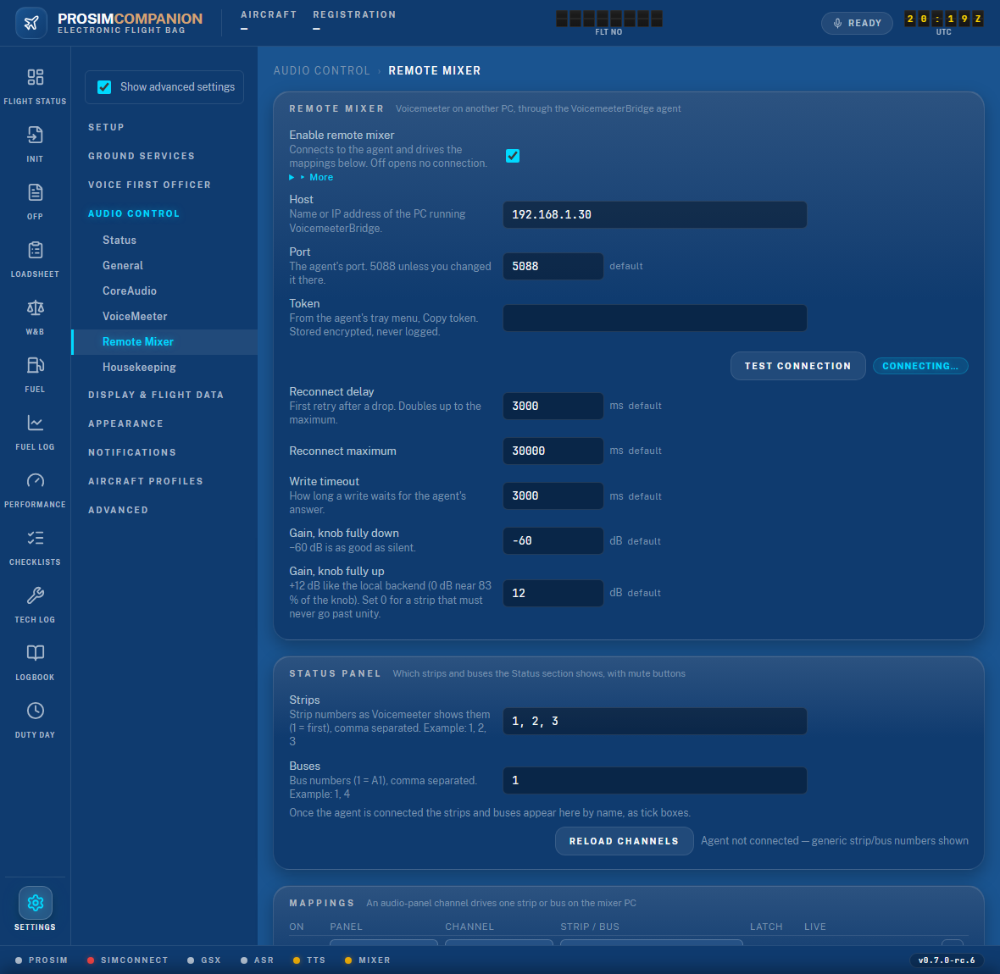
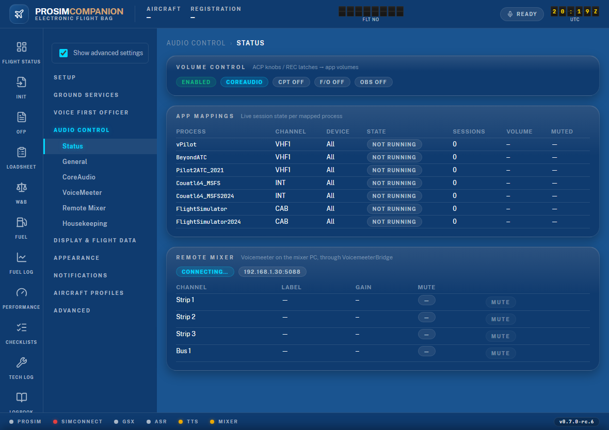

# 9. The remote mixer: a Voicemeeter on another PC

Many cockpits run vPilot (or another ATC client) on a second PC with its own Voicemeeter.
The app can drive **that** Voicemeeter from the cockpit: an audio panel knob sets a strip
or bus gain, a REC push-button mutes it, and a status card shows what the mixer is doing
with a Mute button per channel. This works through **VoicemeeterBridge**, a small agent
that runs in the tray of the mixer PC and talks to its Voicemeeter for us.

Since 0.8 the app can talk to **several** agents at once — one per PC. A two-pilot cockpit
with a PC per pilot drives both (section 9.7).

This is separate from the VoiceMeeter backend of Audio Control (Settings → Audio Control →
Volume Control), which drives the Voicemeeter on the **sim PC** through its DLL. You can use
both at the same time.

## 9.1 What you need

- Voicemeeter (Standard, Banana or Potato) running on the mixer PC.
- **VoicemeeterBridge** installed and running on that same PC. Download
  `VoicemeeterBridge-Setup-<version>.exe` from
  <https://github.com/psyraxaus/VoicemeeterBridge/releases> and follow its own install
  guide (the README in that repository). It shows a tray icon.
- Both PCs on the same network. The sim PC must reach the mixer PC on the agent's port
  (**5088** unless you changed it in the agent).

## 9.2 Set up the mixer PC (once)

1. Start Voicemeeter, then VoicemeeterBridge.
2. Right-click the tray icon → **Copy token**. Paste it somewhere safe for the next step.
   It is the shared secret; without it the app cannot talk to the agent.
3. Allow the agent's port through Windows Firewall on the mixer PC (inbound TCP 5088, private
   network, or only from the sim PC's address).
4. Check from the sim PC: open `http://<mixer-pc>:5088/health` in a browser. You should see
   `{"voicemeeter":{"connected":true},"clients":0}`. If the browser cannot connect, fix the
   firewall or the address before you go on. If it says `"connected":false`, Voicemeeter is
   not running on the mixer PC.

Repeat on every PC you want to drive.

## 9.3 Connect the app: one block per agent

Settings → **Audio Control → Remote Mixer**. The page has one **Agent** block per mixer PC.
Click **Add agent** for the first one (or the next one).

1. **Name**: what you call the PC — `PC1`, `Captain PC`. The mapping rows and the status
   card use it. **Host**: the mixer PC's name or IP address. **Port**: 5088. **Token**:
   paste it.
2. Click **Test connection** in that block. A green pill reads *Connected. Voicemeeter
   potato 3.1.1.2 is running.* (your edition and version). A red pill names the problem:
   *unauthorized* is a wrong token, *No answer* is the address, port or firewall.
3. Tick **Enable remote mixer** at the top and **Save**.

The pill beside each Test button then shows the live state of that saved link. One
`Mixer` dot joins the footer while the feature is on; with several agents it is green only
when every agent is connected, and its tooltip reads *1 of 2 agents connected* when one is
not. Each link reconnects by itself when its PC is off or restarts; the first failure is
logged, later retries are quiet. One agent being down does not slow the others.

**Enable this agent** inside a block keeps the block without opening a connection — handy
for a PC that is not on today.

Every token is stored encrypted in `settings.json` and never written to the log.

**Upgrading from a single-agent version:** the first time you open the page your saved
host, port and token appear as agent block 1, named *Mixer PC*, with a hint saying so. Save
once to keep the new layout. Your mapping rows keep working without a change.

## 9.4 Pick the strips and buses for the status card

Still in the agent's block, **Status Panel**. Once that agent is connected the app has
read the strip and bus names from its PC, and they appear as tick boxes: *Strip 3 — vPilot*,
*Bus A1 — Headset*, and so on. Tick the ones you want on the card. **Reload channels**
reads the names again after you rename a strip in Voicemeeter.

Before the first connect the block shows two text boxes instead: strip numbers as
Voicemeeter counts them from the left (`1, 2, 3`), and bus numbers (`1` is A1).

Save. Settings → Audio Control → **Status** now has a **Remote Mixer** card with one group
per agent: its link state, its Voicemeeter edition, and each chosen channel's Voicemeeter
label, gain and mute state, live, with a **Mute** / **Unmute** button. The card follows
changes made anywhere: a knob, the Voicemeeter window on the mixer PC, a macro button.

(The picture was taken with the agent unreachable — *Connecting…* and dashes. With the link
up the pill is green and the rows show the real labels, gains and mute states.)

## 9.5 Map a channel

Settings → Audio Control → Remote Mixer → **Mappings**. The editor works like the local
VoiceMeeter one: one row per audio-panel channel.

1. Click **Add mapping**. The row comes filled in: *Captain*, the first channel not yet
   mapped (VHF1 to start), the first strip of the first agent, **Latch** ticked.
2. **Panel**: Captain, First Officer or Observer. **Channel**: VHF1 … PA, or LOUDSPEAKER
   on the captain's and first officer's panels.
3. **Strip / bus**: pick the target by its Voicemeeter name — *Strip 3 — vPilot*,
   *Bus A1 — Headset*. The names come from the mixer PC; before the first connect the
   list shows plain numbers. With more than one agent every entry starts with the PC's
   name: *PC1 · Strip 3 — vPilot*, *PC2 · Strip 3 — vPilot*. Pick the PC and the strip in
   one go.
4. **Latch**: ticked, the channel's REC push-button mutes and unmutes the target. Unticked,
   the mute is never written, so a strip you muted on the mixer PC stays muted. The
   LOUDSPEAKER dial has no push-button: fully down always mutes its target.

Save. Turn the knob: the **Live** column shows the gain last sent and the mute state, for
example `-17.0 dB · open`, and, if the agent refused the write, why (`unknown parameter`
means the strip or bus does not exist in that Voicemeeter edition; `no_agent` means the
row names a PC that is not in the list any more; `agent_off` means that agent's block, or
the whole feature, is switched off).

Under the table the page warns when two rows drive the same strip or bus on the same PC:
*Bus A2 is driven by Captain VHF1, First Officer VHF1. One target has one volume — give
each knob its own strip or bus.* It does not stop you saving; it tells you the two knobs
will fight ([chapter 11](11-two-headsets.md) explains the one-fader rule).

### Fine-tuning

- The knob's travel maps to −60 … +12 dB, like the local backend: fully up is louder than
  unity, 0 dB sits at about 83 % of the knob. Both ends are under the first card's
  advanced fields (**Show advanced settings** in the rail) and apply to every agent: set
  the top to 0 dB for a strip that must never go past unity.
- **On**: untick a row to keep it without using it.
- The knob value goes out whether the audio panel is powered or not.
- Writes are limited to 20 per second per parameter per agent; a knob at rest sends
  nothing. After a reconnect every current value for that agent is sent once, so the mixer
  catches up on its own.
- Renaming an agent in its block moves its mapping rows along. Removing an agent leaves
  its rows in place reading `no_agent` until you point them at another PC.

## 9.6 If it does not work

| Symptom | Check |
|---|---|
| Test says *No answer* | Address and port; firewall on the mixer PC; the agent is running (tray icon). Try the `/health` page from 9.2. |
| Test says *unauthorized* | Copy the token again from the agent's tray menu and paste it fresh. |
| Pill says *Connected — Voicemeeter not running on the mixer PC* | Start Voicemeeter there. The agent reconnects to it by itself and the pill turns green. |
| Pill says *Off* on a block | **Enable this agent** is unticked in that block, or **Enable remote mixer** at the top is off, or the host is empty. |
| Footer dot amber, tooltip *1 of 2 agents connected* | One PC is off or unreachable. The other keeps working; look at the block whose pill is not green. |
| Status card shows `—` for a channel | That strip or bus number does not exist in this Voicemeeter edition (Standard has 3 strips, Banana 5, Potato 8). The log says `Mixer [PC1]: parameter Strip[7].Gain cannot be read`. |
| Knob moves, nothing happens | Is the row **On**? Does the **Live** column show a value? `not_connected` means that agent's link is down; `no_agent` / `agent_off` mean the row's PC is missing or off; `unknown parameter` means that strip or bus does not exist in this Voicemeeter edition; a dash means no knob value has arrived from ProSim yet. |
| The REC button does not mute | Is **Latch** ticked on that row? The LOUDSPEAKER dial has no button: it mutes fully down. |
| The level jumps between two values | Two rows send to the same parameter on the same PC — the page shows a warning under the table. Keep one. |
| A knob moves the wrong PC | Open the row's **Strip / bus** list and check the PC name in front of the entry. |

The log (Settings → Logs) prefixes every line with `Mixer [name]`, the agent's name in
brackets. The wire trace channel is `Mixer/<name>` if support asks for frames.

## 9.7 Two pilot PCs: INT and VHF on separate knobs

The case this was built for: a main PC with ProSim, ProsimCompanion and VoiceMeeter Banana,
plus one PC per pilot running ProSim Audio 2 and VoiceMeeter Potato. Headset audio goes
main → pilot PC over VBAN; on each pilot PC the online-ATC audio lands on one strip (the
VBAN strip) and ProSim Audio 2 (intercom, callouts) on another (the VAIO strip). Two strips,
two faders — so INT and VHF can have their own knobs, which the main PC alone cannot give
you ([chapter 11](11-two-headsets.md), sections 11.3–11.4, says why).

1. Install VoicemeeterBridge on **both** pilot PCs (9.2). Copy each token.
2. Settings → Audio Control → Remote Mixer: **Add agent** twice. Name them `PC1` (captain)
   and `PC2` (first officer), fill in host, port and token for each, **Test connection** on
   each, **Enable remote mixer**, Save.
3. Mappings → **Add mapping** four times and set:

| Panel | Channel | Strip / bus |
|---|---|---|
| Captain | INT | PC1 · Strip 6 — Voicemeeter Input (the VAIO strip, ProSim Audio 2) |
| Captain | VHF1 | PC1 · Strip 1 — the strip the VBAN stream from the main PC lands on |
| First Officer | INT | PC2 · Strip 6 — Voicemeeter Input |
| First Officer | VHF1 | PC2 · Strip 1 — the VBAN strip |

   (Strip numbers as on your Potato; the list shows your own labels once each agent is
   connected.)

4. Save. Turn the captain's INT knob: only PC1's VAIO strip moves. Turn the first officer's
   VHF1 knob: only PC2's VBAN strip moves. Status → Remote Mixer shows both agents green;
   tick the four strips in the two blocks' **Status Panel** to watch them.

If one pilot PC is off, its block's pill goes amber and the footer dot reads *1 of 2
agents connected*; the other pilot's knobs keep working, and the missing PC catches up on
its own when it is back.
