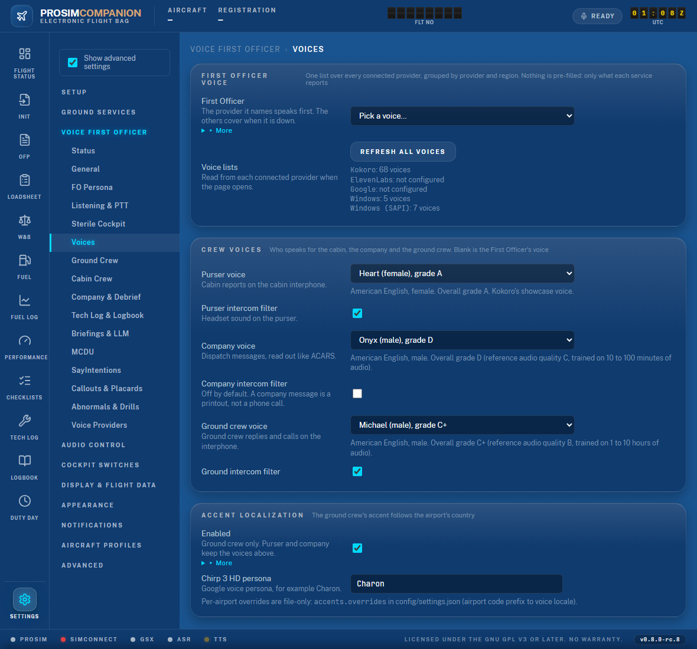
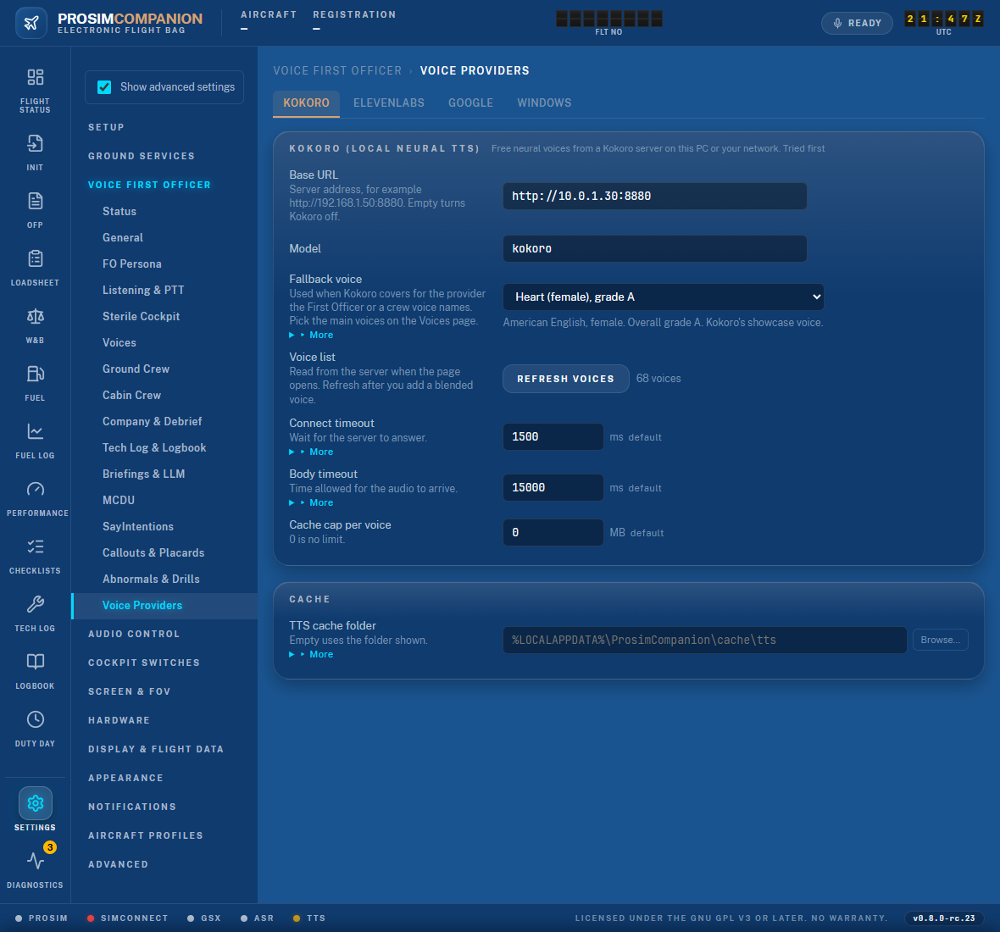
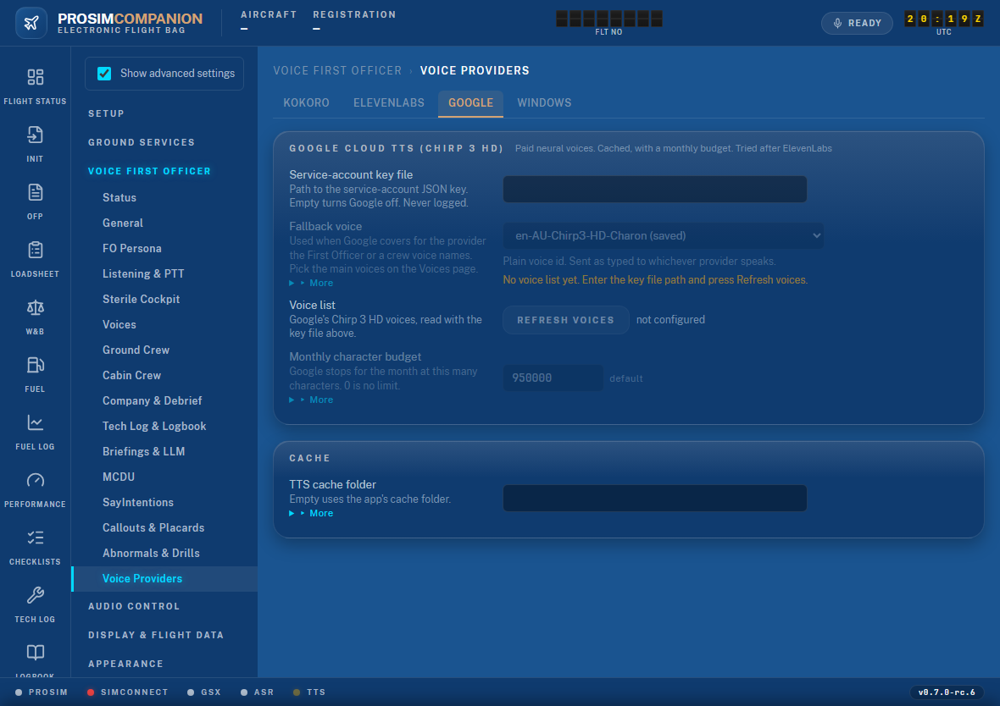
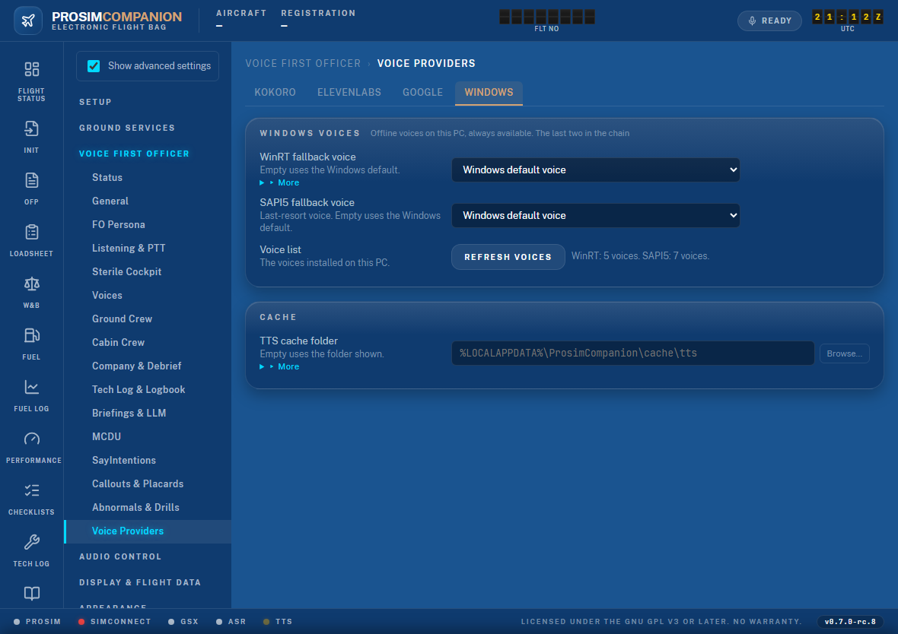
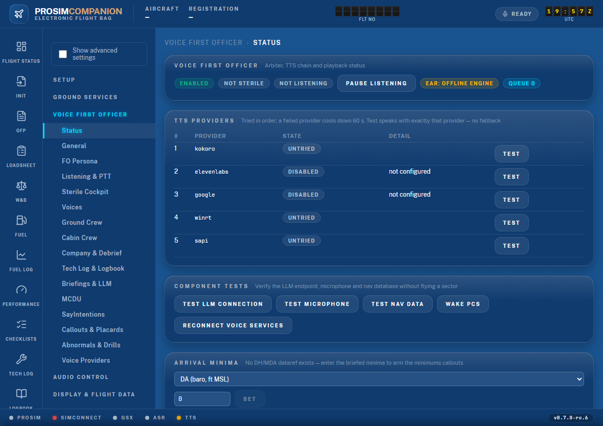

# Voices — setting up the First Officer and crew voices

This page walks you through giving the First Officer, the purser, the company voice and the
ground crew a voice. It takes about ten minutes. Everything happens in the web UI under
**Settings → Voice First Officer**.

Available from **0.7.0-rc.6**.

## How it works, in short

- A **voice provider** is a service that turns text into speech. ProsimCompanion knows four:
  **Kokoro** (free, runs on a PC in your network), **ElevenLabs** (cloud, your own key, paid),
  **Google Chirp 3 HD** (cloud, your own key file, paid) and the **Windows voices** already on
  this PC (free, offline, always there).
- You connect the providers you want on the **Voice Providers** page. It has one tab per
  provider.
- You pick who sounds like what on the **Voices** page. Each dropdown lists every voice from
  every connected provider, grouped by provider and then region. Nothing is pre-filled: the
  lists hold only what each service reports.
- A voice names its provider. The purser can be an ElevenLabs voice while the First Officer
  is a Kokoro voice. If a provider is down, the next one covers with its **fallback voice**.

## Step 1 — connect at least one provider

Open **Settings → Voice First Officer → Voice Providers**. Pick a tab.

### Kokoro (free, local network)

1. Run a Kokoro server ([kokoro-fastapi](https://github.com/remsky/Kokoro-FastAPI)) on this PC
   or another PC in your network.
2. Put its address in **Base URL**, for example `http://192.168.1.50:8880`.
3. Press **Refresh voices**. The note beside the button reads "68 voices" or similar.
4. Pick a **Fallback voice** (more on fallbacks below). `George (male)` is a good British
   First Officer; `Heart (female)` is Kokoro's showcase voice.

The grade beside each Kokoro name (A down to F) is Kokoro's own estimate of how much and how
clean the training audio was. British and American voices make a usable First Officer. The
other languages read English with their own sounds — fun, but not for a flight.

### ElevenLabs (cloud, paid)

1. Open the **ElevenLabs** tab.
2. Paste your API key into **API key**. The other fields unlock.
3. Press **Refresh voices**. The premade voices appear with their accent and gender.
4. Pick a **Fallback voice**.

Plans, cost control and the model choice are in the
[ElevenLabs setup guide](06-elevenlabs.md).

### Google Chirp 3 HD (cloud, paid)

1. Open the **Google** tab.
2. Put the path to your service-account JSON key file in **Service-account key file**.
3. Press **Refresh voices**. Google's Chirp 3 HD voices appear, grouped by language
   ("English (Australia)", "English (United Kingdom)" …).
4. Pick a **Fallback voice**.

### Windows voices (free, offline)

Nothing to connect. Open the **Windows** tab and press **Refresh voices** to see what this PC
has. The WinRT list includes the Windows 11 "Natural" voices when they are installed
(Settings → Time & language → Speech → Add voices). SAPI5 is the last resort and always
works.

## Step 2 — pick the First Officer

1. Open **Settings → Voice First Officer → Voices**.
2. The **Voice lists** block shows what each provider reported, for example
   "Kokoro: 68 voices", "ElevenLabs: 10 voices", "Google: not configured". Press
   **Refresh all voices** if a provider you just connected is missing.
3. Open the **First Officer** dropdown. The groups read "Kokoro · British English",
   "ElevenLabs · American", "Google · English (Australia)", "Windows · English (United
   Kingdom)" and so on. Pick a voice.
4. Read the details line under the dropdown: region, gender, Kokoro's grade where there is
   one, and whether the voice is billed per character or offline.
5. Press **Save** in the bar at the bottom.
6. Go to **Status** (top of the same rail). In the **TTS Providers** table the provider you
   picked reads *Untried* or *Healthy*, not *Disabled*. Press **Test** on that row. The sample
   plays in that voice and the pill turns *Healthy*.

Leave **First Officer** on "Pick a voice…" and every provider speaks with its own fallback
voice, in chain order — the behaviour of earlier versions.

## Step 3 — pick the crew voices

On the same **Voices** page, under **Crew Voices**:

| Voice | Who it is | Tip |
|---|---|---|
| **Purser voice** | Cabin reports on the cabin interphone ("cabin secure", boarding updates) | A different gender from the First Officer makes the cabin easy to tell apart |
| **Company voice** | Dispatch and ACARS messages read out | Any voice; the ACARS beep marks it |
| **Ground crew voice** | The ground crew on the interphone | With **Accent Localization** on, Google speaks the ground crew in the airport's accent instead |

Each dropdown lists the same voices as the First Officer's. **Same voice as the First
Officer** (blank) is always allowed. The intercom filter ticks give the purser and the ground
crew the thin headset sound; leave the company one off — a company message is a printout, not
a phone call.

Press **Save**.

## Fallback voices — what happens when a provider is down

The provider a voice names speaks that role first. When it is down, over its monthly budget,
not configured, or shut out by **Local only** (General page), the chain covers:
Kokoro, then ElevenLabs, then Google, then the Windows voices. The provider that covers
speaks with its **own fallback voice** from its tab — never with another provider's name,
which it could not use. A provider that failed is skipped for 60 seconds and then tried
again; the **Status** page shows this as *Cooling down*.

Two consequences:

- Set a sensible fallback voice on every provider you connect, even the ones you do not plan
  to hear. The Windows tab is the floor — it always works.
- Picking an ElevenLabs or Google voice for the First Officer also fills that provider's
  empty fallback field for you, because those two providers need a voice to count as
  configured.

## Typing a voice id

Every dropdown ends with **Other voice id…**. It opens a text box for a voice the list does
not show — a blended Kokoro voice you just created, or an ElevenLabs voice outside the
premade set. On the Voices page type it as `provider:id`, for example
`elevenlabs:EXAVITQu4vr4xnSDxMaL` or `kokoro:af_sky`. On a provider tab type the bare id.
Settings from earlier versions with plain names (`af_heart`) keep working: a plain name is
handed to whichever provider speaks.

## Troubleshooting

| What you see | Why | What to do |
|---|---|---|
| A dropdown shows only "… (saved)" and a yellow hint | No provider has answered yet, or none is connected | Connect a provider on Voice Providers and press Refresh voices; then Refresh all voices on the Voices page |
| "Kokoro: could not list voices — …" | The server did not answer on that address | Check the Base URL and that the Kokoro server is running; try `http://<address>/v1/audio/voices` in a browser |
| "ElevenLabs: could not list voices — HTTP 401" | The key is wrong or was deleted | Paste the key again and Save |
| "Google: could not list voices — …" | The key file path is wrong, or the file is not a service-account key | Check the path; the file must be a service-account JSON key |
| The FO speaks, but in another voice than the one picked | The picked provider is down, cooling down or over budget, so the chain covered | Status page → TTS Providers: the row reads *Cooling down* or *Disabled*; fix that provider, or pick a voice from a provider that is up |
| The purser sounds like the First Officer | The purser voice is blank, or its provider is down | Pick a purser voice; check the Status page |
| Status page says *Disabled — not configured* for a provider you set up | The provider needs a voice to count as configured (ElevenLabs, Google) | Pick a fallback voice on its tab, or pick one of its voices for the First Officer; Save |
| Test plays but the FO in flight does not use that provider | **Local only** is ticked (General page) — it shuts out every network provider | Untick Local only |
| A voice from the list reads English badly | A non-English Kokoro voice | Pick an American or British Kokoro voice for anything the crew says |
| A one-word Kokoro callout ("Checked") sounds clipped or mumbled | Kokoro cannot time a lone word; since 0.7.0-rc.9 short callouts are sent with a little padding, but clips rendered by an older build are still on disk | Close the app and delete the `kokoro` folder under the TTS cache folder (Voice First Officer → Voice Providers → advanced *Cache folder*; default `%LOCALAPPDATA%\ProsimCompanion\cache\tts`); the callouts render again on the next flight |

The **Logs** page shows the voice listing lines ("Kokoro voice list: 68 voices") and the
reason a provider was skipped. **Export diagnostics** on that page packs them for a bug
report.
