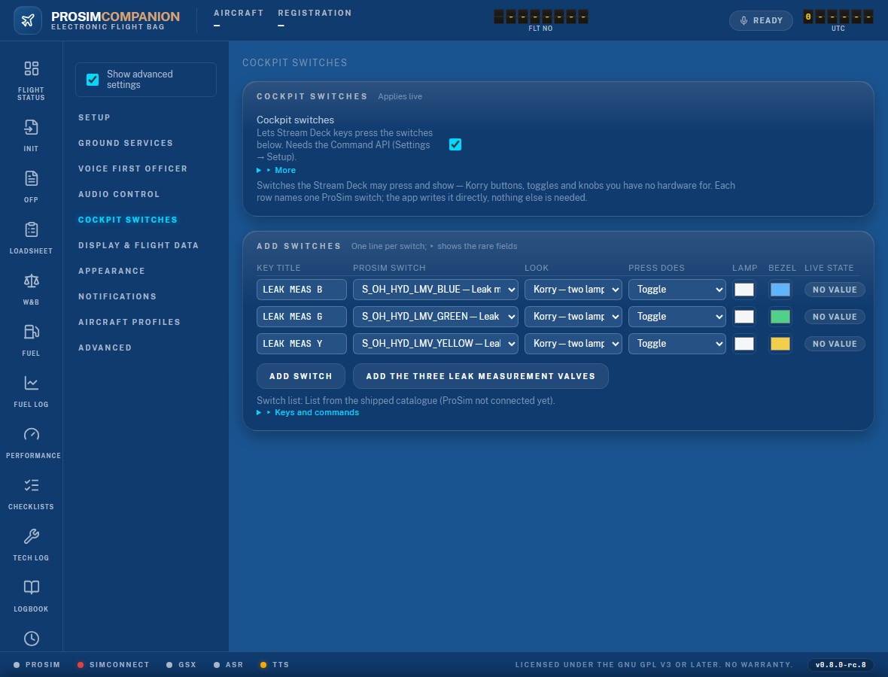

# 12. A Stream Deck on another PC: cockpit switches and camera views

Many cockpits keep the Stream Deck on a second PC. The ProsimCompanion plugin runs there just as
well, and two key types let it do things you have no hardware for:

- **Cockpit switch** keys press ProSim switches — Korry push buttons, toggles, rotary knobs,
  guarded switches — and show their state the way the real overhead does (lights out until the
  aircraft lights a lamp).
- **Camera view** keys change ChasePlane views through a vJoy button on the sim PC.

## 12.1 The plugin on another PC

On the **sim PC**:

1. Settings → Setup → **Web server**: turn on **LAN access**. Restart ProsimCompanion.
2. Allow inbound TCP **5320** in Windows Firewall (private network). Windows may ask on the
   first LAN start; if it did not, add the rule yourself.
3. Settings → Setup → **Stream Deck & External Tools**: turn on **Command API**.
4. Copy `%LOCALAPPDATA%\Programs\ProsimCompanion\streamdeck\com.prosimcompanion.streamdeck.streamDeckPlugin`
   to the other PC (the app installs per user, not under Program Files).

On the **Stream Deck PC**:

5. Double-click the copied file. The Stream Deck app installs the plugin.
6. Drag any ProsimCompanion key onto a page, open its settings and paste the **onboarding
   link** from the ProsimCompanion desktop window on the sim PC (`http://<sim-pc>:5320/?token=…`).
   All ProsimCompanion keys share that one connection.

Keys showing *connecting* mean the sim PC does not answer: check the address, the port, the
firewall and that LAN access is on. *re-pair* means the token was changed — paste a fresh link.

## 12.2 Cockpit switches: set up the rows

Settings → **Cockpit Switches** on the sim PC's web UI.

1. Press **Add the three leak measurement valves** if you want them: three lines appear (or
   existing ones are reset to the preset) — blue / green / yellow bezels, the lamp follows the
   button itself (no aircraft power needed) the way the real OFF light does: a lit **OFF** in
   the Normal position, nothing while pushed. Save. Prefer the real overhead LED instead? Put
   `system.indicators.I_OH_HYD_LMV_BLUE_L` (etc.) into **Lower lamp from** in the fold-out.
2. For any other switch press **Add switch** and pick it from the **ProSim switch** column. The
   list is ProSim's own, grouped by panel (overhead, pedestal, FCU, …). The **Key id**, **Key
   title** and a sensible **Look** fill in by themselves. The line holds what you touch every
   time; **▸** at its end folds out the rare fields (key id, legends, lamp datarefs, the upper
   lamp colour, a test **Press**). Change what you like:
   - **Look**: Korry two lamps / one lamp, toggle switch, rotary knob, guarded switch.
   - **Press does**: *Toggle* flips between the first two positions (most Korry buttons).
     *Momentary push* presses and releases (buttons that spring back, like EXT PWR).
     *Cycle positions* for knobs: short press next, long press back.
   - **Legends**: the words in the lamps (FAULT / OFF, AVAIL / ON).
   - **Legend while dark** (in the fold-out): on = the word stays faintly readable while the
     lamp is dark, like a real engraved Korry; off = the lamp is truly extinguished and the
     word appears only when lit. The leak-valve preset uses "off" with the legend **OFF**: a lit
     OFF while Normal, nothing while pushed.
   - **Lower lamp lit at** (in the fold-out): most Korrys light while pushed; the leak valves
     light in the Normal position (0) instead. Greyed out when a **Lower lamp from** dataref is
     named — ProSim then decides.
   - **Lamps from**: optional `system.indicators.I_…` datarefs. The lower lamp otherwise lights
     while the switch is pushed (or at 0 with the setting above). Start typing `I_` to see the list.
   - **Colours**: upper lamp (amber FAULT, green AVAIL), lower lamp (white OFF, blue ON), bezel
     (grey, or a system colour).
3. Save. The **Live state** pill on each line shows what ProSim reports; **Press** (in the
   fold-out) presses the switch from the page so you can see ProSim react before you build a
   key. **The aircraft must have electrical power** (batteries or external power) for ProSim to
   light any lamp or move any valve — with a cold and dark aircraft every lamp stays dark, which
   is correct.

## 12.3 Cockpit switches: the keys

In the Stream Deck app, drag a **Cockpit Switch** key onto a page and pick the switch in its
settings. The list is the rows you saved. The key:

- draws the switch in the look you chose, with the row's title on top;
- lights a lamp as an outlined box in its colour with the legend inside, the real-world way;
- shows a short blue ring when a press went through and an amber ring with the reason when
  ProsimCompanion refused (switch off, ProSim away, a row no longer saved);
- dims with a note while unpaired, offline, or before ProSim sent a value.

On a knob key, hold the key to step backwards.

## 12.4 Camera views: ChasePlane from the other PC

A vJoy button pressed on the Stream Deck PC exists only there. The relay fixes that: the key
asks ProsimCompanion, and ProsimCompanion presses a vJoy button on the sim PC.

On the **sim PC**:

1. Install the vJoy driver. In **vJoyConf** create one device, for example device 1 with 32
   buttons. Restart ProsimCompanion.
2. Settings → Setup → **vJoy relay**: switch it on. Leave the DLL path empty unless vJoy is not
   in `C:\Program Files\vJoy\x64`. Device: the number from vJoyConf. Save.
3. Press **Check**. The pill goes READY and shows the button count. *NO DRIVER* means the DLL
   was not found or vJoy is not running; *NO DEVICE* means the number does not exist in
   vJoyConf; *DEVICE BUSY* means another program owns it — pick another device number.
4. **Add view** once per ChasePlane view: a name (`wing`, `cockpit`, `tail`) and a vJoy button
   number. Save.
5. In ChasePlane, bind each view to that vJoy button: open the view's controls, press the
   **Press** button on the ProsimCompanion page while ChasePlane listens for a binding, and it
   records "vJoy Device button N".

On the **Stream Deck PC**, drag a **Camera View** key onto a page and pick the view.

## 12.5 Troubleshooting

| Symptom | Meaning / fix |
|---|---|
| Key says **set up** | No switch or view picked yet — open the key's settings. |
| Key says **not found** | The row was renamed or removed in ProsimCompanion. Pick again. |
| Key says **switches off** | Settings → Cockpit Switches → the master switch is off. |
| Key says **prosim away** / **no value** | ProSim is not connected, or it has not sent this switch's value yet. |
| Amber ring + a reason | ProsimCompanion refused the press; the reason is the app's own words. The same press from the page's **Press** button shows the full text. |
| Lamp never lights | Check the row's **Lower lamp from**: the indicator name must exist (start typing `I_`); empty means "lit while pushed", or "lit at 0" when **Lower lamp lit at** says so. |
| Leak valve shows **ON** while pushed | Rows from a build before rc.7. Press **Add the three leak measurement valves** again: it resets them to a lit **OFF** in Normal and dark while pushed. Save. |
| vJoy relay pill **NO DRIVER** | vJoy is not installed on the sim PC, is not running, or the DLL path points at the 32-bit DLL — use the `x64` folder. |
| **Press** says READY but ChasePlane does nothing | The view is not bound to that vJoy button in ChasePlane. Bind it while pressing **Press** (12.4 step 5). |
