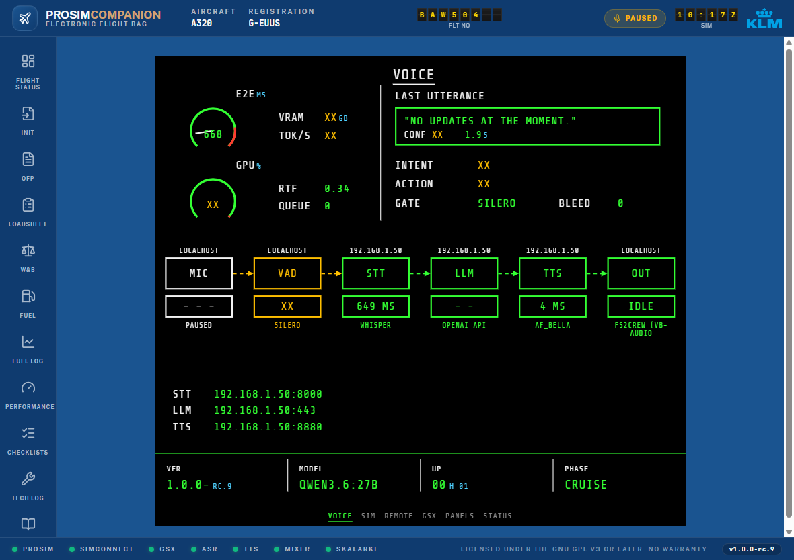
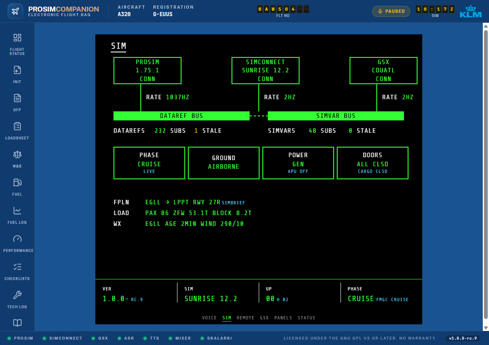
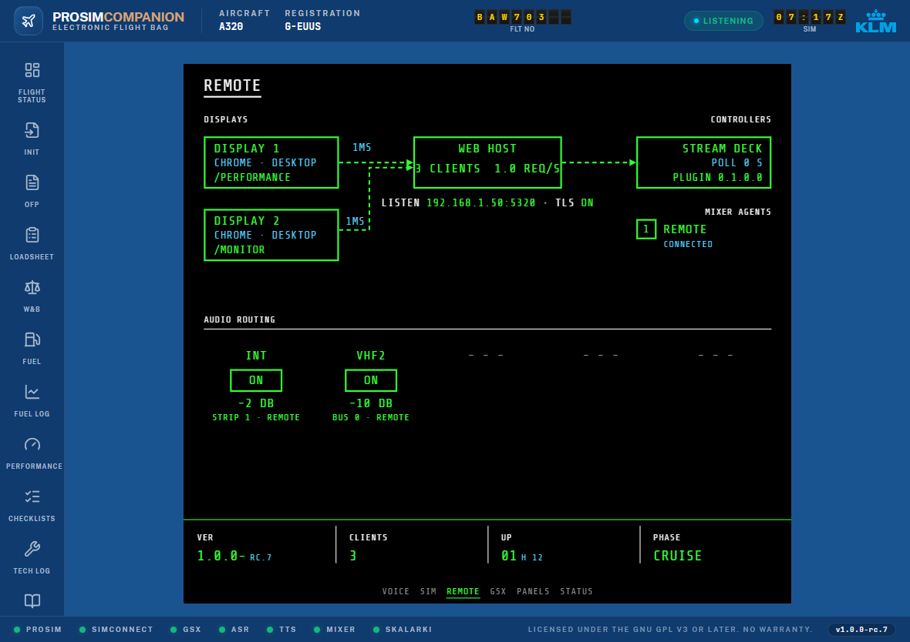
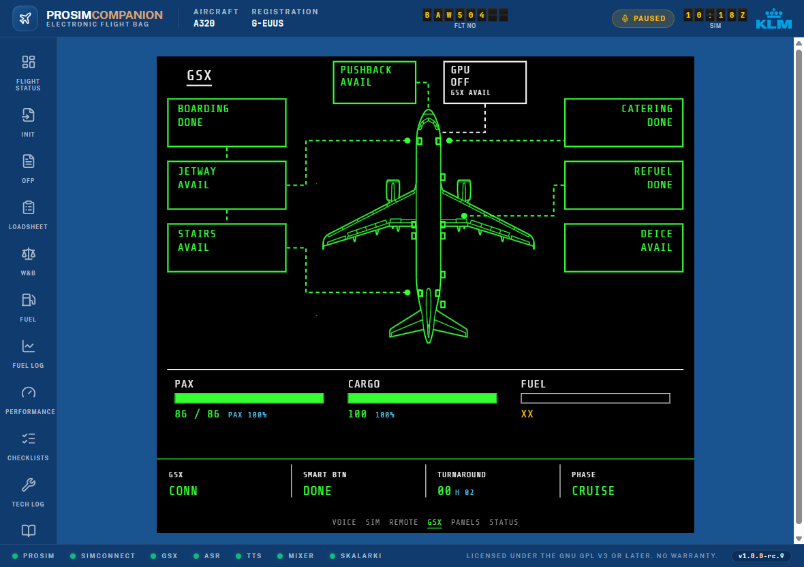
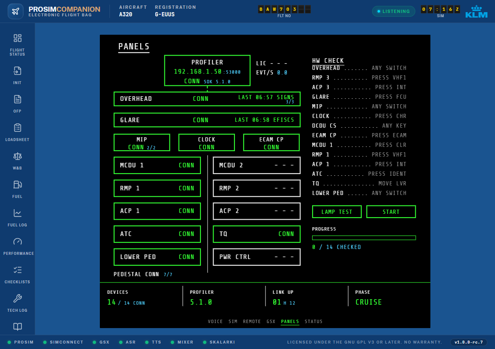
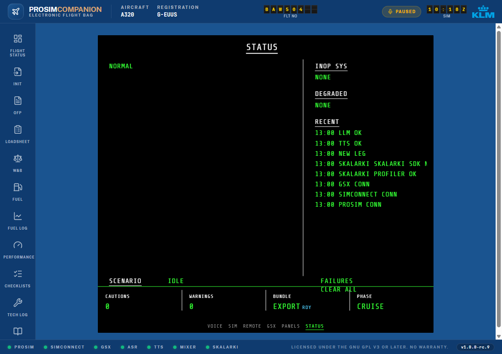
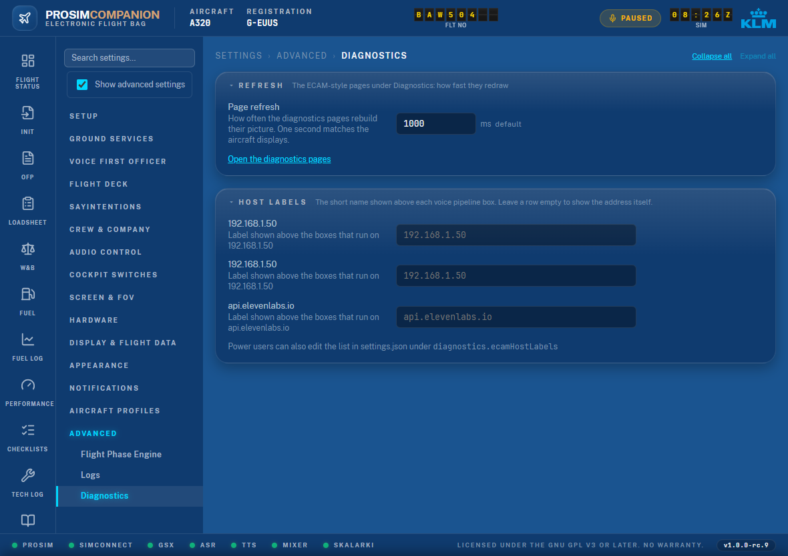

# Diagnostics: the ECAM-style system pages

**Diagnostics** is its own item in the sidebar, below **Settings** (it is not inside the
Settings menu). It opens five pages (six with PANELS, when Skalarki hardware is switched on)
drawn like the aircraft's ECAM system displays. They answer one question at a glance: what is the app doing
right now, and which link is unhappy? The badge on the sidebar item shows how many cautions
are up (amber), or turns red when one of them is a warning.

The pages live at `/diagnostics` (VOICE), `/diagnostics/sim`, `/diagnostics/remote`,
`/diagnostics/gsx` and `/diagnostics/status`, plus `/diagnostics/panels` while the Skalarki
link is switched on. The row of names under the memo strip switches
pages; they are ordinary links, so they work on the tablet too. The drawing scales to the
window as one piece and never rearranges itself.

## How to read a page

| You see | It means |
|---|---|
| Green box, green value | Working normally. |
| Amber box or value | Caution: reconnecting, degraded, queued, stale, lost. The app is still running; something is waiting or falling back. |
| Red box or value | Warning: a hard failure that blocks a feature until you act. |
| `XX` in amber | The app has no data for this box right now (the source is off, not connected, or has not reported yet). It is never a stale number. |
| `- - -` in white | This box is intentionally not in use (a feature that is switched off, a GSX service the automation decided not to call). |
| Dashed line with an arrow | A link between two boxes. It takes the colour of the worse of its two ends. |
| Cyan small text | A unit or qualifier (`MS`, `HZ`, `GB`, `T`, `%`), or an action line on the STATUS page. |
| Grey page name | A page you are not on. The current page is green and underlined. |

Every page ends with a strip of four cells. The last cell is always the flight phase
(**PHASE**). The other three depend on the page:

| Page | The strip shows |
|---|---|
| VOICE | **VER** (app version), **MODEL** (the language model), **UP** (time the app has been running), **PHASE** |
| SIM | **VER**, **SIM** (the simulator), **UP**, **PHASE** |
| REMOTE | **VER**, **CLIENTS** (open browsers, with `n LOST` in amber), **UP**, **PHASE** |
| GSX | **GSX** (the Couatl connection and the airport), **SMART BTN** (what the smart button would do next), **TURNAROUND** (how long it has been running), **PHASE** |
| PANELS | **DEVICES** (connected / watched), **PROFILER** (SDK version), **LINK UP** (hours and minutes), **PHASE** |
| STATUS | **CAUTIONS**, **WARNINGS** (the counts), **BUNDLE** (the support export), **PHASE** |

## VOICE

The pilot-to-First-Officer pipeline as six boxes: **MIC** (level and sample rate), **VAD**
(the voice-activity gate: SPEECH or SILENCE, and which gate), **STT** (the speech server,
with the last round trip in ms), **LLM** (the language model, with its first-token time),
**TTS** (the voice server, with the last synthesis time) and **OUT** (PLAYING or IDLE). The
small label above each box is the machine it runs on: the address of the configured server
until you name it on Settings → Advanced → Diagnostics.

Top left: the **E2E** dial is the time from the moment you stop talking to the first sound of
the FO's answer, amber from 2.5 s, red from 4 s. The **GPU** dial shows `XX`: the app reads no
graphics card. VRAM fills when the language model is
served by Ollama; TOK/S is the model's generation rate; RTF is the speech server's processing
time divided by the length of what you said; QUEUE is how many lines are waiting to be spoken.

Top right: the last thing the app heard, with its confidence and length, what the router made
of it (INTENT, ACTION), which gate was in use and how many utterances were rejected in the
last minute (BLEED: noise, empty transcripts, the FO's own voice heard back).

## SIM

Three sources across the top (**PROSIM**, **SIMCONNECT**, **GSX**) feeding the dataref and
simvar bus bars, with the update rate beside each feed and the number of subscriptions and
stale values under each bar. The four cells show the aircraft as the app sees it: flight phase
and gate, on ground or airborne with the park brake, electrical power, doors. The rows below
are the plan (origin, destination, runway — with the leg-boundary word TURNAROUND / AWAITING PLAN
beside it during a turnaround), the load (pax, zero-fuel weight, block fuel) and the
weather the app is working from. The PHASE cell in the memo strip carries the FMGC's own phase
word (`FMGC DONE`, `FMGC PREFLIGHT`) as a qualifier when ProSim serves it. It is shown for
comparison only; the app does not use it to decide its own phase.

## REMOTE

Everything connected to the app over the network. **WEB HOST** in the middle is the app's own
web server: how many browser sessions are open and the request rate of its API, with the
listen address and whether HTTPS is on. **DISPLAYS** on the left are the open browsers (which
browser and device, which page, the round trip in ms); the page draws the first two.
**CONTROLLERS** on the right: the Stream Deck (how long since it last polled and the plugin
version, or `NEVER POLLED` when no plugin has connected) and the remote mixer agents as
numbered squares (three, then `+n MORE`). The **AUDIO ROUTING** row shows up to five mixer
channels that are switched on: ON or OFF, the level and the strip or bus it drives.

## GSX

The aircraft from above with its doors (an amber marker is an open door) and the ground
services around it, each box wired to where that service meets the aircraft: above the nose,
**pushback** (the tug at the nose tip) and **GPU** (the cable on the forward right fuselage);
on the left, **boarding** at the top (tied to the jetway, and to the stairs when they are in
use), the **jetway** to door 1L, the **stairs** to door 4L (the stairs box is hidden at a
stand that does not use them); on the right, **catering** beside the service door your GSX
profile uses (1R at the top, or 4R at the bottom: Settings → Ground Services → Doors & Jetway
→ **Catering door** is **Auto (learn from GSX)** by default and learns the door the first
time GSX asks for one; **Forward service door (1R)** / **Aft service door (4R)** pin it by
hand), **refuel** to the right wing and **de-icing**. Each box shows the GSX stage (`AVAIL`,
`REQ`, `CONN`, `PROG`, `DONE`, amber `HELD` while the automation holds the service back, or
`- - -` when not required) with a detail line; for `HELD` the detail is the reason. Jetway
and stairs show `CONN` while in place. The three bars are the boarding, cargo and refuel
progress.

The **GPU** box is different in two ways. It shows ProSim's external power, not a GSX stage:
`CONN` with `EXT PWR` when ground power is on the aircraft, `OFF` when it is not. And it is a
button: **one click connects the ground power when it is off, and disconnects it when it is
on.** This changes the aircraft, so do not click it by accident. The answer to the click
shows in the box's detail line for a few seconds.

## PANELS

Shown only when the Skalarki link is switched on, on Settings → Hardware → Skalarki Panels.
How to connect the app to the Profiler, choose the boards and what to do when the link does
not come up: see [chapter 23](23-skalarki.md). The page is your Skalarki cockpit hardware as
the Profiler sees it.

- **PROFILER** box: the Profiler PC and port, CONN / RECONN, the SDK version; beside it LIC
  (always `- - -`) and the input events per second (EVT/S).
- **OVERHEAD** and **GLARE** bars, the **MIP / CLOCK / ECAM CP** row and the pedestal pairs
  (MCDU, RMP, ACP, ATC and TQ, LOWER PED and PWR CTRL): one box per board. Green **CONN** with
  the last input (`LAST 11:04 APU` = time and panel group) means the board is plugged in and
  talking; amber **LOST 42 S** means the Profiler lost its USB link that many seconds ago;
  amber **XX** means you ticked the board in settings but the Profiler has never reported it,
  or the link to the Profiler is down (then every watched board shows it);
  white **- - -** means the board is not watched.
- **Zones.** Every box belongs to a zone: OVERHEAD, GLARE, MIP or PEDESTAL. The zone's
  controller box (the OVERHEAD bar, the GLARE bar, the MIP box) also stands for the boards that
  live in that area but have no box of their own, such as RMP 3 and ACP 3 in the overhead or
  the DCDUs under the MIP: it turns amber with `1 LOST` when one of them drops, and carries a
  small connected/watched count. The pedestal has a clickable **PEDESTAL** label at the bottom
  left instead. Click any box or that label and the right column lists every board of the
  zone with its state, its last input and two small buttons: **LT** lights that board, **RST**
  resets it after a second click (**SURE?**). **BACK** returns to the hardware check.
- **HW CHECK** (right): one line per watched board with what to touch (`PRESS CLR`,
  `MOVE LVR`, `ANY SWITCH`). Press **START**, then walk the cockpit touching one control
  per board; each line turns **DONE**, the bar fills, and the strip says `n / m CHECKED`. A
  board that drops out turns **LOST** and must be touched again when it is back; a board that
  was unplugged when you started is skipped until it appears. **RESTART** clears the list.
- **LAMP TEST** lights every lamp output of the watched boards for the configured time and
  switches them off again. It is the only time the app drives outputs on its own.
- **HW RESET** appears at the bottom of the HW CHECK column while a board is lost, under the
  line `<BOARD> LOST · CHECK USB`. It is for the first lost board; reset any other board with
  **RST** in its zone list. It sends the Profiler's reset for that board: click once to arm
  (the line reads **CONFIRM?**), once more to send. Use it only when a board has stopped
  answering. After a reset the PANELS page can go amber for some minutes and recover on its
  own.
- Memo strip: **DEVICES** connected / watched (amber when a watched board is missing),
  **PROFILER** SDK version, **LINK UP** hours and minutes, **PHASE**.

Cautions this page raises on STATUS, under the system name **SKALARKI**:
`SKALARKI PROFILER LINK LOST` (reconnect is automatic; check that the Profiler is running and
the port is right), `<BOARD> LOST` with `HW RESET ... AVAIL` and the cockpit function it takes
with it under INOP SYS (RMP 2 → RADIO 2), and `SKALARKI SDK NOT LOADED`. The last one shows
for every reason the link is off although it is switched on, not only for a wrong SDK folder;
[chapter 23](23-skalarki.md) lists the reasons and what to do.

## STATUS

The summary page. The left column lists every caution grouped by system, each with the
actions the app took or you can take underneath (for example `WOL MAGIC PKT ...... SENT 06:42`);
with no caution it reads a green `NORMAL`.
The right column lists **INOP SYS** (features blocked by a caution), **DEGRADED** (features
running with reduced function) and **RECENT** (the last eight state changes with their time).
The memo strip counts cautions and warnings, and the **BUNDLE** cell is the same support
export as the Logs page: the bundle includes the diagnostics snapshot and the RECENT list, so
a bug report carries what the pages showed.

At the bottom left, the **SCENARIO** row shows the state of the failure scenario (amber while
a failure is armed or has fired, grey when scenarios are off) and, under it, the planned
scenario and failure or the last clearing. Beside it is the box **FAILURES / CLEAR ALL**. It
is a button: **one click clears every armed failure in ProSim, including failures armed from
the ProSim IOS.** This changes the aircraft. The answer shows in the box. Scenarios are in
[chapter 22](22-scenarios.md).

## Common cautions and what to do

| Caution | What it means | What to do |
|---|---|---|
| `VOICE  LLM HOST NOT RESPONDING` (amber) | The language-model PC does not answer on the network at all; most often it is asleep. The action line says whether a wake-on-LAN packet has been sent and when. | Wait a minute if a packet was sent. Otherwise press **Wake PCs** on Settings → Voice First Officer → Status, or check the PC. Briefings use the template meanwhile. |
| `VOICE  LLM SERVER DOWN` (red) | The model server is not answering, and the PC is up or its state is not known (the action line reads `HOST ... UP` or `XX`). A wake will not help. | Start Ollama / llama-server on that PC, or check its port in Settings → Flight Deck → Briefings & LLM. |
| `VOICE  LLM AUTH REJECTED` (red) | The server refused the API key (it answered 401 or 403; the LLM box prints `401`). | Check the API key. |
| `VOICE  STT SERVER NOT RESPONDING` (amber) | The speech server is unreachable; the app reconnects by itself. Meanwhile the page reads `STT OFFLINE · OFFLINE ENGINE COVERING` and DEGRADED lists VOICE RECOGNITION. | Nothing, unless it stays amber: then check the box and its URL. |
| `VOICE  TTS SERVER NOT RESPONDING` (amber) | The voice server failed. The FO goes on speaking with the next voice (`TTS OFFLINE · FALLBACK VOICE`; DEGRADED lists FO VOICE). The app does not reconnect in the background: the next sentence after the 60-second pause tries the server again. | Nothing, if it comes back. After a repair press **Reconnect voice services** so you do not wait. See [chapter 18](18-kokoro.md). |
| `SIM  SIMCONNECT LOST` / `PROSIM LOST` | The app has no connection to MSFS or ProSim: the feed dropped, or it was never there since the app started. Values hold their last reading (`HOLD LAST`) and the app keeps trying by itself. | Nothing, unless MSFS or ProSim is really gone: then start it. |
| `SIM  PROSIM SDK OFF` | No ProSim SDK folder is set, the SDK does not match this version of the app, or the ProSim connection failed to start. The action line `REASON` shows the start of the reason. | Settings → Setup, point **ProSim SDK folder** at the right folder. For "failed to start" look at the Logs page. |
| `REMOTE  MIXER AGENT n LOST` | A VoicemeeterBridge agent on another PC dropped; the channels it drives are listed as `MUTED`. With several agents lost the title names the first one. | Check that PC and the agent; the app reconnects by itself. |
| `REMOTE  STREAM DECK NOT POLLING` | The plugin has not polled for more than five seconds. After ten minutes of silence the caution goes away by itself. | Check the Stream Deck PC and the plugin's pairing. |
| `GSX  <service> QUEUED` | A ground service is waiting: the automation holds it back (the box shows `HELD`), or it was called and GSX has not started it yet (`REQ`). Only the first waiting service is named, by the name of its box. | Normal for a short while; the action line `WAIT` shows the reason. |
| `GSX  <service> CALL DROPPED` | GSX did not pick up a call in time. An open GSX menu is the usual cause: the action line `MENU` shows the menu's title, or `BUSY`. The caution stays for five minutes or until a call goes through. | Close the open GSX menu, the automation retries. |
| `GSX  COUATL NOT RUNNING` | The GSX connection answers, but GSX itself is not running yet (for example it is still starting). INOP SYS lists GROUND SERVICES. | Wait until GSX has started, or start it. The app reconnects by itself. |
| `GSX  GSX API LOST` | The app has no connection to GSX. INOP SYS lists GROUND SERVICES. | Check that the simulator and GSX are running. The app reconnects by itself. |

## Settings

Settings → Advanced → **Diagnostics** holds the two knobs: how often the pages redraw (one
second by default) and the short names shown above the VOICE boxes for each configured
server. Both apply live.

---

**Next:** [Troubleshooting](05-troubleshooting.md) · **See also:** [Skalarki hardware](23-skalarki.md), [Settings reference](04-settings-reference.md) · [Manual contents](README.md)
