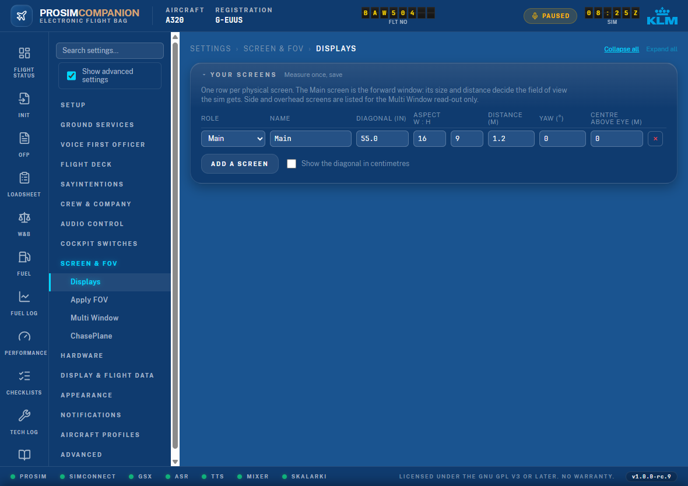
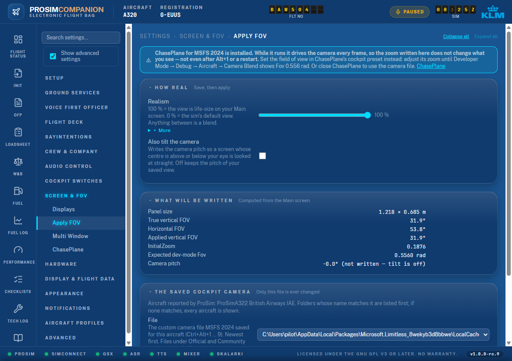

# Screen & FOV: a life-size view on your TV

If your forward "window" is a TV in front of a hardware cockpit, the sim's default view shows
far more of the world than the real window would — about 49° top to bottom, where a 52" TV at
1.5 m covers only 24°. The result is a shrunken, fish-eyed outside world and runway lights that
look twice as far away as they are. On Settings → **Screen & FOV** you enter your screen's size
and distance, and the page writes the matching field of view into the cockpit camera you saved
in the sim. Nothing is guessed in the sim's zoom slider, and no file is written other than
your own saved-camera file.

The page works only with **MSFS 2024**, and only when the app runs on the sim PC: it reads
and writes a file on that PC. You can open the page from any browser, as long as it is the
sim PC's app you are looking at.

## 1. Enter your screens

Settings → Screen & FOV → **Displays**, the card **Your screens**: one line per physical
screen. **Add a screen** adds a line.

- **Role** — the screen straight ahead is **Main**. Exactly one line must be Main: it decides
  the field of view. **Left**, **Right**, **Overhead** and **Other** screens are only listed
  for the Multi Window section.
- **Name** — your own label for the line, for example Main or Left TV. It cannot be empty.
- **Diagonal (in)** — the size on the box, in inches (tick **Show the diagonal in
  centimetres** if you prefer).
- **Aspect W : H** — 16 and 9 for a normal TV, 21 and 9 for an ultrawide.
- **Distance (m)** — from your eye to the centre of the screen, in metres, measured straight
  at it. Sit as you fly and measure; this number matters most.
- **Yaw (°)** — 0 for the forward screen; for a side screen, how many degrees left (negative)
  or right (positive) its centre sits.
- **Centre above eye (m)** — in metres: 0 when the screen centre is level with your eyes;
  positive when it is higher, negative when lower.

Save.

## 2. Save a cockpit camera in the sim (once per aircraft)

MSFS only creates the file this page edits when you save a custom camera:

1. Load the aircraft in MSFS 2024.
2. Put the cockpit view where you want it (eye point, not zoom — the zoom is what the page sets).
3. Press **Ctrl+Alt+1** (save custom camera 1). You recall it later with **Alt+1**.

The sim's built-in pilot view lives in the aircraft package and is never edited; the saved
custom camera is the one that carries your field of view.

## 3. Apply

Settings → Screen & FOV → **Apply FOV**.

- **Realism**, on the card **How real** — 100 % is life-size: you see exactly what the real
  window would show. That is what a hardware cockpit wants, even though it is much tighter
  than the default. Lower values blend towards the sim default (0 %) if you would rather keep
  more of the world in view.
- **Also tilt the camera** — only if your screen centre is above or below your eyes and you
  want the camera pitched to look straight at it. Off keeps the pitch of your saved view.
- **What will be written** shows the **Panel size**, the **True vertical FOV**, the
  **Horizontal FOV**, the **Applied vertical FOV**, the **InitialZoom** that will go into the
  file, the **Expected dev-mode Fov** in radians you should see in Developer Mode afterwards,
  and the **Camera pitch**.
- **The saved cockpit camera** lists the camera file(s) MSFS saved for the aircraft ProSim
  reports (newest first). If no folder matches that aircraft, or ProSim has not reported one,
  the files of every aircraft are listed and you pick yours. Press **Refresh** after step 2
  if it says there is none yet. "No MSFS 2024 LocalCache folder was found on this PC" means
  the app is not running on the sim PC.
- Save the page first: **Apply realistic FOV** is greyed while there are unsaved changes,
  also after you move **Realism** or tick **Also tilt the camera**.
- Press **Apply realistic FOV**, check the zoom and the path in the confirmation line, and
  press **Yes, write it**. The page backs the file up beside itself first
  (`cameras.cfg.bak-<date>`, the last five are kept) and changes only the zoom (and the pitch,
  if ticked) of the saved cockpit cameras. It then asks the sim to set the cockpit zoom back
  to 50 % and to reset the cockpit view; the **In the sim** row of the result card reads
  "Zoom reset sent to the sim." or, without MSFS, "MSFS not connected — nothing was sent to
  the sim." The result card also names the key that loads each camera (**Alt+1** for
  camera 1). If nothing in the file qualified, the card lists every camera block it found so
  you can see what the sim wrote.

## 4. Check it

Press **Alt+1** to load the camera. If the view does not change, reload the aircraft (the sim
reads the file when the aircraft loads) and press Alt+1 again. Then, in MSFS: Options → General
→ Developers → **Developer Mode** on. In the dev menu bar: **Debug → Aircraft → Camera
Blend**. The `Fov` line is the live vertical field of view in radians; it should read the
page's **Expected dev-mode Fov** (about 0.425 rad for a 52" 16:9 screen at 1.5 m). Reading it once
*before* you apply (about 0.86 rad for the default view) makes the difference obvious.

## Multi Window

Settings → Screen & FOV → **Multi Window** lists, for every screen that is not Main, the
lateral and vertical rotation to type into MSFS 2024's Multi Window dialog, the field of view
that screen would ideally have, and how far it is from the one the sim uses. MSFS renders every
window with one field of view — the Main screen's — so a side TV of a different size or
distance is always a compromise; the delta shows how big a one.

## ChasePlane

If ChasePlane for MSFS 2024 is installed, the **Apply FOV** section opens with a warning that
links to the **ChasePlane** section, which says the same. ChasePlane starts with the sim and drives the camera every
frame, so the file this page writes does not change what you see while it runs — not after
Alt+1, not after a restart. Set the field of view in ChasePlane instead: select your cockpit
preset and adjust its zoom until the dev-mode `Fov` reads the target the page shows, then save
the preset. To use the camera file instead, close ChasePlane before you fly. The page's own
advice is the simplest: leave the cockpit view native (do not recall a ChasePlane cockpit
preset) and use ChasePlane for the external cameras. The app never writes to ChasePlane's
files.

## What is never touched

The only file edited is the saved-camera `cameras.cfg` under your MSFS 2024 LocalCache folder,
and only the `InitialZoom` (and optionally `InitialPbh` pitch) lines of the cockpit cameras in
it. Aircraft package files under `Official` and `Community`, and ChasePlane's folder, are
refused by the app itself. Every write makes a backup first.

The one thing Apply sends to the sim itself is two camera commands after the file is written:
cockpit zoom to 50 % and a cockpit view reset. They change the camera only, nothing on the
aircraft. The **In the sim** row of the result card says whether they were sent ("Zoom reset
sent to the sim.") or not ("MSFS not connected — nothing was sent to the sim."); the file is
written either way.

---

**Next:** [General settings](25-app-pages.md) · **See also:** [Troubleshooting](05-troubleshooting.md), [Using the app](02-using-the-app.md) · [Manual contents](README.md)
