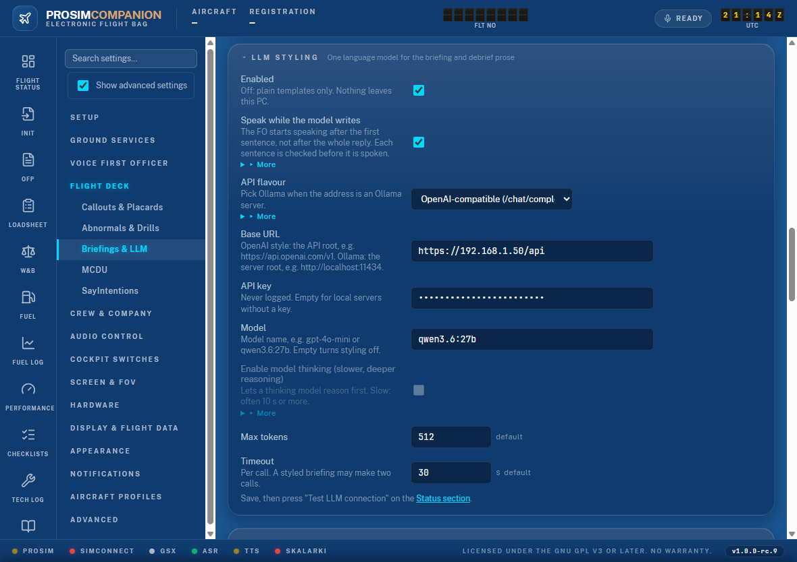

# Language model (LLM): connecting your own server

A language model (LLM) lets the First Officer speak in natural words instead of fixed
sentences, answer your questions, and understand a command you did not say exactly. It is
optional: without it the FO uses the built-in texts and every checklist, callout and briefing
still works. It costs nothing with a model server on your own network; a cloud service such
as OpenAI bills you per use. You need the address of the server and the name of one model on
it.

In every version since **0.3.0-beta.30**. **Speak while the model writes** arrived later.



## Before you start

**The app does not contain a model.** You run a model server (Ollama, Open WebUI, LM Studio,
llama-server) on the sim PC or on another PC, or you use a cloud service. The app only sends
it text and reads the answer.

**One server for everything.** There is one set of fields, on
**Settings → Flight Deck → Briefings & LLM**, in the card **LLM Styling**. Every feature in
the table below uses that one server.

| What the model does | Where its own switch is |
|---|---|
| Words the departure and arrival briefings | **LLM Styling → Enabled** (this chapter) |
| Words the post-flight debrief | **Settings → Crew & Company → Company & Debrief → Post-flight Debrief → Style with the language model** |
| Answers your questions and small talk | **Briefings & LLM → Ask the First Officer** |
| Tells facts about the region below | **Briefings & LLM → Region Facts → Facts from the language model** |
| Picks the command you meant when no known phrase matches | **Settings → Voice First Officer → Listening & PTT → Free wording (language model)** |

**The two things people get wrong:**

1. **The Base URL does not match the API flavour.** The Base URL is the address of the
   server. The API flavour is the "language" the app speaks to it. The app adds the last
   part of the address itself, and each flavour adds a different part. The table below
   shows exactly where your address must stop.
2. **The Model field is empty.** An empty **Model** switches the model off without any
   warning.

### Which values for which server

The examples use `192.168.1.50` for a server on another PC. Use `localhost` when the server
runs on the sim PC.

| Your server | API flavour | Base URL, exactly | Model |
|---|---|---|---|
| Ollama (best choice for a local model) | **Ollama native (/api/chat — thinking control)** | `http://192.168.1.50:11434` — the server address only, nothing after the port | The Ollama model name, for example `qwen3.6:27b` |
| Ollama, the OpenAI way | **OpenAI-compatible (/chat/completions)** | `http://192.168.1.50:11434/v1` | The Ollama model name. Thinking cannot be switched off this way. |
| Open WebUI | **OpenAI-compatible (/chat/completions)** | `http://192.168.1.50:3000/api` | The model name as Open WebUI shows it. Usually needs an **API key** from your Open WebUI account settings. |
| LM Studio, llama-server | **OpenAI-compatible (/chat/completions)** | The address your server shows, ending in `/v1` | The model name your server shows |
| OpenAI (cloud) | **OpenAI-compatible (/chat/completions)** | `https://api.openai.com/v1` | For example `gpt-4o-mini`. Needs an **API key**. |

What the app adds to your Base URL:

- **OpenAI-compatible**: `/chat/completions`. So `http://192.168.1.50:11434/v1` becomes
  `http://192.168.1.50:11434/v1/chat/completions`.
- **Ollama native**: `/api/chat`. So `http://192.168.1.50:11434` becomes
  `http://192.168.1.50:11434/api/chat`.

A `/` at the very end of the Base URL does no harm. Do not type `/chat/completions` or
`/api/chat` yourself.

### Thinking models

Some models (qwen3, deepseek-r1 and others) "think" before they answer. This hidden step
often takes 10 seconds or more, which is too slow for speech. Only the **Ollama native**
flavour can switch it off. If you run a thinking model on Ollama, choose **Ollama native**
and leave **Enable model thinking (slower, deeper reasoning)** unticked. With the
OpenAI-compatible flavour the model keeps thinking, the FO answers late or the request times
out, and the plain text is spoken instead.

### Check the server before you touch the app

Do this on the sim PC, so you also test the network between the two PCs.

**Ollama.** Open this address in a browser:

```
http://192.168.1.50:11434/api/ps
```

You should see a short line of text that starts with `{"models":`. An error page or a
timeout means the sim PC cannot reach the server. Then ask the model one thing. Open
**Command Prompt** (not PowerShell) and type this on one line, with your own model name:

```
curl http://192.168.1.50:11434/api/chat -d "{\"model\":\"qwen3.6:27b\",\"messages\":[{\"role\":\"user\",\"content\":\"ping\"}],\"stream\":false,\"think\":false}"
```

**OpenAI-compatible servers.** In **Command Prompt**, on one line, with your own Base URL
and model name:

```
curl http://192.168.1.50:3000/api/chat/completions -H "Content-Type: application/json" -H "Authorization: Bearer YOUR-KEY" -d "{\"model\":\"your-model\",\"messages\":[{\"role\":\"user\",\"content\":\"ping\"}]}"
```

Leave the `-H "Authorization: …"` part out when your server has no key.

In both cases a good answer is a block of text that contains `"content"` followed by the
model's reply. `404` or `not found` means the address or the model name is wrong. `401`
means the key is wrong. No answer at all means the server is not running, a firewall blocks
the port, or the server only accepts connections from its own PC. Many servers answer only
on their own PC until you tell them to listen on the network; see your server's own
documentation (for Ollama: <https://ollama.com>).

## Set it up

1. Open **Settings → Flight Deck → Briefings & LLM**
   (`http://localhost:5320/settings/speech/briefing`) and go down to the card
   **LLM Styling**.
2. Tick **Enabled**. The other fields of the card unlock.
3. Choose the **API flavour** for your server from the table above.
4. Type the **Base URL** exactly as the table shows for your server.
5. **API key**: paste the key if your server or service needs one. Leave it empty for a
   local server without a key.
6. Type the **Model** name exactly as the server lists it.
7. **Enable model thinking (slower, deeper reasoning)** stays grey unless the flavour is
   **Ollama native**. Leave it unticked.
8. Leave the rest as it is: **Speak while the model writes** ticked, and under Advanced
   **Max tokens** `512` and **Timeout** `30` s.
9. Press **Save** in the bar at the bottom of the page.

No restart is needed. The next request uses the new values.

**If the model PC sleeps.** The app can wake it when it starts: add the PC on
**Settings → Setup → Wake-on-LAN** (**MAC address**, **Wake at startup**).

## Check that it works

1. Open **Settings → Voice First Officer → Status**.
2. In the card **Component Tests** press **Test LLM connection**.
3. A good result reads like this (your time will differ):
   `LLM: Connected — replied "OK" in 850 ms.`

Then look at **Settings → Diagnostics**, page **VOICE**: the **LLM** box is green and, after
the first briefing, shows the time to the first word. With Ollama the VRAM figure fills in.
See [chapter 13](13-diagnostics.md).

In flight, ask for a briefing. With the model on, the wording changes a little each time;
the numbers never do, because the app checks every number the model writes against the
flight's real data and falls back to the plain text if one is wrong.

## If it does not work

The app checks the model 15 seconds after it starts. While the model is down it checks
again every five minutes. After you repair something, press **Test LLM connection** so you
do not have to wait.

| What you see | Why | What to do |
|---|---|---|
| `LLM: LLM styling is disabled or no model is named (briefing.llmEnabled / llmModel) — briefings and debriefs use the built-in templates.` | **Enabled** is unticked, or **Model** is empty. | Tick **Enabled**, type the **Model** name, **Save**. |
| `LLM: LLM test failed: …` with `404`, and the banner "FO free-form understanding is offline (LLM endpoint unreachable — HTTP 404 from the chat endpoint)." The Diagnostics VOICE page can still show the model PC as reachable. | The server is there, but the address the app built does not exist on it. Most often the **API flavour** and the **Base URL** do not match: OpenAI-compatible with an Ollama address without `/v1`, or Ollama native with `/v1` at the end. A wrong **Model** name can give the same error. | Compare all three fields with the table in "Which values for which server". |
| Banner "FO free-form understanding is offline (LLM auth failed — check the API key)."; Diagnostics shows `VOICE  LLM AUTH REJECTED` | The server answered 401 or 403: the key is wrong, missing or was deleted. | Paste the **API key** again and **Save**. |
| "Stored key can't be decrypted on this PC/user (settings copied from elsewhere) — re-enter it and save." under the API key | `settings.json` came from another PC or Windows account. | Paste the **API key** again and **Save**. |
| Diagnostics shows `VOICE  LLM HOST NOT RESPONDING` (amber) | The model PC does not answer at all. Most often it is asleep. | Press **Wake PCs** on the Status page, wait a minute, then **Test LLM connection**. |
| Diagnostics shows `VOICE  LLM SERVER DOWN` (red) | The PC is on but the model server is not running, or the port in the **Base URL** is wrong. | Start the server on that PC. Check the port. |
| The banner says "FO free-form understanding is offline (LLM endpoint unreachable — timed out after 30 s)."; the test can show "Test failed unexpectedly — see the Logs page." | The model is too slow or is still loading. With a thinking model, thinking is not switched off. | For a thinking model on Ollama use **Ollama native** with thinking unticked. Try a smaller model. As a last step raise **Timeout** under Advanced. |
| `LLM: Connected in … ms, but the model returned no content.` | The server answered with empty text. | Try another model. For a thinking model use **Ollama native** with thinking unticked. |
| The test is good, but the FO waits a long time before a briefing | **Speak while the model writes** is unticked, so the FO waits for the whole text. Or the model thinks first. | Tick **Speak while the model writes**. See "Thinking models". |
| The test is good, but briefings sound exactly as before | A number in the model's text did not pass the check, so the plain text was spoken. Or the feature's own switch is off. | This is the safe behaviour. If it happens every time, try another model. Check the switches in the table under "Before you start". |
| The test is good, but questions and free wording do nothing | These features also need the speech recognition server on your network; the offline Windows engine only hears exact phrases. | Set up the speech server, then switch on **Ask the First Officer** or **Free wording (language model)**. |

For anything else: reproduce it, then use **Export diagnostics** on the Logs page and send
the zip. Your key is never in the logs and is removed from the exported settings.

## Privacy

- With **Enabled** unticked nothing leaves the PC.
- With it ticked, the text for the briefing, debrief or question goes to the server in the
  **Base URL**, and nowhere else. With a server on your own network it stays in your house.
- The **API key** is stored encrypted for your Windows account and is never written to a log.

## Related chapters

- [Voice First Officer](03-voice-fo.md): briefings, questions, small talk, persona.
- [Settings reference](04-settings-reference.md): the `briefing` section.
- [Diagnostics](13-diagnostics.md): the VOICE page and its cautions.
- [Troubleshooting](05-troubleshooting.md).
