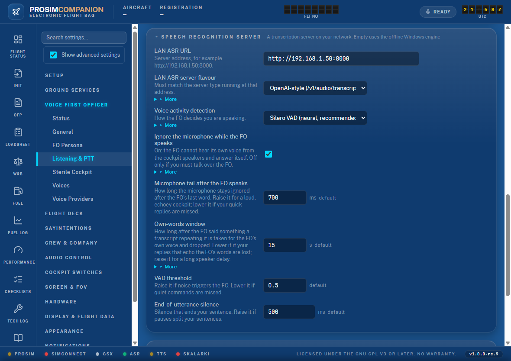

# Speech recognition server: connecting whisper.cpp or faster-whisper

Out of the box the First Officer listens with the speech engine built into Windows. That
engine only hears the exact phrases the app expects. A speech recognition server on your network
understands free speech: commands land more reliably, and questions, free wording and spoken
minima become possible. It costs nothing, but you need a PC or Mac on your network that runs
the server. You need its address and you must know which of the two server types it is.

In every version since **0.3.0-beta.30**. The two server types have the names in this chapter
from **1.0.0-rc.10**; before that they were "faster-whisper wrapper
(/transcribe)" and "whisper.cpp server (/v1/audio/transcriptions)".



## Before you start

**The app does not contain the server.** You install and start it yourself. The speech model
is chosen on the server; the app has no model field. The server must answer without a
password or key: the app sends none.

**If the server is down, the FO still listens.** The app then uses the Windows engine and
keeps trying the server. You lose free speech, not the checklists.

**The two things people get wrong:**

1. **The server flavour does not match the server.** The flavour is the "language" the app
   speaks to the server. With the wrong one the server refuses every sentence, but every
   status light stays green and the FO simply never reacts. See the table below.
2. **Something extra at the end of the address.** The address stops after the port. Do not
   add `/v1`, `/transcribe` or anything else.

### Which values for which server

The examples use `192.168.1.50` for the server PC and port `8000`. Use your own address and
the port your server listens on.

| Your server | LAN ASR server flavour | LAN ASR URL, exactly |
|---|---|---|
| whisper.cpp `whisper-server`, started with `--inference-path "/v1/audio/transcriptions"` (see the install steps) | **OpenAI-style (/v1/audio/transcriptions)** | `http://192.168.1.50:8000` — the address and port only, no `/v1` |
| faster-whisper, with the example server of this project ([tools/asr-server](../../tools/asr-server/README.md)) | **Simple (/transcribe)** | `http://192.168.1.50:8000` — the address and port only |

What the app adds to your address:

- **OpenAI-style**: `/v1/audio/transcriptions` for each sentence.
- **Simple**: `/transcribe` for each sentence.
- Both: `/health` to see if the server is up.

**faster-whisper is a library, not a server.** It needs a small server program around it.
This project has one, in the folder `tools/asr-server` of the source code; its
[README](../../tools/asr-server/README.md) says how to start it. Another faster-whisper
server only works with **Simple** if it has the same `/transcribe` page.

**Other servers and models.** Any server that speaks the same API as the whisper.cpp server
and returns the text works with **OpenAI-style**, for example a server that runs the
Qwen3-ASR model. This manual has no setup steps for such servers. One thing is different: a
server that returns the text only gives the app no "how sure" score, so the app cannot use
that score to drop noise.

**Only with OpenAI-style:** some whisper.cpp builds have no `/health` page. For this flavour
the app therefore accepts any answer from the address as "the server is up". A wrong port
with some other program on it also looks "up". Do the check below so you know the address is
right.

### Check the server before you touch the app

Do this on the sim PC, so you also test the network between the two PCs.

**Step 1.** Open this address in a browser:

```
http://192.168.1.50:8000/health
```

- whisper.cpp answers `{"status":"ok"}`, or "not found" on builds without this page. Both
  are fine.
- The example server answers `{"status":"ok","model":"large-v3"}`.
- No answer at all, or a timeout, means the sim PC cannot reach the server: it is not
  running, the port is wrong, or a firewall blocks it.

**Step 2.** Send it one recording. Record a few words as a WAV file (16 kHz, mono is what
the app sends), name it `test.wav`, open **Command Prompt** in its folder and type one line.

For whisper.cpp (**OpenAI-style**):

```
curl -F "file=@test.wav" -F "response_format=verbose_json" http://192.168.1.50:8000/v1/audio/transcriptions
```

For the example server (**Simple**):

```
curl -F "file=@test.wav" http://192.168.1.50:8000/transcribe
```

A good answer contains `"text"` followed by your words. An answer such as
`File Not Found (/transcribe)` or `404` means this server is the other type, or the address
is wrong.

If the server is not installed yet, see "Install the server, step by step" below, then come
back to this check.

## Install the server, step by step

These steps follow the projects' own pages as they were in November 2026. The projects
change; if a command fails, the project page is right and this page is old. Do the steps on
the server PC, not on the sim PC (unless they are the same PC).

### whisper.cpp

Project page: <https://github.com/ggml-org/whisper.cpp>. The server program is described at
<https://github.com/ggml-org/whisper.cpp/tree/master/examples/server>.

You need git, CMake and a C++ compiler on the server PC.

1. Get the program:

   ```
   git clone https://github.com/ggml-org/whisper.cpp.git
   cd whisper.cpp
   ```

2. Get a speech model. `base.en` is small and fast and is good for a first test:

   ```
   sh ./models/download-ggml-model.sh base.en
   ```

   On Windows: `.\models\download-ggml-model.cmd base.en`. A bigger model hears better, and
   needs more memory and a faster PC. `large-v3-turbo-q8_0` is the model in daily use with
   this app on a Mac mini with Apple Silicon; get it with the same command and that name. The
   project page has the list and the memory each one needs.

3. Build it:

   ```
   cmake -B build
   cmake --build build -j --config Release
   ```

   - With an NVIDIA graphics card: install CUDA first, then use `cmake -B build -DGGML_CUDA=1`
     as the first line.
   - On a Mac with Apple Silicon the graphics chip is used with no extra step.

4. Start the server. **All three options matter:**

   ```
   ./build/bin/whisper-server -m models/ggml-base.en.bin --host 0.0.0.0 --port 8000 --inference-path "/v1/audio/transcriptions"
   ```

   | Option | Without it | Why you need it |
   |---|---|---|
   | `--host 0.0.0.0` | The server answers only its own PC (`127.0.0.1`). | The sim PC must reach it. |
   | `--port 8000` | The port is `8080`. | Any free port works; type the same one in **LAN ASR URL**. |
   | `--inference-path "/v1/audio/transcriptions"` | The server listens on `/inference`. | The app sends every sentence to `/v1/audio/transcriptions`. Without this option the server answers 404 to every sentence. |

   This is the start line in daily use with this app on a Mac mini, with the bigger model and
   five more options:

   ```
   ./build/bin/whisper-server -m models/ggml-large-v3-turbo-q8_0.bin -l en -bs 5 -fa -t 8 --host 0.0.0.0 --port 8000 --inference-path "/v1/audio/transcriptions" --convert
   ```

   | Option | What it does |
   |---|---|
   | `-l en` | The spoken language is English. |
   | `-bs 5` | Beam size 5: the server compares more possible sentences. Better results, a little slower. |
   | `-fa` | Flash attention: faster on a graphics chip. |
   | `-t 8` | Use 8 processor threads. Use the number of fast cores of your PC. |
   | `--convert` | Convert the sound to WAV on the server. This needs the program ffmpeg on the server PC. |

5. Leave that window open. The server runs as long as it is open.

**Start it automatically on a Mac.** Save the text below as
`~/Library/LaunchAgents/com.example.whisper-server.plist`. Put your own user name in place of
`YOURNAME` and use your own model file. Then type
`launchctl load ~/Library/LaunchAgents/com.example.whisper-server.plist`. The server now
starts when you log in, and starts again if it stops.

```xml
<?xml version="1.0" encoding="UTF-8"?>
<!DOCTYPE plist PUBLIC "-//Apple//DTD PLIST 1.0//EN" "http://www.apple.com/DTDs/PropertyList-1.0.dtd">
<plist version="1.0">
<dict>
    <key>Label</key>
    <string>com.example.whisper-server</string>
    <key>EnvironmentVariables</key>
    <dict>
        <key>PATH</key>
        <string>/opt/homebrew/bin:/usr/local/bin:/usr/bin:/bin</string>
    </dict>
    <key>ProgramArguments</key>
    <array>
        <string>/Users/YOURNAME/whisper.cpp/build/bin/whisper-server</string>
        <string>-m</string>
        <string>/Users/YOURNAME/whisper.cpp/models/ggml-large-v3-turbo-q8_0.bin</string>
        <string>-l</string>
        <string>en</string>
        <string>-bs</string>
        <string>5</string>
        <string>-fa</string>
        <string>-t</string>
        <string>8</string>
        <string>--host</string>
        <string>0.0.0.0</string>
        <string>--port</string>
        <string>8000</string>
        <string>--inference-path</string>
        <string>/v1/audio/transcriptions</string>
        <string>--convert</string>
    </array>
    <key>RunAtLoad</key>
    <true/>
    <key>KeepAlive</key>
    <true/>
    <key>ThrottleInterval</key>
    <integer>10</integer>
    <key>StandardOutPath</key>
    <string>/Users/YOURNAME/Library/Logs/whisper-server.log</string>
    <key>StandardErrorPath</key>
    <string>/Users/YOURNAME/Library/Logs/whisper-server.err.log</string>
</dict>
</plist>
```

The `PATH` line lets the server find ffmpeg (for `--convert`) when it was installed with
Homebrew. If the server does not start, read the two log files named at the end.

The project warns: do not run the server as administrator, and the server has no password.
Use it on your home network only.

### faster-whisper

Project page: <https://github.com/SYSTRAN/faster-whisper>. faster-whisper needs the small
server program of this project around it.

1. Install Python 3.10 or later on the server PC.
2. Get the folder `tools/asr-server` of this project from
   <https://github.com/psyraxaus/ProsimCompanion> (three files: `server.py`,
   `requirements.txt`, `README.md`).
3. Open a command window in that folder and install what it needs:

   ```
   pip install -r requirements.txt
   ```

4. With an NVIDIA graphics card, faster-whisper also needs two NVIDIA libraries (cuBLAS and
   cuDNN 9 for CUDA 12). Its project page, section "GPU", says how to install them. Without a
   graphics card it runs on the processor, slower.
5. Start the server:

   ```
   uvicorn server:app --host 0.0.0.0 --port 8000
   ```

   The first start downloads the speech model (`large-v3` unless you choose another one; the
   folder's README lists the settings).

This example server is new and has not been run by the project yet. Do the check below
before you rely on it.

## Set it up

1. Open **Settings → Voice First Officer → Listening & PTT**
   (`http://localhost:5320/settings/speech/listening`) and go down to the card
   **Speech Recognition Server**.
2. Type the server address into **LAN ASR URL**, for example `http://192.168.1.50:8000`.
   The fields below it unlock.
3. Choose the **LAN ASR server flavour** for your server from the table above.
4. Leave **Voice activity detection** on **Silero VAD (neural, recommended)**. This is how
   the app decides that you are speaking.
5. Leave **Ignore the microphone while the FO speaks** ticked. It stops the FO from hearing
   its own voice from the speakers.
6. In the card above, check **Input device**. **Default capture device** is right if your
   headset is the Windows default microphone. Otherwise pick it.
7. Leave the rest as it is.
8. Press **Save** in the bar at the bottom of the page.
9. Open **Settings → Voice First Officer → Status** and press **Reconnect voice services**.
   This switches to the server now. Without it, a newly typed address is used after the
   next start of the app.

You also need a push-to-talk key, or continuous listening. See
[Voice First Officer](03-voice-fo.md).

**If the server PC sleeps.** The app can wake it when it starts: add the PC on
**Settings → Setup → Wake-on-LAN** (**MAC address**, **Wake at startup**). When the app
starts it waits up to two minutes for the server, then uses the Windows engine and tries the
server again every 30 seconds.

## Check that it works

1. Open **Settings → Voice First Officer → Status**.
2. Press **Reconnect voice services**. A good result starts like this:
   `Voice services: Speech recognition: whisper answers at http://192.168.1.50:8000.`
3. The pill at the top of the page reads **Ear: whisper (LAN)**. With the Windows engine it
   reads **Ear: offline engine**.
4. Press **Test microphone** and speak. A good result reads like this:
   `Microphone: Heard you on "Headset Microphone" — peak -12 dBFS over 2 s.`
5. **Now say a command to the FO**, for example ask for a checklist. This is the only test
   that proves the flavour is right. The lights in steps 2 and 3 are green with the wrong
   flavour too.

On **Diagnostics** in the sidebar, page **VOICE**, the **STT** box shows the server and the time
of the last round trip, and the top right shows the last thing the app heard. See
[chapter 13](13-diagnostics.md).

## If it does not work

| What you see | Why | What to do |
|---|---|---|
| whisper.cpp, right flavour, right address, and still the warning with `404` | The server was started without `--inference-path "/v1/audio/transcriptions"`, so it listens on `/inference` only. | Stop the server and start it again with the three options from the install steps. |
| Everything is green, **Ear: whisper (LAN)**, but the FO never reacts to anything you say. The Logs page has one warning: `LAN ASR server … answered 404 for flavour … — utterances are being dropped; check speech.asrApi matches the server` (in this line `FasterWhisper` means **Simple** and `WhisperCpp` means **OpenAI-style**) | The **LAN ASR server flavour** does not match the server, or the **LAN ASR URL** has something extra at the end. The server refuses every sentence. | Choose the other flavour. Remove everything after the port from the address. **Save**. The next sentence uses the new values. |
| The same, with the **OpenAI-style** flavour, and no such warning | The address points at another program that answers, not at the speech server. For this flavour any answer counts as "up". | Do "Check the server before you touch the app". Correct the port. |
| `Speech recognition: no LAN engine configured — the offline engine is the only one.` | **LAN ASR URL** is empty, or you did not press **Save**. | Type the address, **Save**, then **Reconnect voice services**. |
| `Speech recognition: whisper still not reachable at … — the offline engine keeps covering; the app retries every 30 s.` and **Ear: offline engine** | The server does not answer. It is off, asleep, still loading its model, on another port, or blocked by a firewall. | Start or wake the server (**Wake PCs** on the Status page). Do the browser check from the sim PC. The app switches back by itself when the server answers. |
| `Speech recognition: whisper is the active engine but …/health did not answer — the next utterance will show whether it still works.` | The server stopped answering after the app had connected. | Say something. If the FO does not react, check the server PC. |
| Diagnostics shows `VOICE  STT SERVER NOT RESPONDING` | The same: the server is unreachable. The app reconnects by itself. | Nothing, unless it stays. Then check the server PC and the address. |
| `Microphone: Captured 2 s of silence on "…" — check the input device and its Windows level.` | The app listens on the wrong microphone, or the microphone is muted or very quiet in Windows. | Pick the right **Input device**, **Save**. Raise the microphone level in Windows. |
| `Microphone: Microphone test failed: …` | Windows could not open the microphone. | Check that the microphone is plugged in and that another program does not hold it. |
| The FO reacts to noise or to silence with a server that returns the text only | The server gives no "how sure" score, so the app cannot drop weak results by score. | Keep **Voice activity detection** on **Silero VAD (neural, recommended)**. Use push-to-talk. |
| The FO reacts, but only after a long wait, or only sometimes | The server is slow. A sentence that is not answered within 8 seconds is dropped. | Use a smaller model on the server. Look at the **STT** time on the Diagnostics VOICE page. |
| The FO answers its own voice | The cockpit speakers reach the microphone. | Keep **Ignore the microphone while the FO speaks** ticked. |
| The FO cuts your sentence in two, or reacts to noise | The speech detection needs tuning for your cockpit. | Tick **Show advanced settings**. Raise **End-of-utterance silence** if pauses split your sentences. Raise **VAD threshold** if noise triggers the FO. |
| Questions and free wording do nothing, commands work | **Ear: offline engine**: the Windows engine only hears exact phrases. Or the language model is not set up. | Get the server connected first. Then see [Language model](15-language-model.md). |

For anything else: reproduce it, then use **Export diagnostics** on the Logs page and send
the zip.

## Privacy

- With **LAN ASR URL** empty, your voice never leaves the PC.
- With a server, what the microphone hears while the FO listens goes to the server at that
  address, and nowhere else. On your own network it stays in your house.

## Related chapters

- [Voice First Officer](03-voice-fo.md): push-to-talk, listening modes, what you can say.
- [Language model](15-language-model.md): the other server behind questions and free wording.
- [Settings reference](04-settings-reference.md): the `speech` section.
- [Diagnostics](13-diagnostics.md): the VOICE page and its cautions.
- [Troubleshooting](05-troubleshooting.md).

---

**Next:** [Language model](15-language-model.md) · [Manual contents](README.md)
