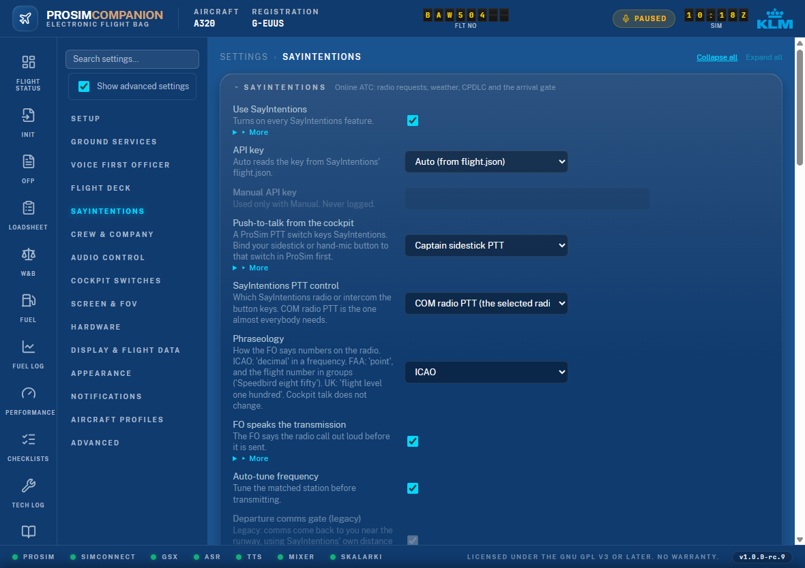

# SayIntentions: ATC requests, the radios and weather

SayIntentions is an online ATC service with AI controllers. With it switched on in
ProsimCompanion you ask the First Officer by voice to call ATC ("request push and start"),
the FO watches that COM1 is on the frequency ATC gave you, and the app gets ATIS, METAR and
TAF for your airports. SayIntentions is a paid service of its own
(<https://www.sayintentions.ai>); the app adds no cost. You need the SayIntentions program
installed and signed in on the sim PC.

In every version since **0.3.0-beta.30**. The cards **Comms hand-over** and
**FO works the radios** arrived later.

## Before you start

**What needs what.**

| You want | What must be there |
|---|---|
| Voice requests to ATC, the radios features | The SayIntentions program running, with an active flight |
| Weather (ATIS, METAR, TAF) and the CPDLC logon | Only the API key. No active flight is needed. |
| Push-to-talk from a cockpit button | MSFS running |

**The API key.** The API key is the password the app uses to talk to SayIntentions for you.
With **Auto (from flight.json)** you type nothing: the app reads the key from a file that
the SayIntentions program writes on this PC
(`%LOCALAPPDATA%\SayIntentionsAI\flight.json`). This only works when SayIntentions runs on
the same PC and the same Windows account as ProsimCompanion. If it runs on another PC,
choose **Manual (entered below)** and paste the key.

**The three things people get wrong:**

1. **Two voices answer ATC.** SayIntentions has its own copilot who can work the radios. The
   app's FO can do that job too. Decide who does it; see "Who works the radios" below.
2. **The FO hears you talk to ATC.** With continuous listening the FO listens while you
   speak to the controller. Tell the app which button is your ATC button; see
   "Push-to-talk from the cockpit" below.
3. **Every call is heard twice.** The FO says the radio call aloud before it is sent. If
   SayIntentions plays the same call on your setup, untick **FO speaks the transmission**.

## Set it up

1. Start SayIntentions on the sim PC and sign in.
2. In ProsimCompanion open **Settings → SayIntentions**
   (`http://localhost:5320/settings/speech/sayIntentions`).
3. Tick **Use SayIntentions**. The other fields unlock.
4. **API key**: leave it on **Auto (from flight.json)**. Only when SayIntentions runs on
   another PC: choose **Manual (entered below)** and paste the key into **Manual API key**.
5. **Phraseology**: how the FO says numbers on the radio. Leave ICAO, or choose FAA or UK
   for flights there.
6. Leave **FO speaks the transmission** ticked.
7. Leave **Wrong-frequency report** ticked and **Wait before the report** on `60` s.
8. Leave the rest as it is.
9. Press **Save** in the bar at the bottom of the page.

No restart is needed.

## What you can say

Hold your FO push-to-talk key and say the request. The FO answers, for example
*"Roger — calling Ground."*, waits until the frequency is quiet, and then makes the call on
COM1.

| You say | The FO calls | The call (ICAO style) |
|---|---|---|
| "request clearance" | Clearance Delivery | "Delivery, *callsign*, request clearance" |
| "request start" | Ground | "Ground, *callsign*, stand *n*, request start up" |
| "request push and start" | Ground | "Ground, *callsign*, stand *n*, request push and start" |
| "request taxi" | Ground | "Ground, *callsign*, stand *n*, request taxi" |
| "ready for departure", "request takeoff", "call the tower" | Tower | "Tower, *callsign*, holding point runway *nn*, ready for departure" |
| "request climb", "request higher" | Center | "*callsign*, request climb, flight level *nnn*" |
| "request diversion" | Center | "*callsign*, request diversion to *airport*" |

The callsign, stand and runway come from SayIntentions. The header's **VOICE** button shows
the full list in the app. The phrases and the wording of each call are in the file
`atc-requests.json` in `%LOCALAPPDATA%\ProsimCompanion\config\`; you can add your own.

**Auto-tune frequency** (off): tick it and the FO tunes the station on COM1 before a request.

## Who works the radios

Choose one of three ways. Start with the first.

| Way | What happens | How to switch it on |
|---|---|---|
| **1. Requests only** | You ask the FO for each call, as in the table above. Everything else on the radio is as you set it in SayIntentions. | This is what you have after "Set it up". |
| **2. Comms hand-over** | The SayIntentions copilot works the radios at the gate, on the taxi and in the cruise. You take them at the holding point and on the approach. The FO tells you each hand-over in one line. | In the card **Comms hand-over** tick **Hand the radios over by flight phase**. Leave the other switches of the card as they are. |
| **3. FO works the radios** | The SayIntentions copilot is switched off. The FO reads back every ATC instruction, tunes COM1 on a hand-off and checks in on the new frequency. One voice on the radio. The page says: "Not yet verified in flight." | In the card **FO works the radios** tick **FO works the radios**. |

- With way 3 on, the **Comms hand-over** card is ignored.
- With way 2 on, **Departure comms gate (legacy)** is ignored. That older switch gave you the
  radios near the runway; it is only used with way 1.
- At any time say *"I have the radios"* to take them and *"you have the radios"* to give
  them back.
- In way 2 the holding-point step needs the departure runway in the FMS. Without a known
  runway it cannot happen.

More about what the FO says on the radio: [Voice First Officer](03-voice-fo.md).

## Push-to-talk from the cockpit

Use this when the button you talk to ATC with is a sidestick or hand-mic button that ProSim
knows (it can be on another PC). The app then presses SayIntentions' talk button for you, and
the FO stops listening while you hold it.

1. In ProSim, bind your button to the sidestick or hand-mic PTT switch.
2. In the SayIntentions program, under **Controls**, switch on the option to map PTT inside
   the sim with an LVAR.
3. In ProsimCompanion, on the SayIntentions page, choose your switch in **Push-to-talk from
   the cockpit**, for example **Captain sidestick PTT**.
4. Leave **SayIntentions PTT control** on **COM radio PTT (the selected radio)**.
5. Press **Save**.

When you choose a switch here, the app sets **ATC mute from a ProSim switch** on
**Settings → Voice First Officer → Listening & PTT** to the same switch, if that field was
still **Off**. This is what keeps the FO from hearing your ATC calls.

## Arrival gate and weather

- **Arrival gate from ATC** (off): tick it and the gate that SayIntentions ATC gives you
  becomes the GSX arrival gate. A gate you set yourself on the OFP page always wins. It is
  off because the gate ATC picks may not exist in your airport scenery.
- **SayIntentions Weather**: the card's **Enabled** switch is on. It gets ATIS, METAR and
  TAF for the airports of your flight plan and keeps each report for 10 minutes.

## Check that it works

1. Open the **Flight Status** page and look at the **Radios** tile. With SayIntentions on and
   a flight active it shows COM1 and, beside **ATC expects**, the frequency ATC gave you.
   Before ATC has named one it reads "SayIntentions has not named a station yet".
2. With a flight active in SayIntentions, hold your FO key and say *"request clearance"*.
   You hear *"Roger — calling Clearance Delivery."* and then the call. SayIntentions ATC
   answers.
3. If you set up the cockpit push-to-talk: hold the button. SayIntentions shows that you are
   transmitting.

## If it does not work

| What you see or hear | Why | What to do |
|---|---|---|
| The Radios tile reads "Switch SayIntentions on under Settings → SayIntentions to see which frequency ATC expects" | **Use SayIntentions** is unticked, or you did not press **Save**. | Tick it and **Save**. |
| The FO says "SayIntentions has no active flight." | The SayIntentions program is not running, or no flight is started in it. | Start SayIntentions and start the flight there. |
| The FO says "I can't reach SayIntentions — no API key." | With **Auto**: the app found no key file on this PC, because SayIntentions runs on another PC or another Windows account, or has never run here. With **Manual**: the **Manual API key** field is empty. | Run SayIntentions on the sim PC, or choose **Manual (entered below)** and paste the key. |
| The FO says "The SayIntentions request failed — see the log." | SayIntentions did not accept the call: no internet, the service is down, or a pasted key is no longer valid. | Check the internet connection. With **Manual**, paste the key again. Look at the Logs page. |
| "Stored key can't be decrypted on this PC/user (settings copied from elsewhere) — re-enter it and save." under the key field | `settings.json` came from another PC or Windows account. | Paste the **Manual API key** again and **Save**. |
| You hear every call twice | The FO says it and SayIntentions plays it too. | Untick **FO speaks the transmission**. |
| The FO answers "Roger — calling …" and then waits | The FO waits until nobody talks on the frequency, at most 20 seconds. | Nothing. This is normal. |
| The FO reacts when you talk to ATC | The FO does not know your ATC button. | Set up "Push-to-talk from the cockpit", or bind **ATC push-to-talk (mute)** on **Listening & PTT**. |
| The Radios tile shows **WRONG FREQUENCY**, or the FO tells you COM1 is on another frequency | COM1 is not on the frequency of ATC's last "Contact … on …". | Press **Tune** on the tile, or tune it yourself. |
| COM1 jumps back to another frequency about a second after you change it, or your squawk code changes by itself | MSFS's own ATC helper is tuning the radio. | In MSFS, Assistance options, switch **AI Radio Communications (ATC)** off. |
| The cockpit push-to-talk does nothing | MSFS is not running, the button is not bound to the switch in ProSim, or the LVAR option in SayIntentions is off. | Check the three steps in "Push-to-talk from the cockpit". |
| With **Comms hand-over** on, you never get the radios at the holding point | The app does not know the departure runway. | Enter the runway in the FMS before you taxi. Say *"I have the radios"* to take them now. |
| The arrival gate from ATC is not found by GSX | The gate ATC picked does not exist in your scenery. | Choose the gate yourself on the OFP page. Untick **Arrival gate from ATC** if it happens often. |

For anything else: reproduce it, then use **Export diagnostics** on the Logs page and send
the zip. Your key is never in the logs and is removed from the exported settings.

## Related chapters

- [Voice First Officer](03-voice-fo.md): the radio calls in detail, "FO works the radios".
- [Settings reference](04-settings-reference.md): the `sayIntentions` section and
  `atc-requests.json`.
- [Speech recognition server](16-speech-recognition-server.md): the FO hears requests more
  reliably with one.
- [Troubleshooting](05-troubleshooting.md).

---

**Next:** [MCDU: "Check the box"](19-mcdu-box-check.md) · [Manual contents](README.md)
