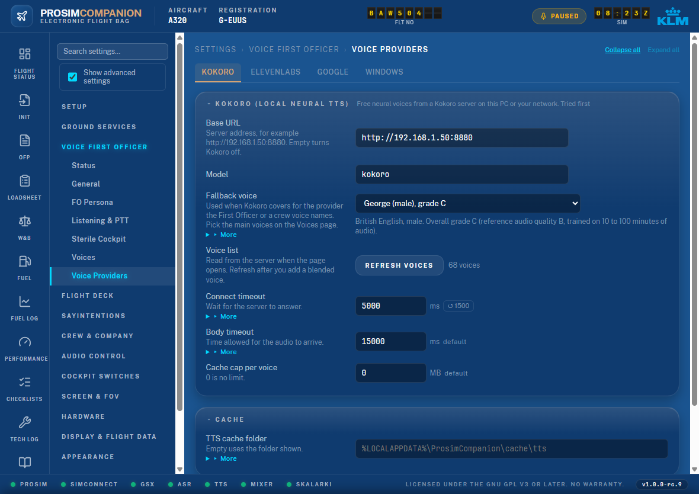

# Kokoro voice server: free neural voices on your own network

Kokoro gives the First Officer and the crew natural-sounding voices without a cloud account.
The voices are made by a small server that you run yourself, on the sim PC or on another PC
in your network. It costs nothing and no text leaves your house. You need a running Kokoro
server and its address. Kokoro is optional: without it the app speaks with ElevenLabs,
Google or the Windows voices.

In every version since **0.3.0-beta.30**. The **Voice Providers** page with its **Kokoro**
tab and the voice list arrived in **0.7.0-rc.6**.



## Before you start

**The app does not contain the Kokoro server.** Installing it is outside this manual. The
app is written for [kokoro-fastapi](https://github.com/remsky/Kokoro-FastAPI); follow the
install page of that project. The app only sends the server text and plays the sound that
comes back.

**What the server must offer.** The app calls three addresses on the server, and nothing
else:

| The app calls | When | What it expects |
|---|---|---|
| `GET /v1/audio/voices` | When you open the page or press **Refresh voices** | The list of voices. The app waits up to 5 seconds. |
| `POST /v1/audio/speech` | Every time Kokoro speaks | The sound as a WAV file. |
| `GET /health` | When you press **Reconnect voice services** | Any answer without an error. The app waits up to 3 seconds. |

The app sends no key and no password. A server that asks for one cannot be used.

### Which values for which server

The example uses `192.168.1.50` for a server on another PC. Use `localhost` when the server
runs on the sim PC. `8880` is the port of the example; use the port your server shows.

| Your server | Base URL, exactly | Model | Fallback voice |
|---|---|---|---|
| kokoro-fastapi | `http://192.168.1.50:8880` — the server address only, nothing after the port | `kokoro` (already filled in) | Pick one from the list, for example `George (male)` |

The app adds the last part of the address itself. So `http://192.168.1.50:8880` becomes
`http://192.168.1.50:8880/v1/audio/speech`. A `/` at the very end does no harm. Do not type
`/v1` or `/v1/audio/speech` yourself: the app would then call an address that does not
exist on the server.

**The two things people get wrong:**

1. **`/v1` at the end of the Base URL.** Other settings in the app want `/v1`. This one
   does not.
2. **The server only answers on its own PC.** Many servers accept connections only from
   the PC they run on until you tell them to listen on the network. Then everything works
   on the server PC and nothing works from the sim PC. See your server's own documentation.

### Check the server before you touch the app

Do this on the sim PC, so you also test the network between the two PCs.

Open this address in a browser:

```
http://192.168.1.50:8880/v1/audio/voices
```

You should see a line of text that starts with `{"voices":` and lists names such as
`bm_george`. An error page or a timeout means the sim PC cannot reach the server.

Then ask for one sentence. Open **Command Prompt** (not PowerShell) and type this on one
line:

```
curl http://192.168.1.50:8880/v1/audio/speech -H "Content-Type: application/json" -d "{\"model\":\"kokoro\",\"input\":\"Before start checklist complete.\",\"voice\":\"bm_george\",\"response_format\":\"wav\"}" -o kokoro-test.wav
```

A good answer is a file `kokoro-test.wav` that plays the sentence when you double-click it.
A file of a few bytes holds an error text instead: open it with Notepad and read it. This is
the same request the app sends.

## Set it up

1. Open **Settings → Voice First Officer → Voice Providers**
   (`http://localhost:5320/settings/speech/providers/kokoro`). The **Kokoro** tab is the
   first one.
2. Type the server address in **Base URL**, exactly as in the table above. The other fields
   unlock.
3. Leave **Model** on `kokoro`.
4. Press **Refresh voices**. The note beside the button reads "68 voices" or a similar
   number. You do not have to save first.
5. Pick a **Fallback voice**. This is the voice Kokoro uses when no other voice is chosen
   for a role. Do not leave it empty: without a fallback voice Kokoro counts as not
   configured.
6. Press **Save** in the bar at the bottom of the page.

No restart is needed. The next sentence uses the new values.

Leave the rest as it is. **Connect timeout** (`1500` ms), **Body timeout** (`15000` ms) and
**Cache cap per voice** (`0`, no limit) only show when **Show advanced settings** is ticked,
and the defaults are right for a server on your own network.

**Who sounds like what** is not chosen here. Pick the First Officer, purser, company and
ground crew voices on the **Voices** page; see [Voices](10-voices.md). That chapter also
explains the grade beside each Kokoro voice and how to type the id of a blended voice.

**If the Kokoro PC sleeps.** The app can wake it when it starts: add the PC on
**Settings → Setup → Wake-on-LAN** (**MAC address**, **Wake at startup**).

## Check that it works

1. Open **Settings → Voice First Officer → Status**.
2. In the card **TTS Providers** find the row `kokoro`. It is row 1. After a save it reads
   *Untried*.
3. Press **Test** on that row. You hear a sample in the fallback voice, the row turns
   *Healthy*, and the line under the table reads like this (your time will differ):
   `kokoro: synthesized in 412 ms and played.`

**Test** speaks with Kokoro only. No other voice covers for it, so a sample you can hear
really came from Kokoro.

Two more places show the state:

- The **TTS** dot in the bar at the bottom of every page. Hold the mouse over it:
  "Voice (Kokoro): healthy".
- **Diagnostics**, page **VOICE**: the **TTS** box shows the time of the last sentence and
  the voice that spoke it. See [chapter 13](13-diagnostics.md).

## How Kokoro behaves in flight

- **Tried first.** The voices are tried in this order: Kokoro, ElevenLabs, Google, then
  Windows. A voice you picked from another provider on the **Voices** page moves that
  provider to the front for that role; Kokoro then covers with its **Fallback voice** when
  that provider is down.
- **The 60 second pause.** When Kokoro fails once, the app does not ask it again for 60
  seconds. The next voice in the order speaks during that time, so the First Officer is
  never silent, but the voice changes. The Status page shows *Cooling down* and
  "retry in 42s". After the 60 seconds Kokoro is tried again by itself.
- **Short wait, long sentences.** The app waits only 1.5 seconds for the server to start
  answering, so a sleeping server does not hold up a callout. Once the server answers, the
  sound gets much longer to arrive: 15 seconds, plus more for every character of a long
  briefing.
- **Every sentence is kept on disk.** A sentence Kokoro has spoken once plays from the disk
  the next time, without asking the server. The folder is **TTS cache folder** on the same
  page (default `%LOCALAPPDATA%\ProsimCompanion\cache\tts`).
- **One-word callouts.** Kokoro cannot time a lone word such as "Checked" and clips it.
  Since **0.7.0-rc.9** the app sends short callouts in a way that makes them sound whole.
  You do not have to set anything. Clips made by an older version are still on disk; the
  table below says how to remove them.

## If it does not work

| What you see | Why | What to do |
|---|---|---|
| Beside **Refresh voices**: "could not list voices — …" | The server did not answer on that address, or the address does not exist on it. With `HTTP 404` in the text the **Base URL** most often ends in `/v1`. | Open `http://192.168.1.50:8880/v1/audio/voices` (your address) in a browser on the sim PC. Compare the **Base URL** with the table in "Which values for which server". |
| Beside **Refresh voices**: "no voices reported" | The server answered, but without a list the app can read. | Check that the server is kokoro-fastapi and is up to date. |
| **Refresh voices** is grey, the note reads "not configured" | **Base URL** is empty. | Type the server address. |
| Status row `kokoro`: *Disabled*, "not configured" | **Base URL** or **Fallback voice** is empty, or the change was not saved. **Test** then answers `kokoro is not configured — nothing to test.` | Fill both fields and press **Save**. |
| Status row `kokoro`: *Disabled*, "local-only mode". **Test** answers `kokoro is excluded by local-only mode.` | **Local only** is ticked on **Settings → Voice First Officer → General**. It shuts out every network voice, and Kokoro counts as one even on the sim PC. | Untick **Local only** and **Save**. |
| **Test** answers `kokoro failed: Kokoro TTS timed out after 1500 ms (connect — host asleep or unreachable)` | The server did not start to answer in time. The PC is asleep or off, a firewall blocks the port, or the server is busy loading. | Wake the PC (**Wake PCs** on the Status page), wait a minute, press **Test** again. If the server is only slow, raise **Connect timeout** under Advanced. |
| **Test** answers `kokoro failed: Kokoro TTS HTTP 404: …` or another HTTP number | The server is there, but it refused the request. The text after the number is the server's own reason: most often a wrong **Base URL**, a **Model** name or a voice the server does not know. | Compare the fields with the table. Press **Refresh voices** and pick the **Fallback voice** from the list again. |
| **Test** answers `kokoro failed: Kokoro TTS returned empty audio` | The server answered without sound. | Restart the Kokoro server. Run the `curl` check above. |
| The First Officer suddenly speaks in another voice. Status row `kokoro`: *Cooling down*, "retry in …s". Diagnostics shows `VOICE  TTS SERVER NOT RESPONDING` (amber) and "TTS OFFLINE · FALLBACK VOICE". | Kokoro failed once and is in its 60 second pause. | Nothing, if it comes back. If it happens again and again, check the server and the network. After a repair press **Reconnect voice services** so you do not wait. |
| **Reconnect voice services** answers `Voice (kokoro): not reachable — the next voice in the chain keeps covering.` | The server did not answer the health check within 3 seconds. | Start the server, or wake its PC. A good answer reads `Voice (kokoro): answers — cooldown cleared.` |
| **Test** plays and the row reads *Healthy*, but new sentences come in another voice | The test sentence was already on disk, so it played without the server. The server itself is down. | Press **Reconnect voice services**: it asks the server itself. |
| A one-word callout ("Checked") sounds clipped or mumbled | The clip was made by a version before 0.7.0-rc.9 and is still on disk. | Close the app and delete the folder `kokoro` inside the **TTS cache folder**. The callouts are made again when they are next spoken. |
| A voice reads English badly | It is a Kokoro voice for another language. | Pick a British or American voice. See [Voices](10-voices.md). |

For anything else: reproduce it, then use **Export diagnostics** on the Logs page and send
the zip.

## Privacy

- The text of each sentence goes to the server in the **Base URL**, and nowhere else. With
  a server on your own network it stays in your house.
- With **Base URL** empty, or **Local only** ticked, nothing is sent to Kokoro.
- The spoken sentences are kept as sound files in the **TTS cache folder** on the sim PC.

## Related chapters

- [Voices](10-voices.md): pick the First Officer and crew voices, fallback voices.
- [ElevenLabs voices](06-elevenlabs.md): the paid cloud voices that are tried after Kokoro.
- [Voice First Officer](03-voice-fo.md): what the First Officer says and does.
- [Diagnostics](13-diagnostics.md): the VOICE page and its cautions.
- [Troubleshooting](05-troubleshooting.md).

---

**Next:** [Speech recognition server](16-speech-recognition-server.md) · [Manual contents](README.md)
