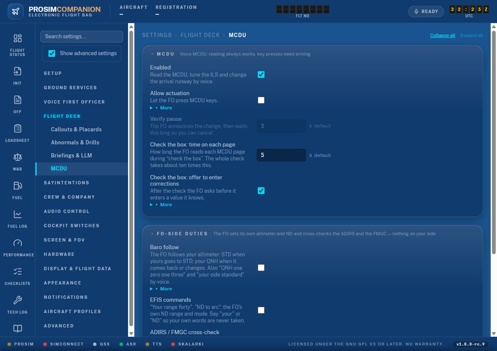
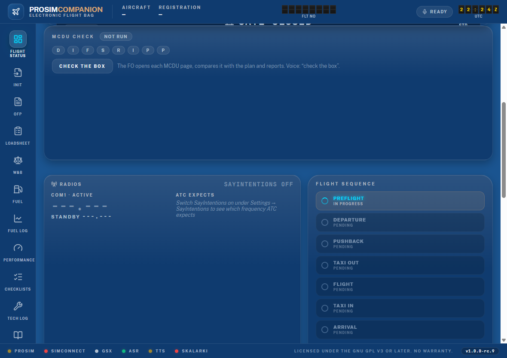

# MCDU: "Check the box" and the FO's own side

Say *"check the box"* and the First Officer (FO) opens every page of its own MCDU, compares
what is entered with your flight plan, the loadsheet and the computed takeoff figures, and
tells you what is different. The same settings page holds the other MCDU voice features
(reading the MCDU aloud, tuning the ILS, changing the arrival runway) and three duties the FO
can do on its own side of the cockpit. It costs nothing. You need ProSim running and
connected, and the voice First Officer working.

"Check the box" is available from **1.0.0-rc.9**. In that version it has not been flown yet:
it was tested against MCDU screens captured at the gate.

## Before you start

**What the check compares with.** The FO can only compare a page with something it knows.

| Page | Compared with | You need |
|---|---|---|
| INIT A | The flight plan (OFP) | The plan loaded in the app |
| INIT B | The final loadsheet, or the preliminary one if there is no final yet | A loadsheet sent |
| PERF TAKE OFF, departure runway | The computed takeoff figures | The takeoff figures computed in the app |
| A/C STATUS | The date in the sim | Nothing |

When one of these is missing, the FO still reads the page, but does not compare it.

**The things people get wrong:**

1. **"The FO did not enter the cost index."** Some corrections need MCDU keys. The FO presses
   those keys only when **Allow actuation** is ticked. See "Which corrections the FO offers".
2. **"Not entered yet" is not a mistake.** V speeds before the loadsheet are simply not in
   yet. The FO names them in a separate list, after the differences.
3. **The check does not start by itself.** You ask for it, by voice or with the button.
4. **The FO uses its own MCDU for about a minute.** The pages on that screen change during
   the check. At the end the FO leaves it on the F-PLN page.

## Set it up

1. Open **Settings → Flight Deck → MCDU** (`http://localhost:5320/settings/speech/mcdu`).
2. In the card **MCDU**, leave **Enabled** ticked. It is on by default. With it off, none of
   the MCDU voice features work and the check card is hidden.
3. **Allow actuation**: off by default. Leave it off if you want the FO to read and report
   only. Tick it if you want the FO to type on INIT A, tune the ILS and change the arrival
   runway for you. The page says: "Off: read only. The FO still turns pages for “check the
   box”, but enters nothing."
4. **Verify pause**: only unlocked when **Allow actuation** is ticked. Leave it on `3` s. The
   FO says what it is going to do, then waits this long so you can cancel.
5. **Check the box: time on each page**: leave it on `5` s (allowed: 1 to 20). The whole
   check takes about ten times this value, so about a minute.
6. **Check the box: offer to enter corrections**: leave it ticked. Untick it and the FO
   reports only and asks nothing.
7. Leave the card **FO-side duties** as it is for now; it is explained below.
8. Press **Save** in the bar at the bottom of the page.

No restart is needed.

## Check the box

### What to say

Hold your FO push-to-talk key and say one of:

- *"check the box"*, *"box check"*, *"check the MCDU"*, *"check the FMS"*: start the check.
- *"stop the check"* or *"cancel the check"*: stop it. The FO says *"Check stopped."*

You can also press the **Check the box** button on the **MCDU CHECK** card. The card is on
the **Flight Status** page and on EFB INIT.

### What the FO does

The FO answers *"Checking the box."* and opens the pages in the order a crew uses,
**D-I-F-S-R-I-P-P**. It turns pages only: page keys, the arrows and page links. It needs no
**Allow actuation** for this, because none of these keys can enter or delete a value.

| Letter | Name on the card | Pages | What the FO checks |
|---|---|---|---|
| **D** | Data | DATA → A/C STATUS, IRS MONITOR, GPS MONITOR | The navigation database is valid on today's sim date. All three IRS and both GPS are in NAV. |
| **I** | Init A | INIT A | City pair, alternate, flight number, cost index and cruise level against the flight plan. |
| **F** | Flight plan | F-PLN, scrolled to its end | Every discontinuity. The departure runway against the takeoff figures. |
| **S** | Secondary plan | SEC F-PLN | Empty, or holding a route. |
| **R** | Rad nav | RAD NAV | Reads the ILS. Nothing is judged. |
| **I** | Init B (fuel) | INIT B | ZFW and ZFWCG against the loadsheet. |
| **P** | Perf takeoff | PERF TAKE OFF | V speeds, flex, flaps and runway against the computed figures. Whether the trim is entered. |
| **P** | Progress | PROG | GPS PRIMARY is shown. The navigation accuracy is not LOW. |

Weights are compared in the unit your MCDU shows. A ZFW within 0.2 and a ZFWCG within 0.3 of
the loadsheet count as the same.

### What the FO reports

After about a minute you hear one report:

- *"Box checked, no differences."*
- Or the number of differences and each one as a sentence, for example *"Box checked, one
  difference. Cost index is five, the plan says four five."*
- Then, if anything is still empty: *"Not entered yet: the V speeds and the trim."*
- Then, if a page could not be read: *"I could not read the takeoff page."*

**"Not entered yet"** means the field is empty. It is a reminder, not a difference.

**"I could not read …"** means the FO opened the page but did not recognise its layout, so it
says nothing about it. This can happen with another ProSim version or with pages opened in
flight (the layouts were captured at the gate). The FO never guesses. When nothing was found
but a page was not read, the report starts *"Box checked, no differences on the pages I could
read."*

### The card

The **MCDU CHECK** card shows the eight letters, and under them, for each page, the lines the
FO read and found. The lines are in English in every language.

| Colour | Word on the card | Meaning |
|---|---|---|
| Green | **OK** | The page was read and there is nothing to say. |
| Amber | **DIFFERENCE** | At least one value differs from the plan, the loadsheet or the takeoff figures. |
| Grey | **NOT ENTERED** | A field on the page is still empty. |
| Grey | **NOT READ** | The FO could not read the page. |

The two greys look the same on the letter; the word beside the page name tells you which one
it is. Hold the mouse over a letter to see the page name and its state. The label in the
card's header reads **NOT RUN**, **CHECKING…**, or **CHECKED** with the UTC time of the last check.

### Which corrections the FO offers

After the report the FO offers to enter what it knows, one question at a time, for example
*"Shall I enter cost index four five?"* or *"The secondary flight plan is empty. Shall I copy
the active plan?"*

- Say *"yes"*, *"enter it"* or *"go ahead"*: the FO answers *"Entering."*, enters the value
  and confirms, for example *"Cost index entered."*
- Say *"no"*, *"leave it"* or *"I'll do it"*: the FO answers *"Left as it is."*
- You can also answer on the open-questions card.
- No answer within a minute counts as no: *"No answer — I leave it."*

| The FO can enter | From | Needs **Allow actuation** |
|---|---|---|
| ZFW, ZFWCG and block fuel | The loadsheet | No |
| V speeds, flex and flaps | The computed takeoff figures | No |
| Flight number, cost index, cruise level | The flight plan, typed on INIT A and read back | Yes |
| Copy the active plan to the secondary | COPY ACTIVE on the SEC INDEX page | Yes |

With **Allow actuation** off, the FO skips the last two rows and tells you: *"One item needs
M C D U actuation, which is off — that one is yours."*

The FO **never** changes the city pair, the alternate, the route, the SID, the STAR or a
discontinuity. It reports them and you repair them. The trim is also yours: *"Takeoff figures
entered. The trim is yours."*

### What the check does not judge

- Block fuel and the RAD NAV page are read, not judged.
- The route and the SID are not compared with the flight plan. Only discontinuities are found.
- The trim value is not checked, only whether one is entered.
- The check does not run by itself. (The **ADIRS / FMGC cross-check** below does.)

## The other MCDU voice features

All of these need **Enabled** ticked in the **MCDU** card.

| You say | What the FO does | Needs **Allow actuation** |
|---|---|---|
| *"read the MCDU"*, *"read the box"*, *"what's on the MCDU"* | Reads the page that is shown aloud. | No |
| *"read the scratchpad"* | Reads only the scratchpad. | No |
| *"tune the ILS"*, *"set the ILS"* | Tunes the ILS of the arrival runway on RAD NAV. | Yes |
| *"change arrival runway …"*, *"change to runway …"* | Changes the arrival runway and its ILS. | Yes |

Before the FO tunes the ILS or changes the arrival, it says what it will do and waits for the
**Verify pause**. Say *"negative"* or *"disregard"* during the pause to cancel. By voice, the
FO does these two only while the FO is the pilot flying. Otherwise it answers *"You're pilot
flying — the radios are yours."* or *"You're pilot flying — the arrival is yours."*

## FO-side duties

The second card on the page. Three switches, all off by default. The FO sets its own
altimeter and its own ND and nothing on your side.

- **Baro follow**: the FO follows your altimeter. STD when yours goes to STD, your QNH when
  it comes back or changes. Each change is announced and waits three seconds for
  *"negative"*.
- **EFIS commands**: *"your range forty"*, *"ND to arc"*. Say *"your"* or *"ND"* in the
  phrase, so that your own words are never taken.
- **ADIRS / FMGC cross-check**: say *"cross-check"*. The FO reads the ADIRS alignment, the
  INIT page against the plan and the PERF speeds against the computed figures. It also runs
  once by itself when the FMGC init settles at the gate. No MCDU key is pressed.

The full description of each is in [Voice First Officer](03-voice-fo.md), section "The FO's
own side".

## Check that it works

1. At the gate, with ProSim running and the flight plan loaded, open the **Flight Status**
   page. The **MCDU CHECK** card shows **NOT RUN**.
2. Say *"check the box"*. You hear *"Checking the box."*, the card shows **CHECKING…**, and
   the pages on the FO's MCDU change.
3. After about a minute you hear the report. The card shows **CHECKED** with the time, and
   each letter is green, amber or grey.

## If it does not work

| What you see or hear | Why | What to do |
|---|---|---|
| There is no **MCDU CHECK** card | **Enabled** is unticked in the **MCDU** card. | Tick it and **Save**. |
| The FO says "Unable — I can't see the M C D U; ProSim isn't connected." | The app gets no MCDU screen from ProSim. | Start ProSim and wait until the app shows it as connected. |
| Under the button: "The MCDU is off in Settings, or its display is not arriving from ProSim." | The same, when you pressed the button. | The same. |
| Under the button: "The voice First Officer is not running." | The voice FO is switched off. | Switch it on under **Settings → Voice First Officer**. |
| The FO says "Still checking." | A check is already running. | Wait for the report, or say *"stop the check"*. |
| The FO says "Unable to finish the check — I lost the M C D U." | A page key was not accepted, because the MCDU screen went away during the check. | Check that ProSim is still connected, then start again. |
| The FO says "I could not read …" for a page | The FO does not recognise the layout of that page. | Check that page yourself. If it happens at the gate every time, send a diagnostics export. |
| The FO says "… needs M C D U actuation, which is off" | The correction needs MCDU keys. | Enter it yourself, or tick **Allow actuation**. |
| The FO says "Unable — the scratchpad is not clear, please check the M C D U." | Something stayed in the scratchpad, so the FO did not type. | Clear the scratchpad and enter the value yourself. |
| The FO says "Unable — the M C D U did not take the entry, please check the scratchpad." | The value was typed but the field did not show it afterwards. | Look at the scratchpad message and enter the value yourself. |
| The FO asks nothing after the report | **Check the box: offer to enter corrections** is unticked, or there is nothing it can enter. | Tick the switch if you want the questions. |
| The FO says "Unable — the M C D U isn't armed." after *"tune the ILS"* | **Allow actuation** is off. | Tick **Allow actuation** and **Save**. |
| The old quick page-flip runs and the FO only says "Checked" | **Enabled** is off and your own edited `commands.json` still has the old macro. | Tick **Enabled** in the **MCDU** card. |

For anything else: reproduce it, then use **Export diagnostics** on the Logs page and send
the zip.

## Related chapters

- [Voice First Officer](03-voice-fo.md): "Check the box" and "The FO's own side" in the
  context of the whole flight.
- [Settings reference](04-settings-reference.md).
- [Diagnostics](13-diagnostics.md).
- [Troubleshooting](05-troubleshooting.md).

---

**Next:** [Flight deck options](26-flight-deck-options.md) · [Manual contents](README.md)
