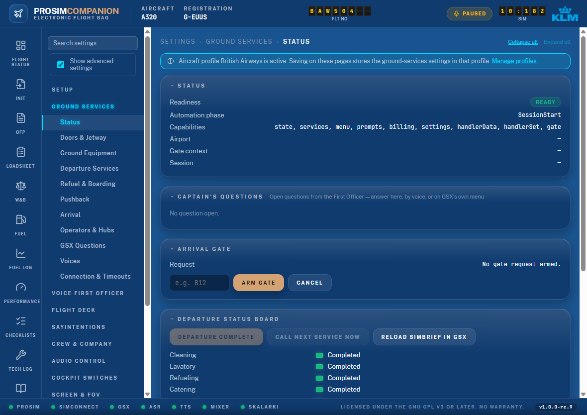
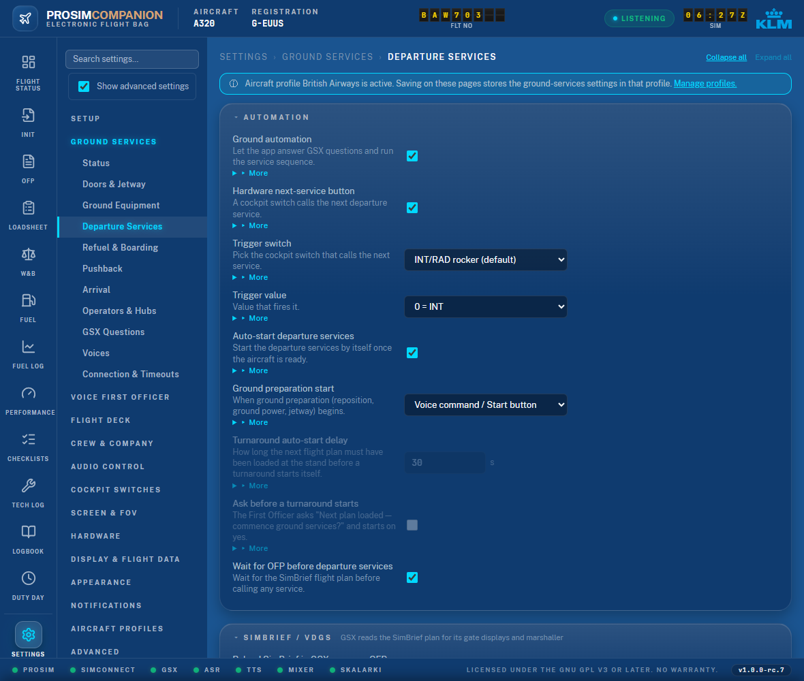

# Ground Services: the GSX settings, page by page

ProsimCompanion drives GSX Pro for you: it calls the ground services in order, opens and
closes the doors, loads fuel and passengers into ProSim, runs the pushback and looks after
the arrival. All of this is set under **Settings → Ground Services**. This chapter tells you
what to set first, and then walks through each menu item with the few settings that matter.
The app adds no cost; you need GSX Pro (version 4 or later) installed in MSFS.

In every version since **0.3.0-beta.30**. The **Voices** item, the **Beacon Sequence Steps**
card and **Release the steering after pushback** arrived in **1.0.0-rc.6**.

## Before you start

| What must be running | Why |
|---|---|
| MSFS, with you in the flight (not in the main menu) | Nothing is driven before you sit in the aircraft. |
| GSX Pro, with its Couatl engine started | The app talks to Couatl, the program behind GSX. |
| ProSim | Doors, fuel, passengers and ground power are set in ProSim. |
| A flight plan (SimBrief import or a plan in the MCDU) | With the default settings no service is called without one. |

**The connection needs no setting.** The app reads the GSX port from GSX's own file
(`%APPDATA%\Virtuali\CouatlAddons.ini`, default port 8744). If the port is different there,
the app follows by itself. There is no port field in the app.

**The two things people get wrong:**

1. **ProSim does the same job.** ProSim has its own door logic, automatic ground power and
   datalink loading. With those on, doors reopen and fuel or passengers load twice. Open
   **Settings → Setup**, card **ProSim Setup Check**, and press **Apply recommended** when
   it shows amber rows.
2. **The INT/RAD switch.** By default the INT/RAD rocker set to INT on either audio panel
   calls the next ground service. If your panel or audio bridge keys the interphone
   microphone on INT, switch **Hardware next-service button** off (see "Departure Services").

When an aircraft profile is active, a line at the top of these pages tells you so. Saving
then stores the Ground Services settings in that profile.

## Set it up: the first five minutes

1. Open **Settings → Setup**. In the card **Features**, check that **GSX ground services**
   is ticked (it is by default). With it off the pages stay, but nothing runs.
2. On the same page, look at **ProSim Setup Check** and clear any amber rows.
3. Open **Settings → Ground Services → Departure Services**
   (`http://localhost:5320/settings/gsx/departure`).
4. Check that **Ground automation** is ticked (default: on).
5. Tick **Auto-start departure services** if you want the services to start by themselves
   once the aircraft is ready. It is off by default: you then press **Start departure
   services** on the Status page, or say *"commence ground services"* to the First Officer.
6. Leave **Wait for OFP before departure services** ticked, and the rest as it is. The
   defaults give a complete turnaround.
7. Press **Save** in the bar at the bottom of the page.

No restart is needed. Save on each page before you go to the next one. Some fields are grey
until you tick the switch above them, and rarely needed fields are hidden until you tick
**Show advanced settings** above the settings menu. The full list of options is in the
[Settings reference](04-settings-reference.md), section "The `gsx` section"; this chapter
does not repeat it.

## Status

The live page, not a settings page: is GSX connected, what is the automation doing, and
why. It is the first item, **Settings → Ground Services → Status**
(`http://localhost:5320/settings/gsx`).

- **Status** card: **Readiness** must read `Ready`. **Airport** and **Gate context** show
  where GSX thinks you are.
- **Captain's Questions**: open questions from the First Officer, with buttons to answer.
  **Arrival Gate**: type a gate and press **Arm gate**.
- **Departure Status Board**: one row per service with its stage (**Waiting**, **Holding**,
  **Skipped**, **Called**, **Requested**, **Active**, **Completed**) and, beside it, the
  reason for a hold or a skip. The buttons **Start departure services** and **Call next
  service now** are here.
- **Diagnostics — services, GSX menu, recent commands**: click this line to unfold it.
  Inside is **Automation Decisions**, the decision log: every action and every deliberate
  non-action with its time and reason, newest first. This is where you see why something
  did not happen.

**Check it:** at the gate with GSX running, **Readiness** reads `Ready` and the **GSX** dot
in the footer is green.

## Doors & Jetway

The app opens and closes the ProSim doors when GSX needs them, and connects the jetway or
the stairs.

| Setting | Default | What to know |
|---|---|---|
| **Door automation** | on | The master switch for all door rules on this page. |
| **Catering door** | **Auto (learn from GSX)** | The app learns the door the first time GSX asks for one. Choose a door only to override. |
| **Connect at session start** | on | Connects the jetway or stairs when you start at the gate. GSX decides which. |
| **Connect on arrival** | on | Connects them after parking, before deboarding. |

**Close doors on final loadsheet** and **Remove jetway/stairs on final loadsheet** are only
used while the beacon pushback sequence is off (see "Pushback").

**Check it:** when the catering truck arrives, a service door on the right side opens in
ProSim. The Diagnostics GSX page shows an open door as an amber marker.

## Ground Equipment

Ground power (GPU), chocks and pre-conditioned air (PCA) at the stand.

| Setting | Default | What to know |
|---|---|---|
| **Place ground equipment** | on | Places GPU and chocks at session start. They are removed when the beacon comes on. |
| **Connect GPU with APU running** | on | Untick it if you start with the APU on and want no GPU. |
| **Connect PCA** | **Never** | Choose **Always** or **Only jetway stands** if you want PCA. |
| **Reposition at startup** | on | Runs GSX's Reposition Aircraft once at session start. |

**Check it:** start cold and dark at a gate. Shortly after you are in the cockpit, external
power is available and the chocks are in.

## Departure Services

When the services start, in which order, and what the cockpit "next service" switch does.

| Setting | Default | What to know |
|---|---|---|
| **Ground automation** | on | Off: the app answers no GSX question and calls no service. The connection and the status board still work. |
| **Hardware next-service button** | on | A cockpit switch calls the next service. Default: the INT/RAD rocker set to INT. For another switch use **Trigger switch** (an advanced field). |
| **Auto-start departure services** | off | See "Set it up" above. |
| **Ground preparation start** | **Automatic (session start)** | **Voice command / Start button** holds everything, also ground power and the jetway, until you say *"commence ground services"* or press Start. |
| **Wait for OFP before departure services** | on | No flight plan, no services. |

**Departure Service Order**, lower on the page, is the call order from top to bottom. Each
row waits for the row above it, as set in its **Activation** column. The default order is the
**Classic** button: Cleaning and Lavatory on turnarounds only, Refueling and Catering side
by side, Water after catering is requested, Boarding last. **Parallel** calls every service
as soon as the previous one was called; **Manual** calls nothing for you. To switch one
service off, set its **Activation** to **Skip / ignore** or remove the row. Change the table
between flights, not during a departure.

**Check it:** load a flight plan and start the services. On the Status page the rows of the
**Departure Status Board** move from **Waiting** to **Called** and on to **Completed**.

**Turnarounds.** With **Ground preparation start** on **Voice on a cold start, automatic on a
turnaround**, the first leg waits for your "commence ground services" and a turnaround starts
by itself: the next flight plan must be loaded at the stand, with the engines off, for the
time in **Turnaround auto-start delay**. Tick **Ask before a turnaround starts** and the
First Officer asks *"Next plan loaded — commence ground services?"* first and starts on your
"yes".

### SimBrief / VDGS

GSX reads your SimBrief plan for its gate displays (VDGS) and the marshaller. After a new
plan GSX must read it again, or the display shows the old flight. GSX has a menu line for
this, and the app can click it for you.

| Setting | Default | What to know |
|---|---|---|
| **Reload SimBrief in GSX on a new OFP** | off | On: the app clicks GSX's SimBrief line once per new flight plan. Only while you are parked at the gate with the engines off and GSX ready, never in flight. A plan fetched in the air is reloaded at the next gate. |
| **Additional Services pages to search** | `4` | The line is not on GSX's first menu page. The app looks at the gate menu, then at Additional Services and up to this many further pages. |

- The button **Reload SimBrief in GSX** on the Status page (card **Departure Status Board**)
  does the same at once, whatever the switch is set to.
- **GSX needs your SimBrief username.** GSX only offers the line when a SimBrief username is
  set in GSX's own settings. Without it no page has the line; the Status page then says so
  once and this plan is not tried again.

**Check it:** press **Reload SimBrief in GSX** at the gate. Under the buttons a line that
starts with **SimBrief reload:** tells you the result: "Reloaded", "Sent" or "Not performed",
with the reason.

### Cold & Dark Check

Once per session, on a fresh departure, the app compares your cockpit switches with a cold
and dark aircraft. It never runs on a turnaround. It only reports; it moves no switch.

| Setting | Default | What to know |
|---|---|---|
| **Verify aircraft state at session start** | on | The expected switch positions are in the file `aircraft-states\cold-and-dark.json` in your config folder (`%LOCALAPPDATA%\ProsimCompanion\config\`). |
| **First Officer announces mismatches** | on | The First Officer reads out the first few mismatches. Grey while the switch above is off. The same switch is also on the **Voices** page. |

**Check it:** start a session with a switch that is not in its cold and dark position. The
First Officer names it, and the Flight Status page shows the full list.

## Refuel & Boarding

How the fuel truck is called, how fast the tanks fill, and how passengers and bags arrive
in ProSim.

| Setting | Default | What to know |
|---|---|---|
| **Refuel call** | **Automatic (departure sequence)** | **After the crew confirms the fuel (SOP)**: the truck waits until you press CONFIRM FUEL on the INIT page or say *"fuel confirmed"*. The other services continue. |
| **Refuel sync** | on | Fills the ProSim tanks while the GSX hose is connected. |
| **Refuel rate** | `25` kg/s | With **Refuel method** on **Dynamic rate** you set a **Time target** instead (`300` s). |
| **Skip refuel when FOB exceeds plan** | on | No truck when the aircraft already carries the planned fuel (25 kg tolerance). |
| **Boarding sync** | on | Fills the ProSim seats and holds as GSX counts passengers and bags aboard. |

Leave **Allow defuel** off: a wrong low fuel figure then never takes fuel out.

**Check it:** during refuelling the fuel on board in ProSim rises only while the hose is
connected. During boarding the passenger count rises with GSX's counter.

### Passengers

For a load that is not exactly the planned one: some booked passengers do not show up, and
some extra passengers appear.

| Setting | Default | What to know |
|---|---|---|
| **Randomize pax no-shows / extras** | off | Off: the load is exactly the load of the flight plan. On: each seat can change, a booked seat to empty or an empty seat to booked. |
| **Chance per seat** | `0.03` | The chance for each seat, from 0 to 1. `0.03` is 3 percent. Grey while the switch above is off. |
| **Weight per bag** | `15` kg | The cargo follows the change: this weight is taken off or added for each passenger less or more. |

**Check it:** tick the switch, save, and load a flight plan. The booked passenger count
differs a little from the figure in the plan.

## Pushback

What happens when you switch the beacon on, and which way the tug pushes.

| Setting | Default | What to know |
|---|---|---|
| **Default direction** | **Auto — toward the departure runway** | Used only when you did not choose for this flight. Your own word always wins: say *"tail left"*, *"tail right"* or *"push back facing north"*, or press a button on the OFP page. |
| **Ask when unsure** | on | In Auto mode the First Officer asks when the app is not confident. |
| **Beacon-orchestrated pushback sequence** | on | Beacon on, with the departure services complete, runs the steps below. Beacon off pauses. |
| **Release the steering after pushback** | on | Keeps the nose wheel steering from staying disconnected after the tug has gone. |

**Beacon Sequence Steps.** After the APU is up, the sequence runs five steps, each with its
own switch (all on): **Close the doors**, **Retract the jetway or stairs**, **Clear the
ground equipment**, **Ask ATC for push and start**, **Call the pushback**. A step that is
off is skipped and stays with you. The ATC step needs SayIntentions with a filed flight;
without it the step is skipped. It waits at most **Push clearance wait** (`120` s) and then
calls the pushback anyway; see [SayIntentions](17-sayintentions.md). Between the steps the
app waits a random 10 to 25 seconds (**Beacon Sequence Delays**); leave these as they are.

**Check it:** with boarding complete, switch the beacon on. The doors close, the jetway
leaves, the equipment is cleared and the tug is called, in that order.

## Arrival

Deboarding, the arrival gate, and how the app finds the stand in GSX.

| Setting | Default | What to know |
|---|---|---|
| **Call deboarding on arrival** | on | Called once you are parked: on the ground, engines off, park brake set, beacon off, not moving, for **Stable-parked hold time** (`10` s). |
| **Arrival gate** | empty | Leave it empty and choose the gate per flight on the OFP page or the Status page. |
| **Ask which stand when GSX splits the gate** | on | When the scenery has gate 36 only as 36A and 36B, you are asked once. |
| **Read GSX profiles and scenery for stands** | on | Turns the gate you type into the name GSX knows. Leave **GSX profile folder** and **Scenery package folders** empty unless the app runs on another PC than the simulator. |
| **Remember fuel on board** | on | The next session starts with the fuel you landed with. With nothing saved yet: **Default FOB**, `3000` kg. |

**Answer GSX's position menu with the arrival gate** is off, and the page itself says it is
not yet verified live. Leave it off unless you want to try it.

**Check it:** after parking and switching the beacon off, the chocks go in, the jetway or
stairs connect and deboarding starts without a click.

**How the arrival gate reaches GSX.** You type the gate on the OFP page the way ATC or the
plan names it. The app tries three names in this order: the stand's number in the scenery,
the name GSX uses for it, then your text. So a stand that GSX prints under another name is
still found.

- To send the gate, the app has GSX load the destination through GSX's own **Select
  airport** menu in flight. That list shows only a few airports per page, so the app turns
  its pages (**Airport list pages to search**). It tries at most three times in a flight,
  ten minutes apart.
- A "no airport loaded" answer from GSX only means the destination is still loading. The
  gate goes out when it has loaded.
- When the scenery has your gate only as two stands with a letter (36A and 36B for "W36"),
  the app takes the letter you typed, else the one with a jetway. Otherwise it asks you
  (**Ask which stand when GSX splits the gate**, on by default), and takes the first one at
  taxi-in if nobody answers.

## Operators & Hubs

Which handling company GSX uses, and which airports count as your airline's hubs.

- **Auto-select operator** (on): the app picks the ground handler and the caterer, so GSX
  never asks. The list under it holds your preferred operators, best first; empty is fine.
- **Company Hubs**: airport codes of 1 to 4 letters. They are only used when a row of the
  departure table has **Company hubs only** or **Non-hub airports only** under **Runs on**.

**Check it:** at the gate, no operator question appears in the sim.

## GSX Questions

The pop-up questions GSX asks, and de-icing.

| Setting | Default | What to know |
|---|---|---|
| **Skip Follow-Me question** | on | The Follow-Me car is never asked about. |
| **Answer crew questions** | on | **Crew boarding answer** is **Both**. |
| **Tug question during boarding** | **No** | **Don't answer** leaves the menu to you. |
| **Auto-accept de-ice offer** | off | On: the app accepts GSX's ice warning and picks **De-ice fluid** (`Type IV`) and **Concentration** (`75 / 25`). |
| **Request de-icing from the weather** | **Off — GSX's offer and my own request only** | **Ask me**: the First Officer asks when the weather calls for it (**OAT threshold** `3` °C). |

**Check it:** during a turnaround no crew or Follow-Me question stays open in the sim. A
question the app leaves for you appears as buttons in the **GSX menu** card.

**When the de-icing question comes.** With **Request de-icing from the weather** on
**Ask me**, the question comes when the de-icing step has its turn (see **When to ask**).
If you say nothing, the question stays open. Say *"request de-icing"* or *"no de-icing"* at
any time until the **Answer timeout** ends; only the end of that time counts as a no.

**The GSX menu card and the automation.** The card does not take your click while the
automation is answering the same menu. A line that moved before your click arrived is not
sent. Every answer, and every menu left for you, is in the decision log.

### De-icing from the weather

The card **De-Icing** on this page holds two things: how the app answers GSX's own ice
warning, and whether the app itself asks for de-icing. **Request de-icing from the weather**
has three values: **Off** (the default), **Ask me** and **Auto**.

**The conditions.** The app decides when the de-icing step has its turn (see "When the
de-icing question comes" above). De-icing is called for when both of these are true:

1. **It is cold.** The outside air temperature is at or below **OAT threshold** (`3` °C).
   The temperature comes from ProSim. When ProSim gives none, the temperature of the
   departure airport's METAR is used. With no temperature at all the app makes no request.
2. **The weather can put ice on the aircraft.** The departure METAR shows one of: snow,
   freezing precipitation, ice pellets or hail, rain, freezing fog, or a dew point within
   3 °C of the temperature (frost is likely). Without a METAR for the departure airport the
   app cannot know this and makes no request.

Point 2 is the switch **Require precipitation or frost** (on). Untick it and the temperature
alone decides.

**The warning on the card.** With an **OAT threshold** above 10 °C the card shows: "A
threshold above 10 °C asks on nearly every flight — most of Europe sits below it for half the
year. 3 °C is the usual rule." Leave it on `3`.

**What each value does.**

- **Ask me**: the First Officer asks, for example *"Captain, conditions call for de-icing —
  OAT -2, snow. Request it?"*. The question is also in **Captain's Questions** on the Status
  page. Only the de-icing step waits for your answer; boarding is not held.
- **Auto**: nobody asks. De-icing becomes the last departure service, after all the others.
  If your **Departure Service Order** already has a DeIce row that is not on **Skip /
  ignore**, that row stays where you put it.

**How Auto-accept de-ice offer follows your answer.** GSX can also offer de-icing by itself
(its "Ice warning" question). With **Auto-accept de-ice offer** off, that question is left
for you. With it on, the app answers it the way you decided:

| Your decision on the app's question | The app answers GSX |
|---|---|
| You said no, or the **Answer timeout** ended | No |
| The question is still open | Nothing. The menu is left for you, and your pick on it is your answer. |
| You said yes, or **Auto** requested de-icing | Yes |
| The app did not ask (the switch is on **Off**, or the weather did not call for it) | Yes: GSX's own judgement stands. |

**De-ice fluid** (`Type IV`) and **Concentration** (`75 / 25`) answer GSX's two fluid menus
in both cases, for GSX's offer and for the app's own request.

**Packs procedure** (off). Tick it and the First Officer runs the cockpit side with you:

1. When the de-icing crew arrives: *"De-icing starting — packs off, ditching on."*
2. Twenty seconds later the First Officer looks at the pack OFF lights and the DITCHING ON
   light. All correct: *"Packs off, ditching on — checked."* Otherwise one reminder, for
   example *"Reminder — pack 1 still on. For de-icing: packs off, ditching on."*
3. When the crew leaves: *"De-icing complete — packs on, ditching off."*, with the same
   check twenty seconds later.

The First Officer never moves these switches. The procedure works for every de-icing that
GSX runs: the app's request, GSX's offer or your own call.

**Check it:** on the Status page, the card **De-Icing** shows the **Verdict** (for example
**Not required**, **Asking the captain** or **De-icing requested**) with the reason beside
it, and under **Inputs** the figures the app used.

## Voices

One place to silence the voices that talk about ground services.

- **Ground service voices** (on): one switch for every voice that speaks by itself about a
  ground service: the ground crew, the pushback crew, the purser's boarding and deboarding
  reports and the First Officer's GSX advisories. Off silences them all. The automation
  runs on, and questions that need your answer are still asked.
- **Voice requests for ground services** (on): lets you say *"request boarding"*,
  *"cockpit to ground"* or *"request pushback"*.
- Below these, each voice has its own switch; the crew ones are also on **Crew & Company**.

**Check it:** untick **Ground service voices**, save, and run a service. It runs, and nobody
reports it.

## Connection & Timeouts

How long the app waits for GSX. All fields here are advanced; the page says "Rarely needs
changing" and "Tuned on real flights. Change only with a reason". Leave them as they are:
**Reconnect interval** `5000` ms, **Reconnect ceiling** `60000` ms (after a lost connection
each failed try doubles the wait, up to the ceiling) and **Trigger confirm timeout**
`10000` ms (how long a service call may go unanswered before it is sent again).

**Check it:** start GSX after the app. The GSX dot in the footer turns green by itself.

## If it does not work

Look first at the **Departure Status Board** and at **Automation Decisions** on the Status
page. The texts below are what you will read there, or hear.

| What you see or hear | Why | What to do |
|---|---|---|
| **Readiness** reads `Disconnected`, the GSX dot is red, the menu card says "GSX is not connected." | The app cannot reach Couatl: GSX Pro is not running, or its Remote API is not enabled. | Start MSFS and GSX Pro. The app connects by itself. |
| **Readiness** reads `ConnectedGsxNotRunning` | Couatl answers, but GSX itself is not running yet. | Wait until GSX has loaded in the sim. |
| A row is **Holding**: "waiting for a flight plan (SimBrief OFP import or MCDU FMS plan)" | **Wait for OFP before departure services** is on and there is no plan. | Import the SimBrief plan or enter the plan in the MCDU. |
| "waiting for ground preparation to complete" | The services are started, but reposition, ground power and jetway are not finished yet. | Wait. No service is called before these are done. |
| "waiting for a manual call (INT/RAD, web button, or the GSX menu)" | The row's **Activation** is **Manual by user**. | Press **Call next service now**, or change the row. |
| A row is **Skipped**: "turnaround only (this is the first leg)" | Cleaning and Lavatory run on turnarounds only by default. | Nothing. To change it, set **Runs on** to **Every leg**. |
| The decision log reads "skip Refueling — FOB … already meets planned … (tankering) — GSX refuel not called" | The aircraft already carries the planned fuel. | Nothing; this is intended. To force the truck, untick **Skip refuel when FOB exceeds plan**. |
| You ask for a service and get "No flight plan loaded yet — load the OFP first." | There is no flight plan, so no passenger count for GSX. | Load the plan first. |
| The FO says "Captain, ground did not pick up the … call. Check the GSX menu and call it again." | GSX dropped the call, often because one of its menus was open. | Close the GSX menu. Call the service again. |
| The FO says "Captain, GSX has not found our stand yet, and its menu won't open for me." | GSX names your stand only once its menu has been opened. | Open the GSX menu once from the MSFS toolbar. |
| The FO says "Captain, GSX doesn't recognise our parking position — restarting won't help." | GSX does not know the stand you are on. | As the FO says: select the stand in the GSX menu, or reposition the aircraft. |
| Doors reopen, ground power connects by itself, fuel or passengers load twice | ProSim's own options do the same job. | **Settings → Setup → ProSim Setup Check**, **Apply recommended**. |
| The interphone microphone is keyed whenever you call a service from the cockpit | Your panel keys the microphone on INT. | Untick **Hardware next-service button**, or choose another **Trigger switch**. |
| After pushback NW STRG DISC stays on and the tiller does nothing | GSX left its "aircraft held" flag set. | Tick **Release the steering after pushback** (it is on by default). |

For anything else: reproduce it, then use **Export diagnostics** on the Logs page and send
the zip. Note the time and the lines of **Automation Decisions** around the event.

## Related chapters

- [Using the app](02-using-the-app.md): a typical flight, step by step.
- [Settings reference](04-settings-reference.md): every option of the `gsx` section.
- [Troubleshooting](05-troubleshooting.md) and [Diagnostics](13-diagnostics.md), with the
  GSX page that draws the doors and services around the aircraft.
- [SayIntentions](17-sayintentions.md): the push clearance and the arrival gate from ATC.

---

**Next:** [Duty Day, Logbook and Company](21-duty-day-logbook-company.md) · [Manual contents](README.md)
