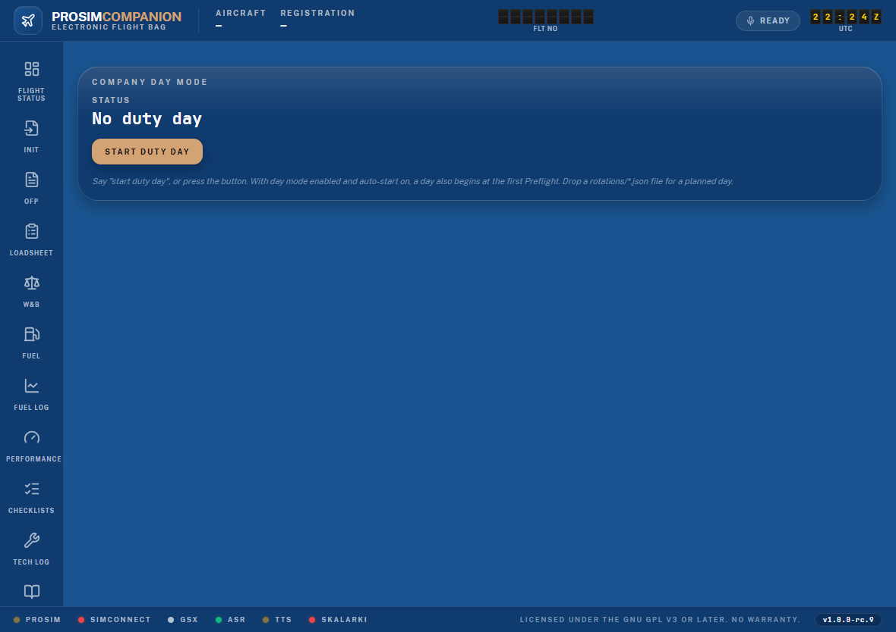
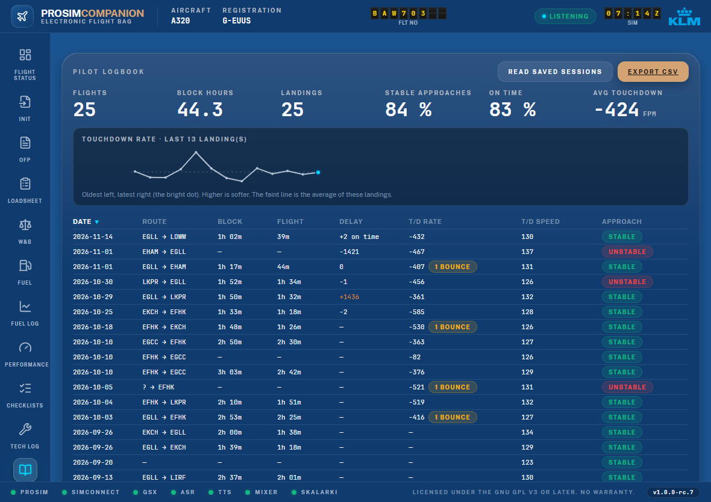
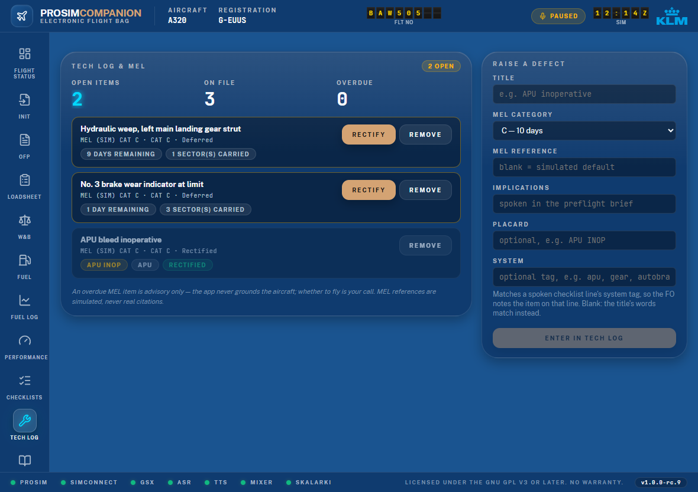

# Duty Day, Logbook and Company: the airline-life features

These features make a series of flights feel like a working day at an airline. The **Duty
Day** page keeps your legs, block time and duty time. The **Logbook** keeps every flight and
the **Tech Log** keeps the defects of your aircraft. The company channel reads the loadsheet
and sends messages, and the First Officer (FO) debriefs you after the flight. All of it is
free and works on its own; the spoken parts need the voice First Officer switched on.

In every version since **0.3.0-beta.30**. The Logbook page arrived in **0.6.0-rc.1**, movement
messages, delay codes and the FDP warning in **0.8.0-rc.1**, the FO's end-of-duty question in
**1.0.0-rc.2** (the duty day is on by default since then), **Discard this day** in **1.0.0-rc.6**.

## Before you start

Nothing has to be set up: the duty day, the logbook and the tech log are on. A leg gets its
route from the OFP you load on the INIT page. The three things people get wrong:

1. **A leg begins when its OFP is loaded.** It does not begin when you power the aircraft or
   when the cabin is empty. After a landing the page waits for your next plan.
2. **The day does not end with the landing.** You end it: by voice, with a button, or by
   saying yes when the FO asks. Until then every new OFP is the next leg of the same day.
3. **The figures are not a legal calculation.** The page says: "Block and duty figures are
   convenience tracking of what was flown — not a flight-time-limitations calculation." The
   app never grounds the aircraft.

## Part 1: The Duty Day page

**What it is for.** One duty day is one crew's working day. It holds the legs you fly, one
after the other. **Where:** **Duty Day** in the sidebar (`http://localhost:5320/day`).

The card **Company Day Mode** shows **From**, **To**, the **Leg** number, **Block**, **Duty**
and **Schedule** (minutes **behind** or **ahead**). The card **Legs** lists each leg with its
route, block minutes, state (**planned**, **in progress**, **landed**) and the FO's name.

### How a day runs

1. **The day starts** at the first preflight, and the FO says *"Duty day started."* You can
   also say *"start duty day"* or press **Start duty day**.
2. **A leg begins** when you load its OFP. From the second leg on the FO announces it, for
   example *"Leg 2. New sector, Amsterdam to Heathrow."*
3. **On blocks** the FO speaks the turnaround summary, for example *"That's leg 1 — 77
   minutes block, 4 minutes behind schedule."*
4. **Between two legs** the page reads "Turnaround — the next leg starts when a new OFP is
   loaded." No new leg row appears until the new plan is in.
5. **You end the day** (see below). An app restart in the middle of a day continues the day.

### Ending the day

- Say *"end duty day"*.
- Press **End duty day** on the Duty Day page. The Flight Status page has the same button
  beside the flight phase while a day is open.
- Answer *yes* to the FO. When the aircraft has been cold and dark, parked, with no new plan
  for 10 minutes, the FO asks once: *"Captain, is that the end of our duty day?"* Yes ends
  the day. No, or no answer, leaves it open, and the FO does not ask again that day.

When the day ends the FO speaks the day's summary (*"That's the duty day complete. 2 sectors
flown. Total block …, duty …"*), the day goes into the logbook, and ground services wait for
a new OFP. A plan you load after the end starts a new duty day.

**The backstop.** If you do nothing, the app closes an open day 300 minutes after deboarding
was complete (or after on-blocks, if there was no deboarding).

### A flight you gave up

A flight that ends in a sim crash, or that you stop part-way, never lands, so its day has
no end. Two things deal with that:

- **The twelve-hour rule.** When the app starts and finds an open day that was last saved
  more than 12 hours ago (real time), it does not continue that day. It discards it: no
  debrief, the unfinished leg is not logged, and legs you completed before stay in the
  logbook. A restart inside 12 hours continues the day as before. The 12 hours are fixed;
  there is no setting.
- **Discard this day.** The button sits beside **End duty day**. Press it once and it reads
  **CONFIRM DISCARD**. Press again within five seconds. The result is the same as the
  twelve-hour rule, at once. **End duty day** is for a day you flew; **Discard this day** is
  for a day you gave up.

**A planned day (optional).** Without a plan file each sector is added when its OFP is
loaded. For a planned day put one JSON file in `%LOCALAPPDATA%\ProsimCompanion\config\rotations`;
the `README.txt` in that folder shows the format.

### The Company Day settings

Open **Settings → Crew & Company → Company & Debrief**
(`http://localhost:5320/settings/speech/company`) and go to the card **Company Day**.

| Field | Default | What to do |
|---|---|---|
| **Track duty days automatically** | on | Leave it on. Off: *"start duty day"* and the page button still work by hand. |
| **Speak the turnaround summary** | on | Untick if you do not want the line at on-blocks. |
| **Auto-close after idle** | `300` min | The backstop. `0` = never. |
| **FO offers to end the day after** | `10` min | `0` = the FO never asks. |
| **FDP warning** | off | See below. |

Leave the rest as it is. Press **Save** in the bar at the bottom of the page. No restart is
needed.

**FDP warning.** FDP is the flight duty period: the time from your report for duty to the
end of the last sector. Tick **FDP warning** and the Duty Day page shows a line **FDP** with
your time so far against the EASA basic maximum and the margin for the next sector. It is
advice only: "Advisory — no acclimatisation or extensions." The table is `ftl-easa.json` in
`%LOCALAPPDATA%\ProsimCompanion\config`; edit it for your operator's scheme. More in
[Voice First Officer](03-voice-fo.md).

## Part 2: The Logbook and the Tech Log

### The Logbook page

**What it is for.** Every flight the app has recorded, with totals and your landings.
**Where:** **Logbook** in the sidebar (`http://localhost:5320/logbook`). A flight is added
when you shut down at the gate.

The page shows your totals (**Flights**, **Block hours**, **Landings**, **Stable approaches**,
**On time**, **Avg touchdown**), the touchdown-rate trend and one row per flight. Click a row
for the detail; **Delete flight** is there (two presses within three seconds, and a deleted
flight does not come back). **Export CSV** downloads every flight as a spreadsheet file.
**Read saved sessions** adds flights that are in the session files but not in the logbook,
for example flights flown while the logbook was switched off.

By voice: *"logbook summary"*, *"how many landings"*, *"logbook day summary"* (the last duty
day). Each column and the touchdown rate are explained in
[Using the app](02-using-the-app.md).

### The Tech Log page

**What it is for.** Airline paperwork: a defect is written down and gets an MEL category
(MEL: the minimum equipment list, which says how long you may fly with a defect) and a due
date. It is paperwork only. The app never creates a failure, and an overdue item never
stops you from flying.
**Where:** **Tech Log** in the sidebar (`http://localhost:5320/techlog`).

**Raise a defect:**

1. In the card **Raise a defect** type a **Title**, for example `APU inoperative`.
2. Choose the **MEL category**. Leave `C — 10 days` if you are not sure.
3. Optional: **Implications** (spoken in the briefing), **Placard**, and **System** (a tag
   such as `apu`, `gear` or `autobrake`).
4. Press **Enter in tech log**.

**Rectify** closes a defect as repaired. **Remove** deletes it from the list. By voice:
*"raise a defect"* or *"log a snag"* starts a guided entry; *"rectify the defect"* or
*"maintenance complete"* closes one; *"open items"* reads the open defects.

### The Tech Log & Logbook settings

Open **Settings → Crew & Company → Tech Log & Logbook**
(`http://localhost:5320/settings/speech/techlog`).

| Field (card **Tech Log & MEL**) | Default | What it does |
|---|---|---|
| **Enabled** | on | The whole tech log. |
| **Offer tech-log entries after an abnormal** | on | After shutdown the FO offers to enter each abnormal you handled on that flight. Silent on a normal flight. |
| **Random wear** | off | A small chance per flight of a harmless cabin defect appearing at shutdown. Tick it if you want the tech log to fill by itself. |
| **Rectify on the due date** | off | Closes open defects by itself when the due date passes. Off: repairing is your action. |
| **Open items in the briefings** | on | The departure briefing names the open items; the arrival briefing only those that affect the landing. |
| **Flag checklist lines** | on | A spoken checklist line about a system with an open item gets *"note, open tech log item: …"* after the challenge. |
| **MEL repair intervals** | A `3`, B `3`, C `10`, D `120` days | How long each category may stay open. |

The card **Pilot Logbook** has one switch, **Enabled** (on). Untick it and flights are no
longer added. Leave the rest as it is and press **Save**.

## Part 3: The Company channel and the debrief

**Where:** **Settings → Crew & Company → Company & Debrief**, the cards **Company Channel**
and **Post-flight Debrief**.

### Company Channel

The company (your airline's dispatch) talks to the cockpit as it does over ACARS, the
aircraft's text-message system. All fields below unlock with **Enabled** (on).

| Field | Default | What it does |
|---|---|---|
| **Read the loadsheet automatically** | off | The loadsheet is read out before departure as soon as the final loadsheet is in. Off: only when you say *"request loadsheet"*. |
| **ACARS chime before messages** | on | The double beep before a company delivery. |
| **Cruise messages** | off | A short company message in the cruise, on some flights: with **Cruise message probability** `0.15`, about one flight in seven. |
| **Movement messages** | off | A message to the cockpit at take-off and on blocks, in the MCDU RCVD MSGS list. **Read the movement message aloud** (off) has the FO confirm each one. |
| **Delay codes** | off | When you leave the gate later than the schedule plus the tolerance, the FO asks for the IATA delay code. |
| **On-time tolerance** | `15` min | Minutes after the scheduled departure that still count as on time. |

To try it: tick **Read the loadsheet automatically**, **Movement messages** and **Delay
codes**, and press **Save**. The delay question and the message formats are described in
[Voice First Officer](03-voice-fo.md). The list of codes is `delay-codes.json` in
`%LOCALAPPDATA%\ProsimCompanion\config`; add your airline's codes there.

### Post-flight Debrief

At shutdown the FO speaks a debrief of the flight from what the app recorded, for example
the touchdown rate and the fuel. You can also say *"debrief"*.

| Field | Default | What to do |
|---|---|---|
| **Enabled** | on | Untick for no debrief. |
| **Length** | **Full** | **Brief** leaves out the activity counts and the fuel-used lines. |
| **Style with the language model** | on | Warmer wording, every number checked. It only has an effect when a language model is set up; see [Language model](15-language-model.md). |

## Check that it works

1. Load an OFP on the INIT page and open **Duty Day**. The card shows **From**, **To** and
   **Leg** 1, and the **Legs** card shows the leg as **in progress**.
2. Fly the leg and shut down at the gate. You hear the turnaround summary and the debrief.
3. Open **Logbook**. The flight is the first row.
4. Open **Tech Log**, raise a test defect and press **Remove** to take it out again.
5. Say *"end duty day"*. The FO speaks the day's summary and the Duty Day page offers
   **Start duty day** again.

## If it does not work

| What you see or hear | Why | What to do |
|---|---|---|
| The page reads **No duty day** | No day has started yet, or you ended it. | Load an OFP, or press **Start duty day**. |
| The FO says "No duty day is running." | You said *"end duty day"* with no open day. | Nothing. |
| The app continues a day you gave up | You restarted inside 12 hours. | Press **Discard this day** twice. |
| The day closed by itself | **Auto-close after idle** ran out (300 minutes). | Raise the figure, or set `0`. |
| The FO never asks about the end of duty | The FO asks once per day, and only when the aircraft is cold and dark, parked, with no new plan. Or **FO offers to end the day after** is `0`. | Say *"end duty day"* or press the button. |
| "The logbook is empty. A flight is added when you shut down at the gate." | No flight has been completed yet, or the logbook was switched off. | Fly to the gate and shut down. Try **Read saved sessions**. |
| "No new flight found in the saved sessions." | Every flight in the session files is already in the logbook, or was deleted by you. | Nothing. Deleted flights stay deleted. |
| The FO does not ask for a delay code | **Delay codes** is unticked, or you left inside the **On-time tolerance**. | Tick **Delay codes** and **Save**. |
| No movement message in the MCDU | **Movement messages** is unticked, ProSim is not connected, or no OFP is loaded. | Tick it, load an OFP. |
| The debrief sounds plain | No language model is set up, or **Style with the language model** is unticked. | See [Language model](15-language-model.md). |
| The Tech Log pill reads **switched off** | **Enabled** is unticked on **Tech Log & Logbook**. | Tick it and **Save**. |

For anything else: reproduce it, then use **Export diagnostics** on the Logs page and send
the zip.

## Related chapters

- [Using the app](02-using-the-app.md): every column of the Logbook, the turnaround chips on
  Flight Status.
- [Voice First Officer](03-voice-fo.md): movement messages, delay codes, the FDP warning and
  the FO roster in detail.
- [Settings reference](04-settings-reference.md): the `company`, `debrief`, `day`, `techLog`
  and `logbook` sections.
- [Language model](15-language-model.md): for the styled debrief.
- [Troubleshooting](05-troubleshooting.md).

---

**Next:** [Voice First Officer](03-voice-fo.md) · [Manual contents](README.md)
