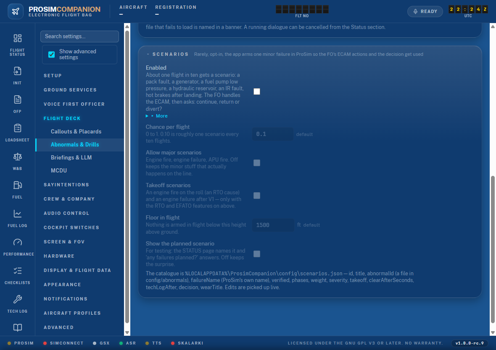
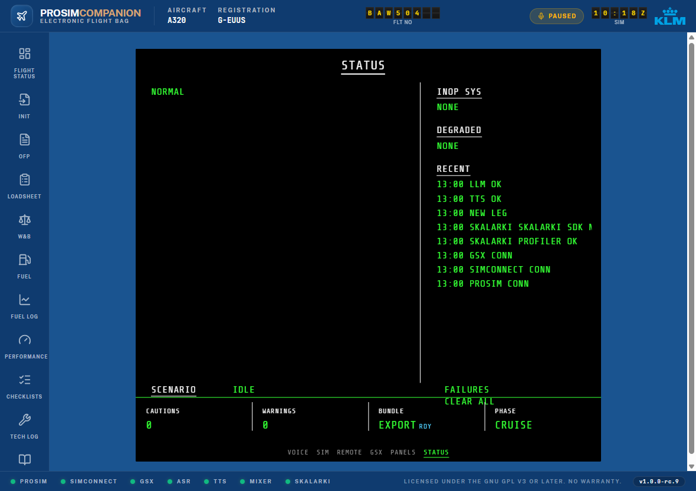

# Scenarios: failures in flight for training

Scenario mode gives you a surprise now and then. On about one flight in ten the app switches
on one failure in ProSim, at a moment you do not know. The First Officer (FO) notices it, works
the ECAM with you, and then asks: continue, return or divert? It costs nothing. You need
ProSim connected and the Voice First Officer working.

Available from **1.0.0-rc.1**. Use **1.0.0-rc.6** or later: earlier versions had faults in
this mode, and only rc.6 writes the file with ProSim's failure names that you need below.

> **Safety: this mode changes the aircraft.** A scenario is a real ProSim failure, the same as
> one set on the instructor station (IOS). It is off until you switch it on. To stop at any
> time, say *"clear all failures"* or click **CLEAR ALL** on the Diagnostics STATUS page. See
> "Switch it off and clear failures" below.

> **Not yet confirmed in flight.** This mode has not been flown from start to end. It also
> does nothing until you have done the one-time file edit in "Set it up", part 1.



## Before you start

**What needs what.**

| You want | What must be there |
|---|---|
| Any scenario | ProSim connected, and a ProSim SDK that has the failure list |
| The FO to notice the failure and work the ECAM | **Detect and announce failures** ticked (it is, as shipped) |
| Engine fire, engine failure, APU fire | **Allow major scenarios** ticked |
| The two takeoff scenarios | **Allow major scenarios** and **Takeoff scenarios** ticked, plus **Rejected takeoff** (for the fire on the roll) or **Engine failure after V1** |

**The three things people get wrong:**

1. **Nothing ever happens.** The app ships a list of 19 scenarios, and every one is marked
   as not verified. An entry that is not verified is never used. You must check each failure
   name against your ProSim and mark it yourself. On ProSim 1.76b5 none of the shipped names
   was in ProSim's list, so expect to change the names.
2. **One in ten is rare.** With **Chance per flight** on `0.1` most flights are quiet. That
   is the idea. For a test, see "Check that it works".
3. **Switching the mode off does not remove a failure that is already active.** Use
   **CLEAR ALL** for that.

## Set it up

### Part 1: match the failure names (one time)

The app may only switch on a failure when two things are true: the entry in your scenario
file is marked verified, and its failure name is in ProSim's own list, letter for letter.
Capital letters count.

1. Start ProSim, then ProsimCompanion. Wait until the **PROSIM** dot at the bottom of the
   window is green.
2. Open the file `%LOCALAPPDATA%\ProsimCompanion\prosim-failures.json` in a text editor. The
   app writes it each time it reads ProSim's failure list. It holds the name of every
   failure of your ProSim version, with a description and a group where ProSim gives them.
3. Open `%LOCALAPPDATA%\ProsimCompanion\config\scenarios.json` in a text editor. Each entry
   looks like this:

   ```json
   {
     "id": "gen-1-fault",
     "title": "Generator 1 fault",
     "abnormalId": "elec-gen-1-fault",
     "failureName": "Generator 1 fault",
     "verified": false,
     "phases": [ "Climb", "Cruise", "Descent" ],
     "weight": 3,
     "severity": "minor",
     "decision": "We've lost generator 1 — I'd suggest we continue to {destination}, we have generator 2 and the APU available. Your call, captain."
   }
   ```

4. For each scenario you want, find the failure in `prosim-failures.json` that causes this
   ECAM caution. Copy its name into `failureName`, exactly.
5. Change `"verified": false` to `"verified": true` for that entry. Leave the entries you
   did not check on `false`.
6. Save the file. The app reads it again by itself; no restart is needed.

The other fields: `phases` is where the failure may come, `weight` is how often this entry is
picked compared with the others, `severity` is `minor`, `significant` or `major`, and
`decision` is what the FO says after the ECAM. Leave `abnormalId` as it is: it names the FO's
procedure for this failure. The first lines of the file explain every field.

### Part 2: the settings

1. Open **Settings → Flight Deck → Abnormals & Drills**
   (`http://localhost:5320/settings/speech/abnormals`).
2. In the card **ECAM Abnormals**, leave **Detect and announce failures** and **Work the
   ECAM line by line** ticked.
3. In the card **Scenarios**, tick **Enabled**. The other fields unlock.
4. **Chance per flight**: leave `0.1`. It is a number from 0 to 1; `0.1` is about one
   scenario in ten flights.
5. **Allow major scenarios**: leave it unticked at first. Then only the smaller failures
   come: a pack, a bleed, a generator, a fuel pump, a hydraulic reservoir, an IR fault, hot
   brakes after landing, a slow cabin altitude climb.
6. **Takeoff scenarios**: leave it unticked at first.
7. **Floor in flight**: leave `1500` ft. No failure comes in flight below this height above
   the ground.
8. **Show the planned scenario**: leave it unticked, or tick it for your first test.
9. Press **Save** in the bar at the bottom of the page.

No restart is needed. Do this before the flight: the app decides once per flight, at the
gate before departure, whether this flight gets a scenario.

## What happens in a flight

1. **At the gate** the app decides: a scenario or a quiet flight. If a scenario, it picks one
   verified entry, one of its phases, and a moment inside that phase.
2. **At that moment** the app switches the failure on in ProSim. It waits when you are below
   the floor, on the takeoff or landing roll, in a sterile cockpit moment, while another
   failure or a drill is being worked, or while the tech log holds a no-go item.
3. **The FO notices the caution** and works the ECAM with you, as for a failure set on the
   IOS. At any line you can say *"standby"*, *"say again"*, *"skip"*, *"fault remains"*,
   *"unable"* or *"cancel ecam"*. The FO never moves a switch.
4. **After the ECAM the FO gives a suggestion**, for example: *"We've lost generator 1 — I'd
   suggest we continue to* (your destination)*, we have generator 2 and the APU available.
   Your call, captain."* With a language model switched on, the wording can differ.
5. **You answer** *"continue"*, *"return"* or *"divert"*. The FO reads back *"Continuing,
   captain."*, *"Returning — I'll set it up."* or *"Diverting to the alternate — I'll set it
   up."* Return and divert start the app's diversion handling. If you say nothing, the FO
   says *"Your call, captain — we continue unless you say return or divert."* and the flight
   continues.
6. **At the end** the app clears the failure it set: when the flight is reset after arrival
   and when you close the app. Hot brakes clear by themselves after 15 minutes. At shutdown
   the FO offers the failure for the tech log, and the debrief says *"Scenario today: …"*.

There is at most one scenario per flight.

## The abnormals and drills on the same page

You need these only as far as a scenario uses them.

| Field | As shipped | What it does |
|---|---|---|
| **Detect and announce failures** | on | The FO reads the E/WD and announces a failure. Off: the FO says nothing, and a scenario failure still comes. |
| **Work the ECAM line by line** | on | Each action line waits for your confirmation. Off: the FO announces the failure and leaves the ECAM to you. |
| **Rejected takeoff** | off | Say *"stop"* or *"reject"* on the roll, or pull both thrust levers to idle above 40 kt. The FO makes the calls of the stop. |
| **Engine failure after V1** | off | The FO calls the memory items when an engine fails between V1 and 400 ft. Needs **Detect and announce failures**. Rehearse on the ground with *"engine failure after V1"*. |

Leave the rest as it is. The procedures and memory drills are files in
`%LOCALAPPDATA%\ProsimCompanion\config\abnormals`. More about the ECAM dialogue and the
drills: [Voice First Officer](03-voice-fo.md).

## Switch it off and clear failures

**Clear the failures now.** Any of these works at any time, with scenario mode on or off:

- Say *"clear all failures"* (also *"clear the failures"* or *"reset all failures"*). The FO
  answers *"All failures cleared, captain."*
- Open **Diagnostics**, page **STATUS** (`http://localhost:5320/diagnostics/status`), and
  click the box **FAILURES / CLEAR ALL** at the bottom right. Under the box you then read,
  for example, "1 failure(s) cleared."

Both clear **every** active failure in ProSim, also the ones you set on the IOS.

**Switch the mode off.** Untick **Enabled** in the card **Scenarios** and press **Save**. A
scenario that was planned but has not started will not start. A failure that is already
active stays: clear it as above.



## Check that it works

1. Do "Set it up" part 1 for at least one entry.
2. For the test only: set **Chance per flight** to `1`, tick **Show the planned scenario**,
   and **Save**.
3. Load a flight plan and sit at the gate. Open the Diagnostics **STATUS** page. The
   **SCENARIO** row at the bottom left shows the state:

   | Row | Meaning |
   |---|---|
   | `OFF` | Scenario mode is switched off. |
   | `IDLE` | On, and nothing is planned for this flight. |
   | `PLANNED` | A scenario waits for its moment. With **Show the planned scenario** ticked, its title is under the row. |
   | `ARMED` | The failure is switched on in ProSim. |
   | `FIRED` | The FO has noticed it. |
   | `FAILED` | ProSim did not accept the failure. No second try on this flight. |

4. Ask the FO *"any failures planned?"*. With **Show the planned scenario** ticked the FO
   names the scenario and the phase.
5. Fly. In the planned phase the caution comes and the FO starts the ECAM.
6. After the test set **Chance per flight** back to `0.1` and untick **Show the planned
   scenario**.

## If it does not work

The log lines are on the Logs page.

| What you see or hear | Why | What to do |
|---|---|---|
| Log: "scenarios.json loaded (19 scenarios, 0 verified)" | No entry is marked verified, so no scenario can be picked. | Do "Set it up" part 1. |
| Log: "ProSim failure API: 691 failures listed; 19 catalogue name(s) not in the list: …" (your numbers differ) | The line names each entry whose `failureName` is not in your ProSim's list. | Correct these names from `prosim-failures.json`. |
| The file `prosim-failures.json` is not there | ProSim was not connected yet, or the version is older than 1.0.0-rc.6. | Start ProSim, wait for the green **PROSIM** dot, look again. |
| `SDK FAILURE API N/A` under the SCENARIO row. Log: "This ProSimSDK.dll has no failure API this app binds — scenario mode is off until the SDK matches" | ProSim is not connected, or the ProSim SDK the app uses has no failure list. | Connect ProSim. Check the ProSim SDK folder on **Settings → Setup**. |
| The row stays `IDLE` at the gate. Log: "Scenario roll: a quiet leg" | The app decided against a scenario for this flight, or no entry is allowed by your settings. | Normal with `0.1`. For a test use `1`. |
| The row shows `FAILED`. Log: "… ProSim refused the failure or is unreachable — no further attempt this leg" | The failure name is not in ProSim's list, or ProSim is not reachable. | Correct the name. The next flight tries again. |
| The row stays `PLANNED` in the right phase. Log: "Scenario … held: below the 1500 ft floor" (or "sterile cockpit", "an abnormal is open", "a drill or ECAM dialogue is running", "the tech log holds a no-go item", "the takeoff or landing roll") | The app waits for a safe moment. | Nothing. It starts when the reason is gone. |
| The row shows `ARMED`, but the FO says nothing | **Detect and announce failures** is unticked, or the ProSim failure you chose does not cause the caution this entry expects. | Tick the switch. Or choose another failure name. Click **CLEAR ALL**. |
| Log: "Scenario … names abnormal …, which is not loaded — refused" | The `abnormalId` of the entry names no procedure file. | Put back the shipped `abnormalId`. |
| The FO says "Nothing I can tell you about, captain." | **Show the planned scenario** is unticked, or nothing is planned. | Tick it for a test. |
| The FO says "I couldn't clear the failures, captain — check the IOS.", or you read "ProSim is unreachable — check the IOS." under the box | ProSim did not answer. | Clear the failures on the ProSim IOS. |
| The FO says "Say again, captain — continue, return, or divert?" | The FO did not understand your answer. | Say one of the three words. |

For anything else: reproduce it, then use **Export diagnostics** on the Logs page and send
the zip. The zip includes `prosim-failures.json`.

## Related chapters

- [Voice First Officer](03-voice-fo.md): the ECAM dialogue, the drills, rejected takeoff.
- [Diagnostics](13-diagnostics.md): the STATUS page.
- [Settings reference](04-settings-reference.md): the `scenario` and `abnormals` sections and
  `scenarios.json`.
- [Command and telemetry API](27-command-telemetry-api.md): clear failures from a button or
  a script.
- [Troubleshooting](05-troubleshooting.md).

---

**Next:** [Loudspeaker dial](08-loudspeaker-dial.md) · [Manual contents](README.md)
