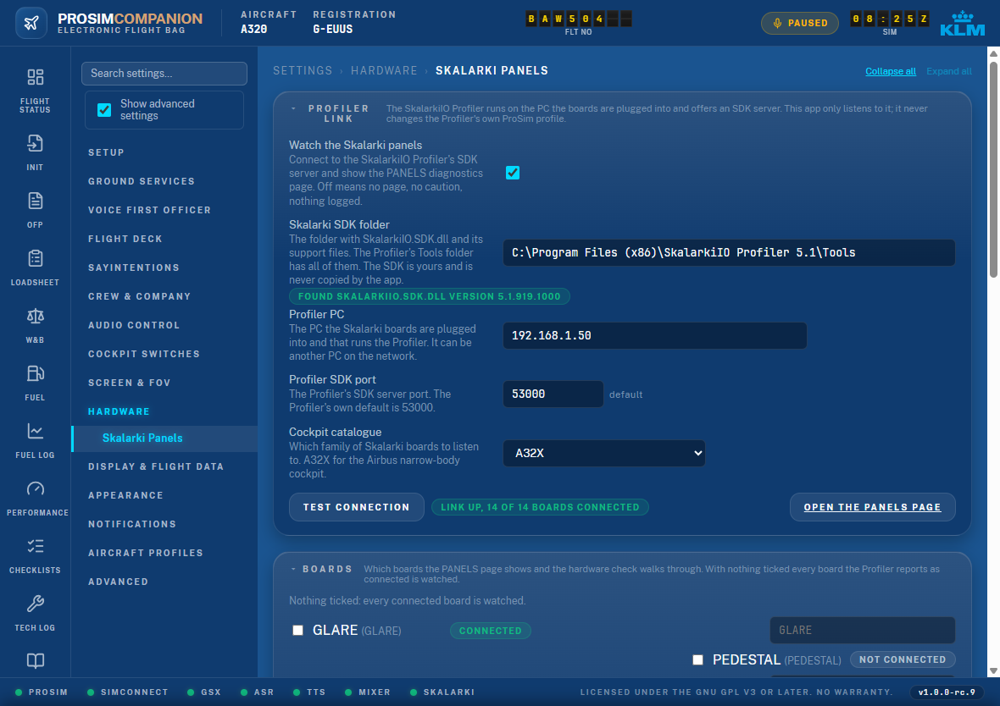
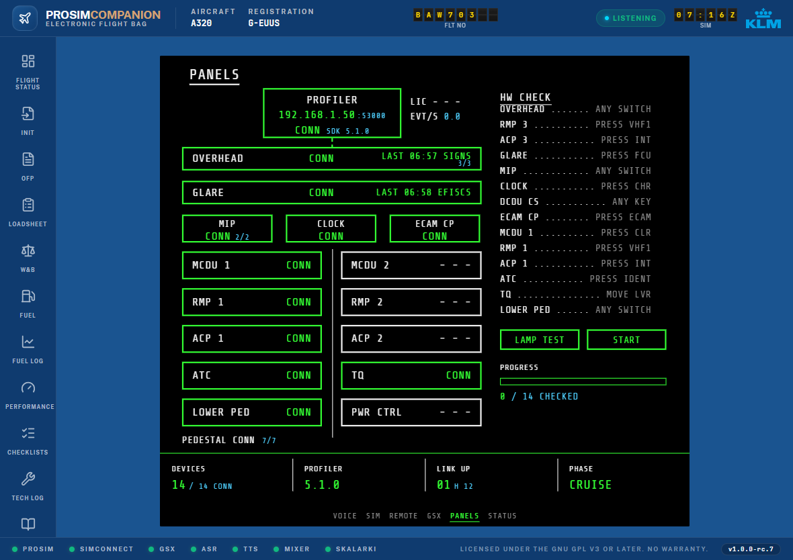

# Skalarki hardware: connecting the app to the SkalarkiIO Profiler

If your cockpit is built from Skalarki panels, the app can show you which boards the
SkalarkiIO Profiler sees right now: which are connected, which dropped out, and when each one
last sent an input. This is the **PANELS** page under Diagnostics. This chapter connects the
app to the Profiler; [chapter 13](13-diagnostics.md#panels) explains how to read the page.

It costs nothing extra. You need Skalarki hardware, the SkalarkiIO Profiler running, and the
Profiler's own SDK files (see "Before you start"). If you have no Skalarki hardware, leave
this page switched off: off means no PANELS page, no caution and nothing in the log.

Available from **0.8.0-rc.15**.

## Before you start

**The app only listens.** The Profiler keeps driving your cockpit exactly as before. The app
connects to the Profiler's SDK server (a small network service inside the Profiler), reads
which boards are present and which controls you move, and draws that. It never changes the
Profiler's own ProSim profile. It sends something to the hardware in two cases only, and only
when you press the button yourself on the PANELS page: **LAMP TEST** and **HW RESET**.

**The SDK files are yours.** The app does not contain Skalarki's SDK and never copies it. It
loads the files, while it runs, from a folder you name. Four files must be in that folder,
side by side:

- `SkalarkiIO.SDK.dll`
- `SkalarkiIO.SDK.Telemetry.dll`
- `System.Threading.Tasks.Dataflow.dll`
- `Microsoft.Diagnostics.Tracing.EventSource.dll`

The Profiler's own `Tools` folder has all four, for example
`C:\Program Files (x86)\SkalarkiIO Profiler 5.1\Tools`. Point the app at that folder and do
not pick single files out of it.

**The Profiler can be on another PC.** The Profiler runs on the PC the boards are plugged
into. That need not be the PC that runs ProsimCompanion: you type the other PC's address into
**Profiler PC**. The SDK folder, however, is opened by ProsimCompanion itself, so it must be a
folder that the ProsimCompanion PC can read.

**What was tested.** The link was measured against SkalarkiIO Profiler 5.1.920 with SDK files
of version 5.1.919. Other versions are not tested.

## Set it up

1. Start the SkalarkiIO Profiler on the PC your boards are plugged into.
2. In ProsimCompanion open **Settings → Hardware → Skalarki Panels**
   (`http://localhost:5320/settings/hardware/skalarki`).
3. Tick **Watch the Skalarki panels**. The other fields unlock.
4. **Skalarki SDK folder**: type or paste the path of the Profiler's `Tools` folder. Under
   the field a green line appears: **Found SkalarkiIO.SDK.dll version** and the version
   number. If the line is red or carries a message, see "If it does not work".
5. **Profiler PC**: leave `127.0.0.1` when the Profiler runs on the same PC as
   ProsimCompanion. Otherwise type the address of the Profiler PC, for example
   `192.168.1.50`. A PC name works too.
6. **Profiler SDK port**: leave `53000`. This is the Profiler's own default. Change it only
   if you changed the port in the Profiler.
7. **Cockpit catalogue**: leave `A32X` for the Airbus narrow-body cockpit. The list also has
   `A33X`, `B73X` and `B77X`; for those the PANELS drawing is only a basic one.
8. Press **Test connection** (see the next section). You can do this before you save.
9. Press **Save** in the bar at the bottom of the page.

No restart is needed. The app connects as soon as you save, and reconnects by itself when
you later change the folder, the PC, the port, the catalogue or the board list.

## Check that it works

**Test connection** connects once to the Profiler, lists the boards it reports, and
disconnects again. It uses the values that are on the page at that moment.

- Good: a green **Connected: 26 boards reported, 14 connected** (your numbers will differ),
  and under the buttons **Connected boards:** with the names, for example
  `GLARE, OVERHEAD, MCDU1, TQ`. "Reported" counts every board type the Profiler knows about;
  "connected" is the number that matters.
- Bad: a red **Could not connect:** with the reason. See "If it does not work".

After you saved, three more places show the link:

- The pill beside the button reads **Link up, 14 of 14 boards connected**. While the app is
  still trying it reads **Connecting…**, after a drop **Link lost, retrying**.
- A **SKALARKI** dot appears in the footer at the bottom of every page. It is not shown
  while the link is off.
- **Open the PANELS page** takes you to `http://localhost:5320/diagnostics/panels`. The
  **PROFILER** box shows the address, the port and **CONN**, and each connected board is a
  green box.

## Choosing the boards and naming them

The **Boards** card decides which boards the PANELS page shows and which ones the hardware
check walks through.

- **Nothing ticked** (the default): every board the Profiler reports as connected is watched.
  The card says **Nothing ticked: every connected board is watched.** This is right for most
  cockpits.
- **Some boards ticked**: only those are watched. Use this when you want the page to warn
  you about a board that should be there but is not: a ticked board that the Profiler has
  never reported shows as amber `XX` on the PANELS page.

Each row shows the board's state: **connected**, **lost** (it was there and dropped out),
**not connected**, or **not reported yet** (the app has not heard from the Profiler about it
in this session).

A ticked or connected board also gets a text field on the right. Type a name there to change
what the PANELS page calls the board, for example `RMP FO` for RMP2. Leave it empty to keep
the standard name.

The page notes that power users can also edit the two lists in `settings.json`, under
`skalarki.enabledDevices` and `skalarki.deviceLabels`. You do not need to.

Under **Lamp test and reconnect**, **Lamp test duration** is how long **LAMP TEST** on the
PANELS page keeps the lamps on: `2000` ms by default, between `500` and `10000`. Leave the
rest as it is. Press **Save** after any change on this page.

## What is still unverified on real hardware

The link was built and measured on one cockpit. These points are still marked as "to be
verified on hardware" in the project's own notes. Treat them with care:

| Point | What is known |
|---|---|
| Listening beside the Profiler's ProSim profile | In the test the app's subscription changed nothing in the Profiler. It is not yet proven by a full cockpit session that every normal cockpit action still reaches ProSim exactly as before while the app listens. If your cockpit behaves differently with the link on, untick **Watch the Skalarki panels** and report it. |
| Live inputs on the page | That the inputs you make arrive on the PANELS page (the `LAST` time, the hardware check) is not yet signed off on hardware. |
| **LAMP TEST** | Not yet confirmed that it lights the right boards. |
| **HW RESET** | Its effect on the Profiler's running profile is not verified. On the test cockpit a reset of the overhead made the Profiler drop the link for several minutes before it came back. Use it only when a board has stopped answering. |
| The licence | The PANELS page always shows `- - -` for the licence. With this SDK version, asking for the licence stops all further events, so the app never asks. |
| Other cockpit families | Only `A32X` has a complete PANELS drawing. |

## If it does not work

| What you see | Why | What to do |
|---|---|---|
| Red line **SkalarkiIO.SDK.dll is not in this folder** | The folder you typed does not hold the SDK. | Type the Profiler's `Tools` folder, not the Profiler's main folder. |
| Beside the green line: `… is missing beside SkalarkiIO.SDK.dll; point the folder at the Profiler's Tools folder, which has every file.` | The main file is there but one of the other three is not. The text names the missing file. | Use the complete `Tools` folder. |
| `This build of the app has no Skalarki SDK bridge (ProsimCompanion.Skalarki.Sdk.dll).` | A file of the app itself is missing. Settings cannot fix this. | Report it with a diagnostics bundle (Logs page → Export diagnostics). |
| **Test connection** is greyed out | **Watch the Skalarki panels** is not ticked. | Tick it first. |
| **Could not connect: No Skalarki SDK folder is set.** | The folder field is empty. | Fill in **Skalarki SDK folder**. |
| **Could not connect: No answer from 192.168.1.50:53000 within 6 s.** or **Could not connect: The Profiler did not answer in time.** | Nothing answered at that address and port: the Profiler is not running, the address is wrong, the port is not the Profiler's, or the network blocks it. | Start the Profiler. Check **Profiler PC** and **Profiler SDK port**. Check that the two PCs reach each other. |
| The pill reads **Link off** although the box is ticked, and STATUS shows `SKALARKI SDK NOT LOADED` | The link was saved without a usable SDK folder. | Hold the mouse over the pill to read the reason. Correct **Skalarki SDK folder** and save. |
| **Link lost, retrying**, and STATUS shows `SKALARKI PROFILER LINK LOST` | The Profiler stopped answering. The app tries again by itself, waiting longer after each failure, up to one minute. | Check that the Profiler is running. The link comes back without a restart of the app. |
| STATUS shows a board name with `LOST`, for example `RMP 2 LOST` | The Profiler lost that board's USB link. | Check the cable and the board's power. See [chapter 13](13-diagnostics.md#panels) for **HW RESET**. |
| A board is amber `XX` on the PANELS page | You ticked it, but the Profiler has never reported it. | Untick the board if you do not have it, or check it in the Profiler. |
| No PANELS name in the row of Diagnostics pages, no **SKALARKI** dot | The link is switched off, or you did not save. | Tick **Watch the Skalarki panels** and press **Save**. |
| The PANELS page went amber after **HW RESET** | The reset can restart the Profiler's side. | Wait some minutes; the app reconnects by itself. |

## Related chapters

- [Diagnostics: the ECAM-style system pages](13-diagnostics.md): how to read the PANELS page,
  the hardware check, LAMP TEST, HW RESET and the STATUS cautions
- [Using the app](02-using-the-app.md): the settings menu and the footer dots
- [Settings reference](04-settings-reference.md)
- [Troubleshooting](05-troubleshooting.md)

---

**Next:** [Screen & FOV](14-screen-fov.md) · [Manual contents](README.md)
