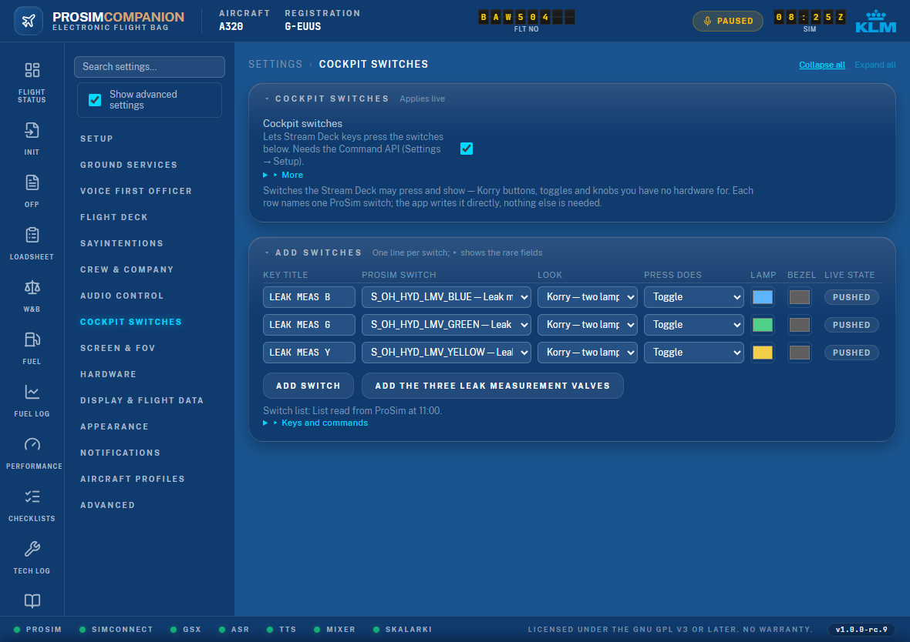

# Cockpit Switches: the switches your Stream Deck keys can press

On this page you build the list of ProSim switches that Stream Deck keys may press and show:
Korry push buttons, toggle switches and rotary knobs you have no hardware for. Each line of
the list is one ProSim switch. The app writes the switch directly in ProSim; no other program
is needed. It costs nothing extra. You need ProSim, and a Stream Deck with the ProsimCompanion
plugin. The plugin, the keys and the second PC are in
[A Stream Deck on another PC](12-remote-streamdeck.md); this chapter is about the page.

Available from **0.8.0-rc.3**. The first public build with it is **0.8.0-rc.8**.

## Before you start

- **The Command API must be on.** A key reaches the app through the Command API, and that is
  off after installation. Switch on **Command API** under **Settings → Setup → Stream Deck &
  External Tools**. Without it the keys cannot read your list and cannot press anything.
- **Start ProSim first, if you can.** The switch list on the page is ProSim's own. With ProSim
  connected the app reads the list from your ProSim version. Without ProSim it uses a list
  that comes with the app, which can be older. The line under the buttons tells you which one
  you see: "List read from ProSim at 06:05." or "List from the shipped catalogue (ProSim not
  connected yet)."
- **The aircraft needs electrical power for the lamps.** With a cold and dark aircraft ProSim
  lights no lamp and moves no valve. The press still arrives. This is correct, not a fault.

**The two things people get wrong:**

1. **Testing before saving.** The **Press** button and the **Live state** pill work only with
   saved lines. Press **Save** first.
2. **Changing the key id after building keys.** A key finds its line by the **Key id**. If you
   change the id later, the key says *not found* and you must pick the switch again on the key.

## What a line is

Open **Settings → Cockpit Switches** (`http://localhost:5320/settings/cockpit`). The card
**Add switches** has one line per switch. The line holds what you touch every time:

| Column | What it is |
|---|---|
| **Key title** | The text on top of the key face, for example `LEAK MEAS B`. |
| **ProSim switch** | The switch this line presses, picked from ProSim's list. |
| **Look** | How the key draws the switch. |
| **Press does** | What one press of the key does. |
| **Lamp** | The colour of the lower lamp. Toggles and knobs use it for the active position. |
| **Bezel** | The colour of the ring around the button. |
| **Live state** | What ProSim reports for this switch right now. |

**▸** at the end of the line opens the fields you need less often (the key id, the legends,
the lamp settings, the upper lamp colour, the test **Press**). **×** removes the line.

## Set it up

1. Press **Add switch**. A new line appears with its extra fields open.
2. In **ProSim switch**, choose the switch. The list is grouped by panel: **Overhead panel**,
   **Pedestal**, **FCU / EFIS**, **Main instrument panel** and so on. Each entry shows the
   ProSim name and a short description.
3. The app fills in three things for you: the **Key id**, the **Key title** (if it was empty)
   and, for a switch with more than two positions, **Look** = **Rotary knob** with
   **Press does** = **Cycle positions**. Every other switch starts as **Korry — two lamps**
   with **Toggle**.
4. Change the **Key title** to what you want to read on the key.
5. Check **Look** and **Press does** (see the two tables below). The field **Positions** in
   the extra fields shows the positions ProSim lists for this switch, for example
   `0 = Normal, 1 = Pushed`. Use it to decide.
6. Set the colours and lamps if you want (see "Lamps, legends and colours"). You can leave them.
7. Press **Save** in the bar at the bottom of the page.

No restart is needed. The page says "Applies live".

**The three leak measurement valves in one click.** Press **Add the three leak measurement
valves**, then **Save**. You get the lines `LEAK MEAS B`, `LEAK MEAS G` and `LEAK MEAS Y`
with blue, green and yellow bezels. Their lamp shows a lit **OFF** in the Normal position and
nothing while pushed, like the real button. If the three lines exist already, the button
resets them to this preset.

### Look

| **Look** | Use it for |
|---|---|
| **Korry — two lamps** | A push button with an upper lamp (FAULT, AVAIL) and a lower lamp (OFF, ON). |
| **Korry — one lamp** | A push button with one lamp. |
| **Toggle switch** | A two-position switch: lever up or down. |
| **Rotary knob** | A selector with several positions. The key shows the position names around the knob. |
| **Guarded switch** | A toggle under a red guard. |

### Press does

| **Press does** | What happens | Use it for |
|---|---|---|
| **Toggle** | Flips between the first two positions of the switch. | Most Korry buttons and toggle switches. |
| **Momentary push** | Presses and releases. | Push buttons that spring back. |
| **Cycle positions** | Steps to the next position and starts again after the last one. A long press on the key steps back. | Rotary knobs. |

## Lamps, legends and colours

These fields are under **▸**. Leave them as they are unless the key does not look right.

- **Upper legend** and **Lower legend**: the words in the lamps. The defaults are `FAULT` and
  `OFF`. An empty **Upper legend** hides the text. **Upper legend** is only for
  **Korry — two lamps**; **Lower legend** for both Korry looks.
- **Lower lamp from**: leave it empty and the lower lamp is lit while the switch is pushed
  (not 0). Or type a ProSim indicator name that starts with `system.indicators.I_`; then
  ProSim's own lamp decides. Start typing `I_` to see the list.
- **Upper lamp from**: the same for the upper lamp. Empty means the upper lamp never lights.
- **Lower lamp lit at**: unticked, the lamp is "lit while pushed (not 0)". Ticked, it is "lit
  in position 0 (Normal)". The leak measurement valves use the second way. The box is greyed
  out when **Lower lamp from** is filled in.
- **Legend while dark**: ticked (the default), the word stays faintly readable while the lamp
  is dark, like a real engraved Korry. Unticked, nothing shows until the lamp lights.
- **Colours.** On the line, click the **Lamp** or **Bezel** square to choose a colour. Under
  **▸** you find **Upper lamp** and three text boxes for the same colours as hex codes
  (`#ffb000`). The defaults are amber for the upper lamp and white for the lower lamp. The
  page suggests amber for FAULT, green for AVAIL, white for OFF and blue for a selected ON.
  An empty **Bezel** box keeps the grey bezel.

## The general switch

The card **Cockpit switches** at the top has one tick box, **Cockpit switches**. It is on
after installation. Unticked, the keys still show the state of the switches, but every press
is refused. Use it when you want to be sure that no key can move a switch.

## Which switches you can add

The app is strict about what it writes into the aircraft. You cannot change these rules in
the settings:

- Only switches from ProSim's list (names that start with `S_`). You pick from the list; you
  cannot type a name.
- No circuit breakers.
- Only switches that are a saved line on this page. A switch that is not in your list cannot
  be pressed by any key or command.
- Only while **Cockpit switches** is ticked.
- Only to a position that ProSim lists for the switch. A switch without a position list takes
  0 or 1 only.
- A key sends the **Key id** of a line, never a ProSim name. Removing a line takes the switch
  away from every key at once.

Every press is written to the log with the switch, the old and the new position, and where it
came from.

## Check that it works

1. With ProSim running and the lines saved, look at **Live state**. It shows the position
   ProSim reports, for example **PUSHED**. A green pill means a lamp of the key is lit.
2. Open **▸** on a line and press **Press**. The answer appears beside the button, for
   example "LEAK MEAS B: Normal → Pushed." For **Momentary push** it reads
   "LEAK MEAS B: pressed."
3. Watch ProSim react: the switch moves on the ProSim overhead, and **Live state** changes.
4. Press **Press** again to put the switch back.

The **Press** button is greyed out while the page has unsaved changes, and for a switch that
is not in the list.

## How the lines reach the Stream Deck

You do not copy anything. The plugin asks the app for the saved lines.

1. On the Stream Deck PC, drag a **Cockpit Switch** key onto a page and open its settings.
   The list there is your saved lines.
2. Pick the switch. The key draws it with your title, look, legends and colours, and follows
   the live state.
3. If you add a line later, press **Save** on the page and open the key's settings again.

A change to the title, the look or a colour of a saved line reaches the keys by itself, within about half a minute.
The plugin needs the **Command API** and the pairing from
[chapter 12](12-remote-streamdeck.md). Other tools can use the same lines with the commands
shown under **Keys and commands** at the bottom of the card.

## If it does not work

| What you see | Why | What to do |
|---|---|---|
| **Save** cannot be pressed and a cell is red | A line has no **Key title**, no **Key id** or no **ProSim switch**, or a colour box holds something that is not a hex colour. | Fill in the red cell, or remove the line with **×**. |
| **Live state** shows **NOT SAVED** | The line is new or its **Key id** changed, and you did not save. Or the line's switch is not in the list. | Press **Save**. If it stays, pick the switch again. |
| **Live state** shows **NO VALUE** | ProSim has not sent a value for this switch yet. | Start ProSim and wait until the ProSim dot in the footer is green. |
| **Live state** shows **PROSIM AWAY** | ProSim was connected and is gone. | Start ProSim again. |
| "ProSim is not connected (no live value for LEAK MEAS B yet)." after **Press** | The same: no live value from ProSim. | Start ProSim, then press again. |
| "Cockpit switches are off — Settings → Cockpit Switches." | The tick box **Cockpit switches** is off. | Tick it and **Save**. |
| "… is not in the switch list — pick it again. The row is skipped until then." under **Positions**, and the **ProSim switch** cell is red | Your ProSim version does not have this switch, or ProSim is not connected and the list that comes with the app does not know it. | Start ProSim and look again. If it stays red, pick the switch again from the list. |
| "… is not a switch in ProSim's catalogue (system.switches.S_*) — pick it again on the page." | A key pressed a line whose switch is not in the list. | The same as the row above. |
| "Two rows share the id "…" — a key would press the first one only." | Two lines have the same **Key id**. | Change one of the two ids under **▸**. |
| "No cockpit switch '…' — known: …" on a key or from a command | The key asks for a **Key id** that is not saved (changed or removed). | Pick the switch again in the key's settings. |
| "Dataref '…' is not on the write allow-list. …" | The line or the switch list changed at the moment of the press, and the app refused to write. | Check the line, **Save**, and press again. |
| The press works but no lamp lights | The aircraft has no electrical power, or **Lower lamp from** holds a wrong name. | Switch on the batteries or external power. Empty **Lower lamp from**, or choose a name from the list. |
| A leak valve key shows **ON** while pushed | The lines were made by a build before **0.8.0-rc.7**. | Press **Add the three leak measurement valves** again, then **Save**. |
| The key's settings say "No switches yet: add rows on ProsimCompanion → Settings → Cockpit Switches, save, then reopen this." | No saved line yet. | Add a line, **Save**, open the key's settings again. |
| The key shows *connecting*, *re-pair* or *switches off* | The plugin side. | See [chapter 12](12-remote-streamdeck.md), sections 12.1 and 12.5. |

For anything else: reproduce it, then use **Export diagnostics** on the Logs page and send
the zip.

## Related chapters

- [A Stream Deck on another PC](12-remote-streamdeck.md): install and pair the plugin, the
  Cockpit Switch and Camera View keys, what a key shows.
- [Settings reference](04-settings-reference.md): the `cockpitSwitches` section.
- [Using the app](02-using-the-app.md): where the settings pages are.
- [Troubleshooting](05-troubleshooting.md).

---

**Next:** [Skalarki hardware](23-skalarki.md) · [Manual contents](README.md)
