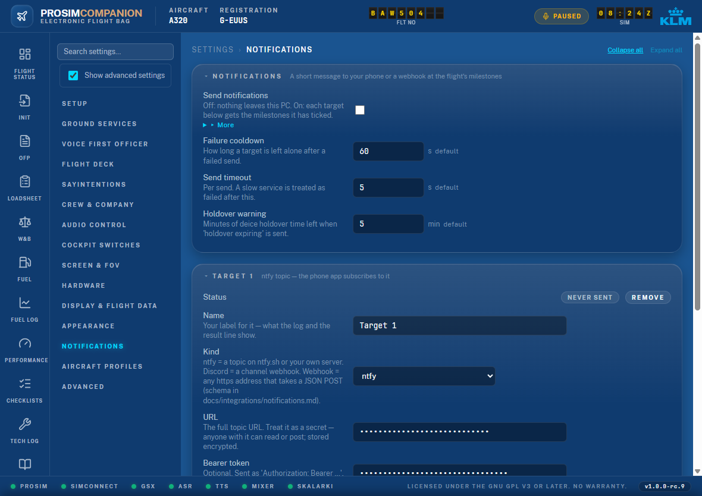
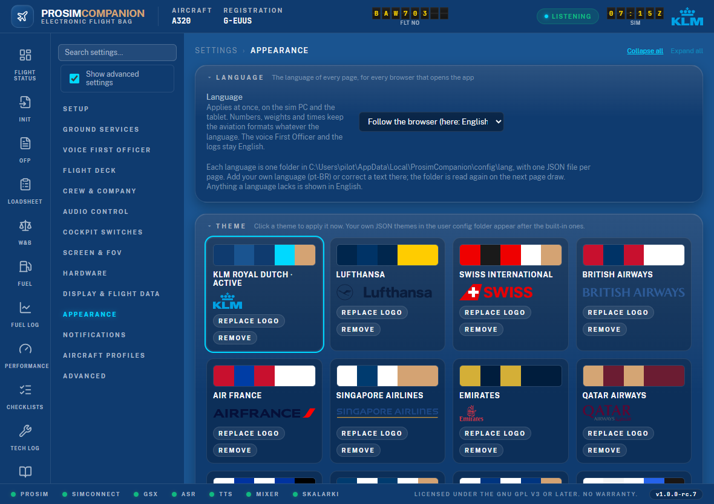
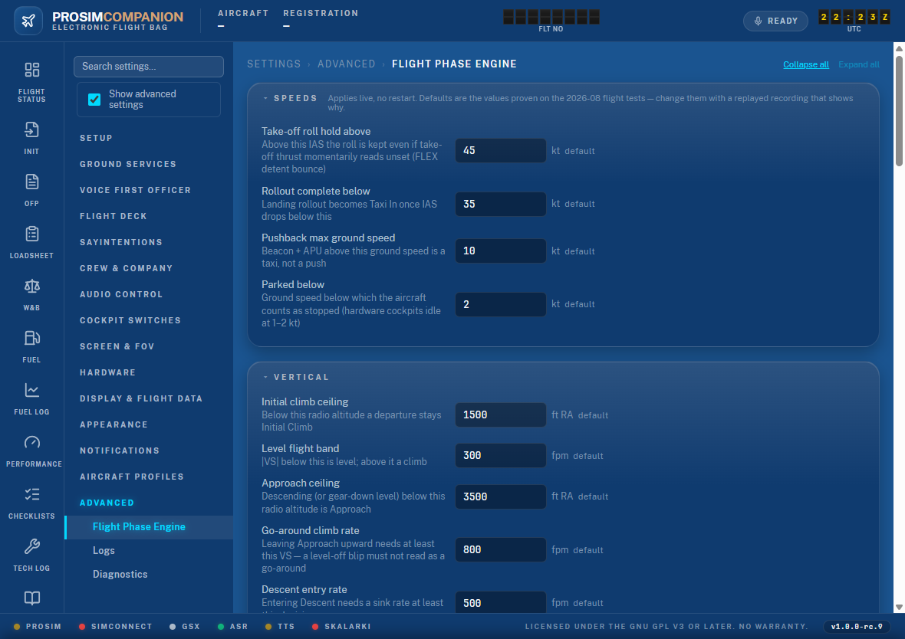
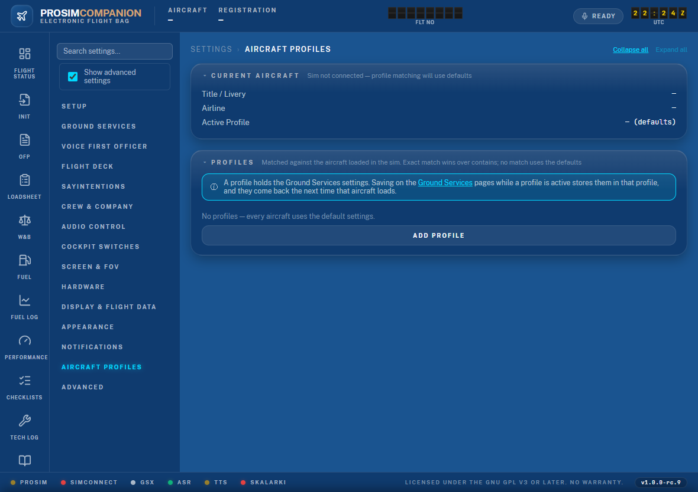
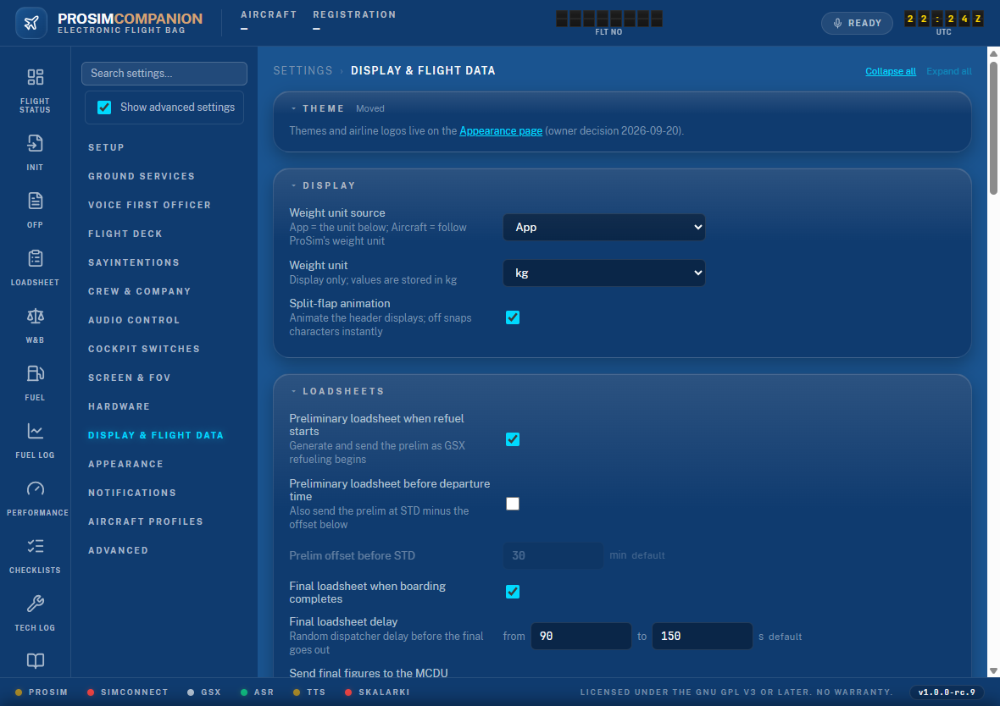

# General settings: notifications, appearance, flight phases, aircraft profiles, display & flight data

Five settings pages that belong to the app as a whole and not to one feature: messages on
your phone, the look and language of the pages, the flight phase engine, a set of Ground
Services settings per aircraft, and the units and loadsheet automation. You only need the
installed app; a phone message also needs a service such as ntfy or Discord.

In every version since **0.3.0-beta.30**. Later arrivals: Appearance in **0.4.0-beta.4**,
Notifications and **Keep the screen awake** in **0.6.0-rc.1**, **After a restart in
flight** in **0.7.0-rc.5**, the language choice in **0.7.0-rc.8**, **Last-Minute
Changes**, **Aircraft limits**, **Fuel decision** and **Diversion** in **0.8.0-rc.1**.

| Page | Where | Address |
|---|---|---|
| Notifications | **Settings → Notifications** | `http://localhost:5320/settings/notifications` |
| Appearance | **Settings → Appearance** | `http://localhost:5320/settings/appearance` |
| Flight Phase Engine | **Settings → Advanced → Flight Phase Engine** | `http://localhost:5320/settings/flight-phase` |
| Aircraft Profiles | **Settings → Aircraft Profiles** | `http://localhost:5320/settings/profiles` |
| Display & Flight Data | **Settings → Display & Flight Data** | `http://localhost:5320/settings/app` |

Some fields are tuning fields. They are hidden until you tick **Show advanced settings**
at the top of the settings menu. This chapter says so where it matters.

## Notifications

**What it is for.** A short message to your phone, or to a webhook (an address of your own
that receives the message), at ten moments of the flight, from "refuel complete" to
"deboarding complete". Each one is sent once per flight. With the switch off, nothing
leaves the PC. The list of moments is in
[Using the app](02-using-the-app.md#notifications-on-your-phone).

**A target** is one place the messages go. The app supports three kinds:

| **Kind** | What it is | What to type in **URL** |
|---|---|---|
| **ntfy** | A topic on ntfy.sh or on your own ntfy server. The ntfy phone app subscribes to the same topic. The easiest way to a phone. | The full topic address, in the shape `https://ntfy.sh/your-private-topic` |
| **Discord** | A webhook of one Discord channel. | The webhook address from Discord → Channel settings → Integrations, in the shape `https://discord.com/api/webhooks/…` |
| **Webhook (JSON POST)** | Any address of your own that takes a JSON POST, for example a home-automation server. | Your address, in the shape `https://homeassistant.local:8123/api/webhook/prosim` |

The URL is a secret: with ntfy and Discord, anyone who has it can read or post. The app
stores the URL and the token encrypted on this PC and never writes them to the log.

**Set it up (ntfy on a phone).**

1. Install the ntfy app on your phone and subscribe to a topic with a name nobody can
   guess. Treat the topic name as a password.
2. Open **Settings → Notifications** and press **Add target**. A card **Target 1** appears.
3. **Name**: type a name you will recognise, for example `My phone`.
4. **Kind**: leave **ntfy**.
5. **URL**: type `https://ntfy.sh/` followed by your topic name.
6. **Bearer token**: leave it empty. Fill it only when your topic is protected with an
   access token, or when your own webhook asks for one.
7. **Events**: all ten are ticked. Untick the ones you do not want on this target.
8. In the first card tick **Send notifications**.
9. Press **Save** in the bar at the bottom of the page.

No restart is needed. Leave **Failure cooldown** (`60` s), **Send timeout** (`5` s) and
**Holdover warning** (`5` min) as they are.

**Check that it works.** Press **Send test** on the target's card. The phone shows
"Test notification", with your flight number in front when a flight plan is loaded. The
line beside the button reads `Sent · 200 OK` and the time, and the **Status** pill changes
from **NEVER SENT** to **OK**. The test also works with **Send notifications** unticked.

**If it does not work.**

| What you see | Why | What to do |
|---|---|---|
| "Failed · the URL is not a valid http(s) address" | The address is not complete. | Type the whole address, starting with `https://`. |
| "Failed · could not connect" | The PC cannot reach the service: no internet, or a wrong server name. | Check the address and the internet connection. |
| "Failed · timed out after 5 s" | The service answered too slowly. | Try again. For a slow server of your own, tick **Show advanced settings** and raise **Send timeout**. |
| "Failed · HTTP" and a number, for example 401, 403 or 404 | The service refused the message: a wrong or missing token, or a wrong topic or webhook address. | Check **URL** and **Bearer token**. |
| The pill reads **FAILED** and a later milestone did not arrive | After a failed send the target is left alone for one minute. Milestones in that minute are not sent later. | Repair the target and press **Send test**. |
| The test arrives, the milestones do not | **Send notifications** is unticked, the event is unticked on the target, or you did not press **Save**. | Tick them and **Save**. |
| "Top of descent approaching" never arrives | **Top of descent notice** on Display & Flight Data is `0`, which means off. | Set it back to `10` min (tick **Show advanced settings** to see it). |
| "Stored key can't be decrypted on this PC/user (settings copied from elsewhere) — re-enter it and save." | `settings.json` came from another PC or Windows account. | Type the URL and the token again and **Save**. |

## Appearance

**What it is for.** The language of the pages, the colour theme, your own logos, one extra
header button, and two switches for a tablet. Everything on this page works at once; there
is no **Save** bar here.

| Card | What you do there | At the start |
|---|---|---|
| **Language** | Choose the language of every page. It changes on every open browser, on the sim PC and the tablet. The app comes with English, Deutsch, Español, Français, 日本語, 한국어 and Nederlands. The voice First Officer and the logs stay English. | The choice that starts with **Follow the browser**: each device shows its own browser language. |
| **Theme** | Click a theme to use it. There are thirteen built-in themes. | KLM Royal Dutch |
| **Header** | **Show NEXT SERVICE button in the header**: a button on every page that calls the next departure service now. | Off |
| **Screen & Install** | **Keep the screen awake** and **Install as an app**, for the device you are reading on. The steps are in [The app on a tablet](07-tablet-install.md). | Off |
| **Airline logos** | Logos for the Flight Monitor window, chosen by the airline code of your flight plan. | None |

**Your own files.**

- **Own themes.** The page says: "Your own JSON themes in the user config folder appear
  after the built-in ones." The folder is `%LOCALAPPDATA%\ProsimCompanion\config\themes`.
- **Theme logo.** Press **Add logo** under a theme and choose a PNG, SVG, JPG or WEBP file
  of at most 512 KB. The header shows it while that theme is active. **Replace logo** and
  **Remove** change it later.
- **Airline logo.** Type the code in **Airline ICAO code** (the one SimBrief shows, for
  example `KLM`, `BAW`, `DLH`), then press **Add logo**. The Flight Monitor shows the logo
  whose code is the airline code of the flight plan. Without one it shows the code itself.

Logos are your own files; the app and the installer contain none. They stay on this PC in
`%LOCALAPPDATA%\ProsimCompanion\config\themes\logos`.

**Check that it works.** Click another theme: the colours change at once and the page says
"Theme set to" with the theme's name. Its tile shows "· active".

**If it does not work.**

| What you see | Why | What to do |
|---|---|---|
| "Logo for … not saved:" and a reason | The file is not PNG, SVG, JPG or WEBP, or it is larger than 512 KB. | Make the file smaller or save it in one of the four formats. |
| "Type the airline's 2–4 character code first (e.g. KLM)." | **Airline ICAO code** is empty. | Type the code, then press **Add logo**. |
| The Flight Monitor shows the code and not your logo | The code of the logo is not the airline code of the flight plan. | Remove the logo and add it again with the code SimBrief shows. |
| The pill beside **Keep the screen awake** reads **NEEDS HTTPS** | Only a secure page can keep the screen awake. | Follow [The app on a tablet](07-tablet-install.md). |

## Flight Phase Engine

**What it is for.** The flight phase engine decides where the flight is: Preflight,
Pushback, Taxi Out, Take-off Roll, Climb, Cruise, Descent, Approach and so on. The ground
services, the First Officer and the Flight Status page all follow it. This page holds the
numbers the engine uses: speeds, altitudes, climb rates and waiting times.

**This is an Advanced page. Most users never change anything here.** The page itself says
that the starting values were proven on test flights, and that you change one only "with a
replayed recording that shows why". So change a value when support asks you to, or when
you see the same wrong phase on several flights and one of the fields below names your
case. A change works at once after **Save**; no restart is needed.

The page has eight cards, from **Speeds** to **Rule table**. The fields a user may have a
reason to touch:

| Field | Start value | When to touch it |
|---|---|---|
| **Pause grace** | `60` s | You press Escape in MSFS for longer than a minute and the phase starts again afterwards. `0` means every pause starts the phase again at once. |
| **Pause grace, parked** | `300` s | At the gate with the engines off you look at the aircraft from outside for more than five minutes. The larger of the two grace times is used. |
| **Parked below** | `2` kt | In a hardware cockpit the ground speed does not go below this while you stand still. The page says such cockpits idle at 1–2 kt. |
| **Turnaround hold** | `30` s | How long the aircraft stands parked after deboarding before the next Preflight begins. |
| **Record flight samples** | On | Leave it on. It writes one small line per second to the session log, so that a flight can be replayed through the engine later. |

Leave the rest as it is. The **Rule table** at the bottom is read-only: it shows the order
in which the engine tests its rules.

**Check that it works.** The Flight Status page shows the phase the engine is in. The SIM
page of the [Diagnostics](13-diagnostics.md) shows the flight phase too.

**If it does not work.**

| What you see | Why | What to do |
|---|---|---|
| After a long Escape in MSFS the phase and the ground preparation start again | The pause was longer than the grace time, or the aircraft was moved or refuelled in the pause. | Raise **Pause grace** or **Pause grace, parked**. |
| The phase is wrong and you changed nothing | This needs a recording, not a guess. | Leave **Record flight samples** on, fly, then use **Export diagnostics** on the Logs page and send the zip. |

## Aircraft Profiles

**What it is for.** A profile keeps a set of Ground Services settings for one aircraft,
livery or airline. The page says: "A profile holds the Ground Services settings. Saving on
the Ground Services pages while a profile is active stores them in that profile, and they
come back the next time that aircraft loads." With no profiles, every aircraft uses the
same settings. You do not need a profile when you fly one aircraft.

**How the active profile is chosen.** The card **Current Aircraft** shows what the app
knows: **Title / Livery** (the title of the aircraft loaded in the sim), **Airline** (the
letters at the start of the callsign in your flight plan) and **Active Profile**. The app
compares these with the **Match** line of each profile, in this order:

| Order | **Match** | The profile is chosen when |
|---|---|---|
| 1 | **Title / livery (exact)** | The aircraft title is exactly your text. |
| 2 | **Title / livery (contains)** | The aircraft title contains your text. |
| 3 | **Airline (ICAO prefix)** | The airline of the flight plan starts with your text, for example `BAW`. |
| 4 | **Default (fallback)** | Nothing else fits. |

Capital and small letters make no difference. When two profiles of the same kind fit, the
higher one in the list is used. When nothing fits, **Active Profile** reads
**— (defaults)**. The choice is made again when the aircraft or the flight plan changes.

**Set it up.**

1. Load the aircraft in the sim, so that **Title / Livery** shows its title.
2. Press **Add profile** and type a name, for example the airline.
3. In **Match** leave **Title / livery (contains)** and type a part of the title that only
   this aircraft or livery has. The pill **matches current** appears when your text fits
   the loaded aircraft.
4. Press **Save** in the bar at the bottom. The profile now shows **ACTIVE**.
5. Open **Settings → Ground Services**, set what this aircraft needs, and **Save** there.
   These settings are now kept in the profile.

**Choosing by hand.** **Set Active** on a saved profile uses that profile whatever the
aircraft is. The pill **MANUAL** shows beside **Active Profile**. This lasts until you
press **Return to automatic matching** or close the app.

**Check that it works.** Load the aircraft: **Active Profile** shows your profile and its
card shows **ACTIVE**. Load another aircraft: it changes or reads **— (defaults)**.

**If it does not work.**

| What you see | Why | What to do |
|---|---|---|
| "Sim not connected — profile matching will use defaults" | The app has no aircraft title yet. | Start the sim and ProSim and load the aircraft. |
| **Airline** shows "—" and an airline profile is not chosen | No flight plan is loaded, so there is no callsign. | Load the flight plan. |
| The wrong profile is **ACTIVE** | Another profile fits first, or **MANUAL** is on. | Make the match text longer or use the exact kind. Press **Return to automatic matching**. |
| **Set Active** does nothing on a new profile | The profile is not saved yet. | Press **Save** first. |
| Ground Services settings changed "by themselves" | Another profile became active and brought its own settings. | Look at **Active Profile**. |

## Display & Flight Data

**What it is for.** The weight unit, the automatic loadsheets, and a number of flight
helpers that are off until you want them. Change a card, then press **Save** in the bar
at the bottom.

| Card | The settings that matter | Start value |
|---|---|---|
| **Display** | **Weight unit source**: **App** uses the unit below, **Aircraft** follows ProSim's weight unit. **Weight unit**: only what the pages show; values are stored in kg. **Split-flap animation**: the moving letters in the header. | **App**, kg, on |
| **Loadsheets** | **Preliminary loadsheet when refuel starts**. **Final loadsheet when boarding completes**, after the **Final loadsheet delay**. **Preliminary loadsheet before departure time** adds a second moment for the preliminary one. **Send final figures to the MCDU** puts ZFW, ZFWCG and block fuel into INIT B for you. | On. On, `90` to `150` s. Off. Off. |
| **Last-Minute Changes** | **Last-minute change check**: compares the load on board with the final loadsheet before departure. Limits: **Max passenger difference**, **Max weight difference**, **Max MAC shift**. | Off; `4`, `300` kg, `0.5` % |
| **Aircraft limits** | The wind limits for the Takeoff and Landing pages, the briefings and the FO's wind check: **Max crosswind, takeoff**, **Max crosswind, landing**, **Max crosswind, wet runway**, **Max tailwind, takeoff**, **Max tailwind, landing**. They are advice; they do not stop a takeoff or a landing. | `38`, `38`, `33`, `15`, `15` kt |
| **Fuel decision** | **Fuel decision at dispatch**: after the flight plan import the FO reads the destination forecast and asks "take it?" when holding fuel is advised. **Holding burn** is the fuel flow used for it. | Off; `2200` kg/h |
| **Diversion** | **Diversion workflow**: the pages, the weather, the briefing and the GSX gate follow a new destination. | Off |
| **Flight Status card** | **Tile layout** shows the saved order of the Flight Status tiles; **Reset** puts the default order back. The other four fields are tuning fields. | default order |
| **After a restart in flight** | **Remember the flight across a restart**: when the app starts again in the same flight, it takes back the flight plan, the times, the fuel log and the minima. **Ignore a saved flight older than** sets the limit. | On; `18` h |
| **Checklists** | **Allow manual ticks**: you may tick automatically checked lines by hand on the Checklists page. | Off |

Grey fields belong to a switch that is off: tick the switch first. For a first flight
leave everything as it is. Only if you fly in pounds, choose `lb` in **Weight unit**.

**Check that it works.** After **Save**, open a page with weights, for example Fuel or
W&B: the figures are in the unit you chose.

**If it does not work.**

| What you see | Why | What to do |
|---|---|---|
| The bar says "Fix" and a field name "before saving" | A value is outside the allowed range. | Correct that field, then **Save**. |
| **Weight unit** seems to do nothing | **Weight unit source** is **Aircraft**, so ProSim's unit is used. | Choose **App**. |
| The Flight Status tiles are in a strange order | Somebody changed the order on the Flight Status page. It is saved for every device. | Press **Reset** beside **Tile layout**, then **Save**. |
| After an app restart in flight the flight plan and times are gone | **Remember the flight across a restart** is unticked, or the saved flight is older than the limit, or the aircraft or the plan in the EFB changed. | Tick it. Load the flight plan again for this flight. |

**What comes back after a restart in flight.** With **Remember the flight across a
restart** ticked, the app takes back: the flight plan as it was imported (nothing is written
to the EFB again), the off-blocks and takeoff times with their fuel, the Fuel Log rows
already stamped, the arrival minima you entered, the running chrono, and the things that
happen once per flight and already happened (the cabin-secure report, the final loadsheet
notification). It does this only when ProSim reports the same aircraft and the same flight
plan, and the saved flight is not older than the limit on the card (18 hours as installed).
A restart in a turnaround comes back as a turnaround. Without a saved flight the app does
not guess: the debrief and the Logbook say "takeoff time unknown (app started in flight)"
and the Fuel Log marks the earlier fixes "not recorded". After a restart the gate monitor
believes the cabin, not GSX's counter: a boarding that GSX calls completed over an empty
cabin belongs to the leg before and reads *Not called*.

## Related chapters

- [Using the app](02-using-the-app.md): the settings menu, phone notifications, themes.
- [The app on a tablet](07-tablet-install.md): HTTPS, home-screen app, keeping the screen on.
- [GSX settings](20-gsx-settings.md): the Ground Services settings a profile keeps.
- [Screen & FOV](14-screen-fov.md): your screens; not the Display & Flight Data page.
- [Settings reference](04-settings-reference.md) and [Troubleshooting](05-troubleshooting.md).

---

**Next:** [Diagnostics](13-diagnostics.md) · [Manual contents](README.md)
