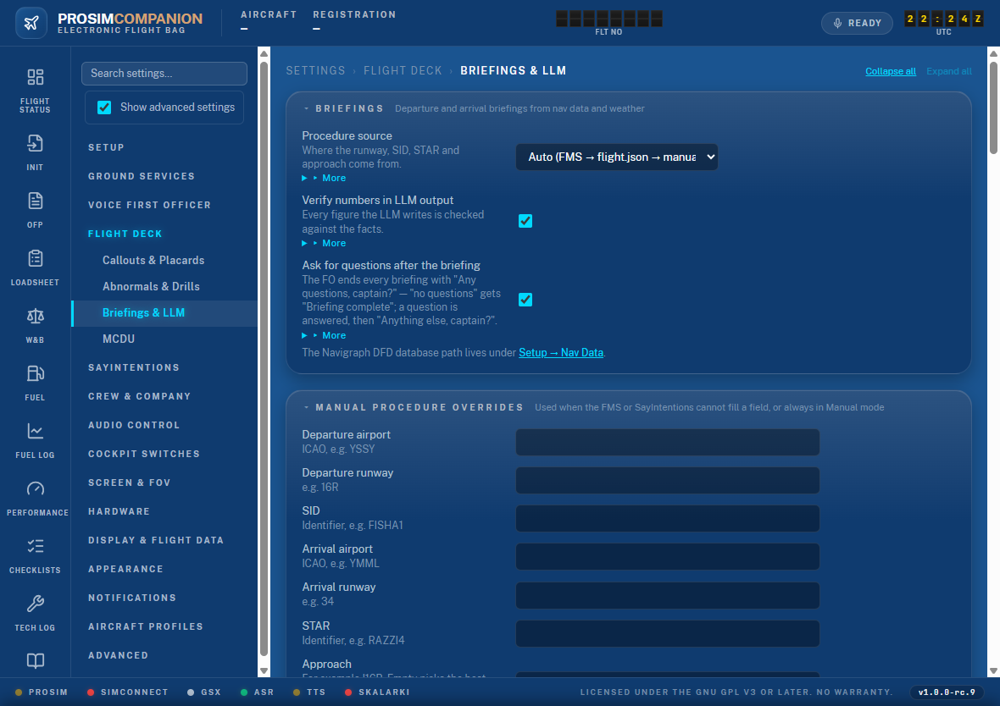
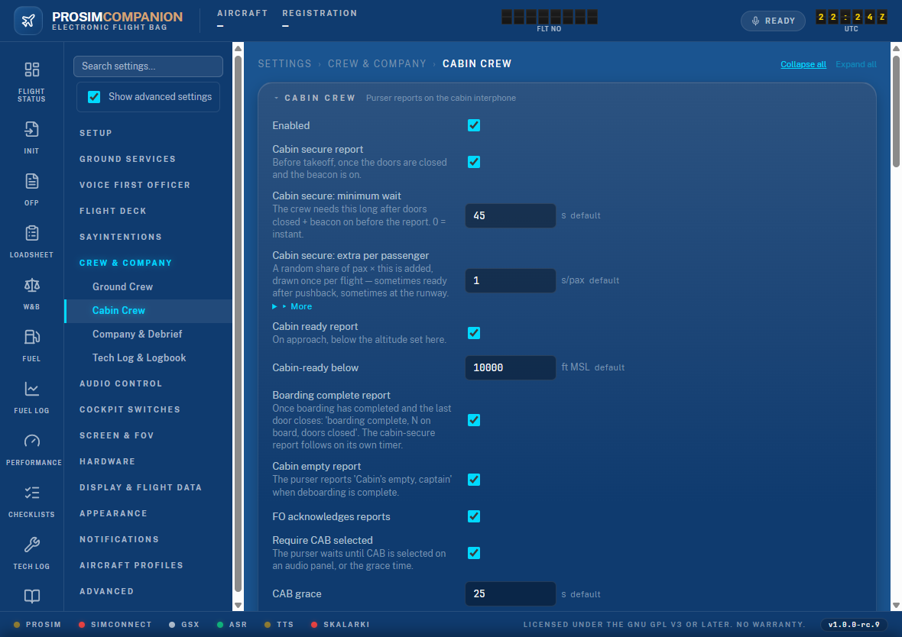
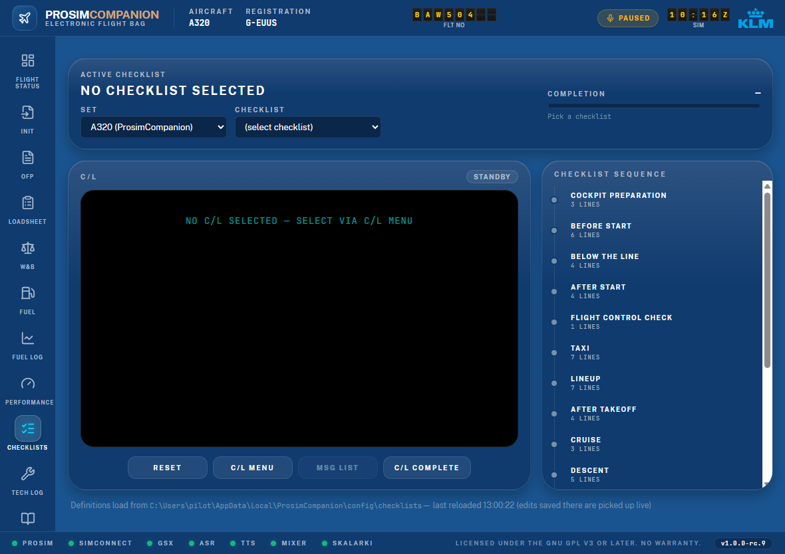

# Flight deck options: weather, fuel, briefings, cabin crew, small talk, checklists and abnormals

This chapter is the short guide to seven groups of settings: where each switch is, what it is
set to after installation, and what you should change. What the First Officer (FO) says in
detail is in [Voice First Officer](03-voice-fo.md). Everything here costs nothing. Some
switches need another feature; each section says which.

In every version since **0.3.0-beta.30**. Many of the optional switches arrived later; the
**Small Talk** card arrived in **1.0.0-rc.1**.

## Before you start

**Where the seven topics are.** They are not on one page.

| Topic | Where in the menu | Address after `http://localhost:5320/` |
|---|---|---|
| Weather | **Settings → Setup**, card **Weather Sources** | `settings` |
| Fuel | **Settings → Display & Flight Data**, card **Fuel decision**; **Settings → Flight Deck → Callouts & Placards**, card **In-flight monitoring** | `settings/app`, `settings/speech/callouts` |
| Briefings | **Settings → Flight Deck → Briefings & LLM**; the database path is on **Settings → Setup**, card **Nav Data** | `settings/speech/briefing`, `settings` |
| Cabin crew | **Settings → Crew & Company → Cabin Crew** | `settings/speech/cabin` |
| Small talk | **Settings → Flight Deck → Briefings & LLM**, card **Small Talk** | `settings/speech/briefing` |
| Checklists | **Settings → Display & Flight Data**, card **Checklists**; **Settings → Voice First Officer → General** | `settings/app`, `settings/speech/general` |
| Abnormals | **Settings → Flight Deck → Abnormals & Drills** | `settings/speech/abnormals` |

**What needs what.**

| You want | What must be there |
|---|---|
| SIDs, STARs, approaches, the MSA and the engine-out routing in a briefing | A Navigraph DFD database (your own; the app does not include one) |
| The weather that is really in the sim | ActiveSky on the sim PC |
| ATIS and TAF without ActiveSky | SayIntentions: see [chapter 17](17-sayintentions.md) |
| The fuel check against the plan, step climbs | A SimBrief OFP with a navlog |
| To answer the FO or the purser in your own words | A speech recognition server: see [chapter 16](16-speech-recognition-server.md) |
| Briefings in natural wording, "Ask the First Officer", small talk composed by the FO | A language model: see [chapter 15](15-language-model.md) |

Without these the app still works: the briefing gets shorter and the FO uses fixed sentences.
Press **Save** in the bar at the bottom before you leave a page. A field stays locked until
the switch above it is ticked. Most optional features are off after installation.

## Weather

**What it does.** The app reads METAR, ATIS and TAF for the airports of your flight. The
weather cards on the Flight Status page, the briefings, the fuel decision and the destination
weather watch all use them. There are three sources. ActiveSky has the weather that is really
in the sim, so it wins over the ProSim gateway and SayIntentions when it is present.

**Where.** **Settings → Setup**, card **Weather Sources**. The card is folded; click to open.

| Field | After installation | What to set |
|---|---|---|
| **ActiveSky snapshot file** | empty | Leave empty: the app looks in the known HiFi install folders. Fill it in only when ActiveSky is installed in another place. When you set a path, the app uses only that path. |
| **Also try the ActiveSky API** | on | Leave on. |
| **API host**, **API port**, **API timeout** | `localhost`, `19285`, `3` s | Change **API host** only when ActiveSky runs on another PC, for example `192.168.1.50`. |

You do not have ActiveSky? Leave the card as it is. The app goes on to the next source. The
SayIntentions weather switch is in [chapter 17](17-sayintentions.md).

**Destination weather watch** (off) is on **Settings → Flight Deck → Callouts & Placards**,
card **In-flight monitoring**. Tick it and, from the cruise on, the FO tells you when the
destination goes below your limits: **Visibility limit** (`1500` m), **Ceiling limit**
(`500` ft) and **Tailwind limit** (`5` kt). **Announce ATIS letter changes** is on.

**Check.** Load a flight plan and open the Flight Status page. Each weather card shows the
METAR time, the ATIS letter and how many minutes ago it was updated.

## Fuel

**What it does.** Before the flight the FO can advise extra fuel for bad weather at the
destination (the fuel decision). In the cruise the FO can compare the fuel on board with the
plan (the fuel check). Calling the fuel truck is a GSX setting: [GSX settings](20-gsx-settings.md).

**Fuel decision. Where:** **Settings → Display & Flight Data**, card **Fuel decision**.

| Field | After installation | What to set |
|---|---|---|
| **Fuel decision at dispatch** | off | Tick it when you want the FO to ask. After the OFP import the FO reads the destination TAF at your arrival time and, when holding fuel is advised, asks *"… Take it?"* Say *"take it"* and the block fuel on INIT goes up by that figure, rounded up to 100 kg. The refuel target follows. Say *"no"* and the plan stands. |
| **Holding burn** | `2200` kg/h | Leave it. It is the A320 fuel flow in a hold. |
| **Holding for thunderstorms**, **Holding for marginal weather**, **Holding for below minima** | `20`, `15`, `30` min | Leave them, or set your airline's values. They unlock when **Fuel decision at dispatch** is ticked. |

The advice needs a TAF. A TAF comes from ActiveSky or from SayIntentions; the ProSim gateway
has none. With the switch off you can still say *"fuel decision"* at any time. The FO only
advises: it never stops the flight.

**Fuel check. Where:** **Settings → Flight Deck → Callouts & Placards**, **In-flight monitoring**.

| Field | After installation | What to set |
|---|---|---|
| **Fuel check** | off | Tick it. |
| **Fuel check every** | `30` min | Leave it. `0` means only when you say *"fuel check"*. |
| **Shortfall margin** | `300` kg | Leave it. This far below the plan the FO speaks the check as a warning. |
| **Counts as on plan within** | `100` kg | Leave it. |

The fuel check needs a SimBrief OFP with a navlog and the aircraft position. Without them the
FO uses the fuel on board, the fuel flow and the time to arrival.

**Check.** On the ground say *"fuel check"*. The FO answers with the fuel on board and the
plan figure. The Fuel page shows the fuel plan and what the fuel decision added.

## Briefings

**What it does.** Say *"brief the departure"* or *"brief the arrival"*. The FO builds the
briefing from the FMS plan, the Navigraph database, the weather and your minima.

**Step 1: the database.** Open **Settings → Setup**, card **Nav Data**. In **DFD database
path** enter the `.s3db` file or its folder. ProSim's Navdata folder works. With the field
empty the app looks next to the ProSim SDK. Press **Save**.

**Step 2: the briefing switches.** Open **Settings → Flight Deck → Briefings & LLM**.

| Card | Field | After installation | What to set |
|---|---|---|---|
| **Briefings** | **Procedure source** | **Auto (FMS → flight.json → manual)** | Leave it. The FO takes the runway, SID, STAR and approach from the FMS plan, then from SayIntentions, then from the manual entries. |
| **Briefings** | **Ask for questions after the briefing** | on | Leave on. The FO ends with *"Any questions, captain?"* Say *"no questions"* to close. |
| **Manual Procedure Overrides** | **Departure runway**, **SID**, **STAR**, **Approach** and others | empty | Leave empty. Fill a field only when the FMS cannot give it. |
| **Minima Capture** | **Interactive capture** | on | Leave on. In the arrival briefing the FO asks for the minimums, reads them back and arms the minimums callouts. |
| **Missed-Approach Re-brief** | **Enabled** | on | Leave on. After a go-around the FO reads the missed approach. |
| **Emergency Briefing & Threats** | **Takeoff emergency brief** | off | Tick it for the rejected-takeoff and engine-failure part of the departure briefing, with the threats of the day. |
| **Emergency Briefing & Threats** | **Ask for other threats** | on | It unlocks with the switch above. Leave on. |
| **Emergency Briefing & Threats** | **Arrival go-around brief** | off | Tick it to add the missed-approach altitude, the MSA and the go-around actions to the arrival briefing. |

Leave the rest as it is. The card **LLM Styling** on the same page is the language model:
follow [chapter 15](15-language-model.md). **Verify numbers in LLM output** is on; leave it on.

Three of these work better with a speech recognition server. Without one, *"any other
threats, captain?"* ends with *"no further threats"* and *"Any questions, captain?"* ends
with *"Briefing complete"*, because the offline Windows engine cannot hear free sentences.

**Check.** Open **Settings → Voice First Officer → Status**. Under **Component Tests** press
**Test nav data**; a line that begins with "Nav data:" shows the result. Then, with a flight
plan in the FMS, say *"brief the departure"*. The card **Arrival Minima** on the same Status
section shows the minima; a value you enter there is used and the FO does not ask for it.

## Cabin crew

**What it does.** The purser calls the flight deck on the cabin interphone: boarding
complete, cabin secure before takeoff, cabin ready on the approach, cabin empty after
deboarding. The chime rings and the header shows CABIN CALLING. The purser speaks when you
select CAB on an audio panel, or after a short wait.

**Where.** **Settings → Crew & Company → Cabin Crew**.

| Field | After installation | What to set |
|---|---|---|
| **Enabled** | on | Leave on. Untick it for a silent cabin. |
| **Cabin secure report**, **Cabin ready report**, **Boarding complete report**, **Cabin empty report** | on | Leave on. |
| **Cabin secure: minimum wait** | `45` s | Leave it. `0` gives the report at once. |
| **Cabin secure: extra per passenger** | `1` s/pax | Leave it. With these two values a full A320 waits between 45 seconds and about 4 minutes. |
| **FO acknowledges reports** | on | Leave on. |
| **Require CAB selected** | on | Leave on if you use the audio panel. Untick it and the purser speaks directly after the chime. |
| **FO answers cabin calls on the ground**, **FO answers cabin calls in the air** | off | Tick them when you do not want to touch the audio panel. The FO selects CAB on the FO's audio panel for you. This is the only cabin setting that changes a switch in the aircraft. |
| **Interphone chime before calls** | on | Leave on. |
| **Ding on final loadsheet** | on | Leave on. |
| **Ding on startup**, **Ambient events**, **Purser cruise query** | off | Your choice. With **Purser cruise query** the purser asks you once in the cruise about the arrival time or turbulence. |

Three more cards are on the page. Everything on them is off after installation:

- **Turbulence**: tick **Detect turbulence** first. Then **Seat-belt advice** and **Purser
  call in turbulence** unlock.
- **Captain's PA**: **"Captain, your PA" prompts** reminds you of your own announcements;
  **Purser PAs audible** lets you hear the purser's announcements to the cabin.
- **Cabin Wording**: every sentence of the purser, spoken word for word. Change them to
  your airline's wording.

A free answer to the purser needs a speech recognition server. Voice: [Voices](10-voices.md).

**Check.** At the gate, finish boarding and close the doors. You hear the chime. Select CAB
on the audio panel, or wait: the purser reports the boarding complete.

## Small talk

**What it does.** In the cruise, after a time of silence, the FO sometimes says something
that is not about the flight: offers a coffee, speaks about the view, asks about the layover,
or tells something about themselves. Any callout speaks over it.

**Where.** **Settings → Flight Deck → Briefings & LLM**, card **Small Talk**.

| Field | After installation | What to set |
|---|---|---|
| **Enabled** | off | Tick it. |
| **Lines per flight** | `3` | Leave it. This is only the highest number. |
| **Quiet gap** | `8` min | Leave it. |
| **Coffee offer**, **The view**, **The layover**, **About themselves** | on | Untick a kind you do not want. |

**The real number comes from the persona.** Open **Settings → Voice First Officer → FO
Persona** and look at **Chattiness**. With `0` the FO says no small talk at all, also when the
card is on. With `3` you get up to three lines. **About themselves** needs the FO roster on the same FO Persona page. With a language model
each line is written in the FO's own style; without one the built-in sentence is spoken. Say
*"quiet please"* and the small talk stops for the rest of the session.

Two more cards on the Briefings & LLM page add talk in the cruise. Both are off:

- **Ask the First Officer**: you ask in your own words and the FO answers from the live
  flight data. Its switch **Small talk and fun facts** lets you ask about anything. It
  needs a language model and a speech recognition server.
- **Region Facts**: a short fact about the country or sea below. It works without a
  language model, from the file `region-facts.json` in
  `%LOCALAPPDATA%\ProsimCompanion\config`. You can add your own facts there.

**Check.** Set **Chattiness** to `1` or more and fly a cruise of more than eight quiet minutes.

## Checklists

**What it does.** Say the name of a checklist, for example *"before start checklist"*. The
FO reads each line and waits for your answer. The Checklists page shows the same checklist
and ticks the lines.

| Field | Where | After installation | What to set |
|---|---|---|---|
| **Allow manual ticks** | **Settings → Display & Flight Data**, card **Checklists** | off | Leave off. Tick it only when a switch in your hardware cockpit is correct but the app does not see it. Then you can tick such a line by hand on the Checklists page. |
| **Read through lines already set** | **Settings → Voice First Officer → General** | off | Tick it for a faster checklist. A line whose switch is already correct is spoken with its answer, for example *"Flaps, retracted."*, and needs no reply. Lines with a number still wait for you. |
| **Flag checklist lines** | **Settings → Crew & Company → Tech Log & Logbook** | on | Leave on. A line about a system with an open tech log item gets a short note. |

**Your own checklists.** The checklists are JSON files in
`%LOCALAPPDATA%\ProsimCompanion\config\checklists`. The Checklists page shows the folder
and the time of the last reload under the checklist. Save a change and that time moves; no
restart is needed. If it does not move, you changed a file in another folder. Updates keep
your files.

**Check.** Open the Checklists page and choose a checklist under **Set** and **Checklist**.
Say its name. The FO reads the first line, and the page ticks it after your answer.

## Abnormals

**What it does.** The FO reads the ECAM, announces a failure and works the procedure with
you, line by line. The FO never moves a switch.

**Where.** **Settings → Flight Deck → Abnormals & Drills**, card **ECAM Abnormals**.

| Field | After installation | What to set |
|---|---|---|
| **Detect and announce failures** | on | Leave on. Off: nothing is detected or announced. |
| **Work the ECAM line by line** | on | Leave on. Each action line waits for your confirmation. At any line you can say *"standby"*, *"say again"*, *"skip"*, *"fault remains"*, *"unable"* or *"cancel ecam"*. Untick it and the FO only announces the failure and leaves the ECAM to you. |
| **Answer window per line** | `20` s | Leave it. |
| **Rejected takeoff** | off | Tick it and the FO makes the calls of a rejected takeoff when you say *"stop"* or *"reject"* on the roll, or pull both thrust levers to idle above 40 kt. |
| **Engine failure after V1** | off | Tick it for the memory drill between V1 and 400 ft. It needs **Detect and announce failures** on. |

The procedures are JSON files in `%LOCALAPPDATA%\ProsimCompanion\config\abnormals`. They are
read when the app starts, so restart the app after a change. A file that cannot be loaded is
named in a banner. The card **Scenarios** on the same page lets the app set a failure in ProSim by itself. It
is off, and it has its own chapter: [Scenarios](22-scenarios.md).

**Check.** Tick **Engine failure after V1** and **Save**. On the ground say *"engine failure
after V1"*. The FO goes through the memory items as a rehearsal. While a procedure runs,
**Settings → Voice First Officer → Status** shows "ECAM DIALOGUE RUNNING" with the button
**Cancel ECAM dialogue**.

## If it does not work

| What you see or hear | Why | What to do |
|---|---|---|
| The briefing has no SID, STAR or approach details | The app found no Navigraph database. | Fill in **DFD database path** on **Settings → Setup**, then press **Test nav data** on the Status section. |
| The FO never asks *"Take it?"* after the OFP import | **Fuel decision at dispatch** is off, no holding fuel is advised, or no source has a TAF. | Tick the switch. Use ActiveSky or SayIntentions for the TAF. Say *"fuel decision"* to hear the advice. |
| After *"any other threats, captain?"* the FO says *"no further threats"* although you answered | The offline Windows engine cannot hear free sentences. | Set up a speech recognition server: [chapter 16](16-speech-recognition-server.md). |
| The header shows CABIN CALLING, the Status section shows "CABIN CALLING — select CAB on the audio panel", and the purser says nothing | The purser waits for CAB, or for the end of the wait time. | Select CAB on an audio panel. Or untick **Require CAB selected**, or tick **FO answers cabin calls on the ground**. |
| No small talk in the whole cruise | **Chattiness** is `0`, you said *"quiet please"*, or the cruise was short. | Set **Chattiness** to `1` or more on **FO Persona**. |
| The FO answers *"I don't have a verified answer for that"* | A number in the answer could not be checked against the flight data, or the language model was too slow. | Ask again in other words. Check the language model: [chapter 15](15-language-model.md). |
| The VOICE list shows "… is off — Settings → Flight Deck → Briefings & LLM → Ask the First Officer" | The card **Ask the First Officer** is not enabled. | Tick **Enabled** on that card and **Save**. |
| The Checklists page shows "NO CHECKLIST FILES FOUND IN …" | The checklist folder is empty or the files cannot be read. | Look at the folder that the message names. Put your checklist files back there. |
| Your changed abnormal procedure is not used | The files are read only when the app starts. | Restart the app. Look for a banner that names a file with an error. |

For anything else: reproduce it, then use **Export diagnostics** on the Logs page.

## Related chapters

- [Voice First Officer](03-voice-fo.md): what the FO and the purser say, in detail.
- [Settings reference](04-settings-reference.md): every section, and the list "User-editable
  content files" (checklists, abnormals, `phrases.json` for the FO's acknowledgements).
- [Language model](15-language-model.md), [Speech recognition server](16-speech-recognition-server.md),
  [SayIntentions](17-sayintentions.md), [Voices](10-voices.md), [GSX settings](20-gsx-settings.md).
- [Troubleshooting](05-troubleshooting.md) and [Diagnostics](13-diagnostics.md).

---

**Next:** [Scenarios](22-scenarios.md) · [Manual contents](README.md)
