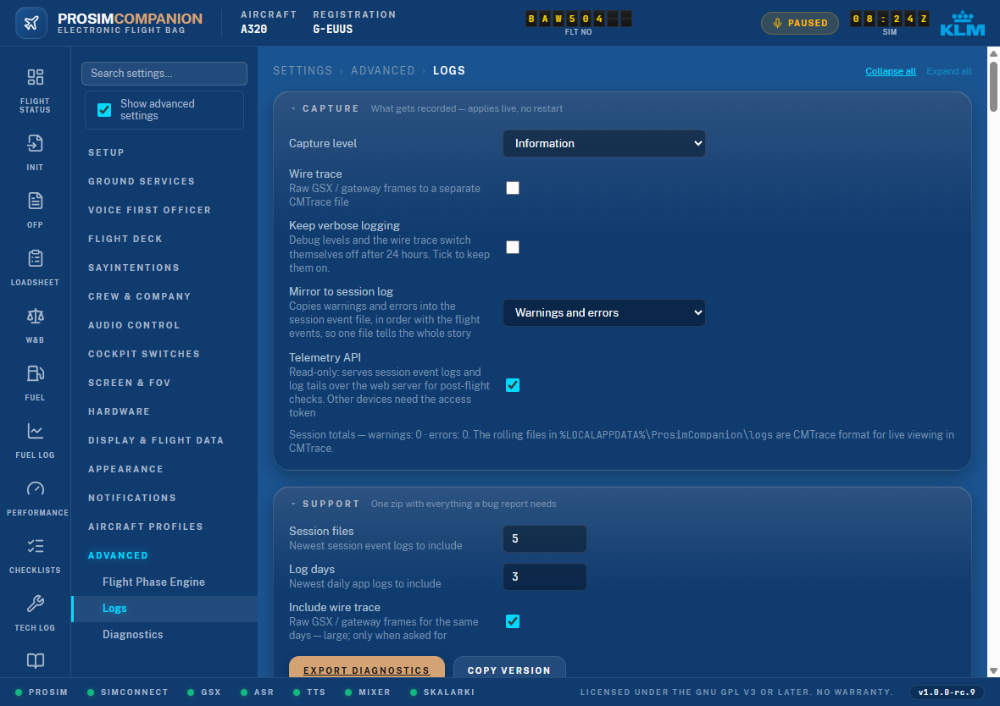

# Command API and Telemetry API: driving the app from your own tools

ProsimCompanion has two HTTP interfaces on its web server. The **Command API** lets a
Stream Deck, a script or home-cockpit software press the app's buttons: call a GSX service,
tick a checklist line, set the minima. The **Telemetry API** is read-only: it gives you the
app's event log and log files, also during a flight. Both cost nothing and need no extra
software. This chapter is for readers who are comfortable with a URL, an HTTP header and
JSON.

In every version since **0.3.0-beta.30**.



## What each one is for

| | Command API | Telemetry API |
|---|---|---|
| Does | Runs a named command and tells you what happened. Also gives the live state for key faces. | Lists and downloads the session event logs and the app logs. |
| Changes anything? | Yes. It acts on the aircraft and on GSX. | No. Read-only. |
| After installation | **Off** | **On** |
| Switch | **Settings → Setup → Stream Deck & External Tools → Command API** | **Settings → Advanced → Logs → Capture → Telemetry API** |
| Token on the sim PC itself | Always needed | Not needed |
| Token from another device | Always needed | Always needed |

All addresses in this chapter start with `http://localhost:5320`. From another PC, replace
`localhost` with the address of the sim PC, for example `http://192.168.1.50:5320`.

## Before you start

**The access token.** The token is the password of the web server. You find it in the
ProsimCompanion desktop window, in the box **Web server**, in the field **Access token:**.
It is the same token that the QR code and the onboarding link carry
(`http://192.168.1.50:5320/?token=…`).

**Never share the token.** Anyone on your network who has it can open the app and, with the
Command API on, operate your aircraft. Do not post it in a forum, a screenshot or a script
you publish. If it got out, press **Regenerate** in the desktop window. The window then
says: "New token saved — previously connected LAN devices must scan again." Tablets, the
Stream Deck plugin and your scripts all need the new token.

**The three things people get wrong:**

1. **The token goes in a header, not in the address.** Send
   `Authorization: Bearer YOUR-TOKEN` with every request. `?token=` is only for signing in
   a browser.
2. **A command is a POST.** A browser address bar or a "Website" key sends a GET and cannot
   send the header. Use a tool that can do both, such as `curl`.
3. **The Command API wants the token on the sim PC too.** `localhost` is not an exception
   for commands. It is an exception only for the Telemetry API and the normal pages.

## Switch it on

**Command API**

1. Open **Settings → Setup** (`http://localhost:5320/settings`).
2. Open the section **Stream Deck & External Tools**.
3. Tick **Command API**.
4. Press **Save** in the bar at the bottom of the page. No restart is needed.

**Telemetry API**

It is on. To switch it off or on again, open **Settings → Advanced → Logs**
(`http://localhost:5320/settings/logs`) and use **Telemetry API** in the section
**Capture**. This page has no Save bar: every switch on it works at once.

**Reaching the app from another PC**

1. In the desktop window, box **Web server**, tick **Allow LAN access (other devices on
   your network)**. Leave **Port:** on `5320` unless another program uses it.
2. Press **Save**. The window says: "Saved. Restart ProsimCompanion to apply port/LAN
   binding changes." Restart the app.
3. Allow inbound TCP port `5320` in the Windows Firewall of the sim PC (private network).

The same two settings are on **Settings → Setup → Web Interface** as **Port** and
**Allow other devices (LAN)**. More about pairing other devices:
[The app on a tablet](07-tablet-install.md) and
[A Stream Deck on another PC](12-remote-streamdeck.md).

## Sending a command

There are two addresses:

| Address | What it does |
|---|---|
| `GET /api/commands` | The names of all commands this build has: `{ "commands": ["checklists.advanceNext", …] }` |
| `POST /api/command/{name}` | Runs one command. Some commands take a small JSON body; most take none. |

The examples are written for the Windows Command Prompt. In PowerShell type `curl.exe`
instead of `curl`. `YOUR-TOKEN` stands for your own token.

```
curl -X POST http://localhost:5320/api/command/checklists.advanceNext -H "Authorization: Bearer YOUR-TOKEN"
```

A command with a body:

```
curl -X POST http://localhost:5320/api/command/gsx.requestGate -H "Authorization: Bearer YOUR-TOKEN" -d "{\"gate\":\"B12\"}"
```

**The most useful commands.** Put the name after `/api/command/` in the first example; add
`-d "…"` with the body where one is shown.

| Command | Body | What it does |
|---|---|---|
| `gsx.startDepartureServices` | none | Starts the departure service sequence. |
| `gsx.forceNextService` | none | Calls the next departure service now, without waiting for its condition. |
| `gsx.requestRefuel` | none | Calls the fuel truck. |
| `gsx.confirmFuel` | none | Confirms the block fuel figure and orders the truck on it. |
| `gsx.requestCatering` | none | Calls catering. |
| `gsx.requestBoarding` | none | Starts boarding. |
| `gsx.requestDeboarding` | none | Starts deboarding by hand. |
| `gsx.requestJetway`, `gsx.retractJetway` | none | Connects or removes the jetway. |
| `gsx.requestStairs`, `gsx.retractStairs` | none | Connects or removes the stairs. |
| `gsx.requestGpu`, `gsx.disconnectGpu` | none | Ground power on or off. |
| `gsx.requestDeice` | none | Calls de-icing. |
| `gsx.requestPushback` | none | Tells the app you want the pushback. The tug is called when the aircraft is ready for it. |
| `gsx.requestGate`, `gsx.cancelGate` | `{"gate":"B12"}`, none | Sets or cancels the arrival gate request. |
| `checklists.select` | `{"name":"Before Start"}` | Opens a checklist by name. |
| `checklists.advanceNext` | none | Ticks the active line: the one-button checklist. |
| `checklists.check`, `checklists.skip` | `{"index":0}` | Ticks or skips one line. It must be the active line. |
| `checklists.restart`, `checklists.deselect` | none | Starts the checklist again, or closes it. |
| `loadsheet.generatePreliminary`, `loadsheet.generateFinal` | none | Makes the loadsheet. The final one needs a preliminary one first. |
| `fms.syncInit` | none | Syncs the FMS INIT weights. The answer also carries `source`, `zfwTonnes`, `zfwCgPercent` and `blockTonnes`. |
| `ofp.fetch` | none | Gets the SimBrief flight plan again. |
| `minima.set`, `minima.clear` | `{"kind":"da","altitudeFt":740}`, none | Sets or clears the arrival minima. `kind` is `da`, `dh` or `mda`; 0 to 20000 ft. |
| `speech.toggleListening` | none | Voice pause on or off. `speech.pauseListening` and `speech.resumeListening` do one of the two. |
| `speech.speakTest` | `{"text":"Radio check"}` | The First Officer says the text. At most 300 characters. With a paid voice provider this uses your credit. |
| `cockpit.press` | `{"id":"oh_hyd_lmv_blue","long":false}` | Presses a switch you set up on **Settings → Cockpit Switches**. The id is the row's key id. |
| `input.pressView` | `{"name":"wing"}` | Changes a camera view through the vJoy relay. |
| `mcdu.checkBox` | none | Starts the First Officer's MCDU check. |

`GET /api/commands` gives you the full list. What the switches and views need is in
[A Stream Deck on another PC](12-remote-streamdeck.md); the MCDU check is in
[The MCDU box check](19-mcdu-box-check.md).

**Say who you are.** Add the header `X-Source: my-tool` (letters, digits and dashes, at
most 32 characters) and the event log records that name as the caller. Without it the
caller is recorded as `api`.

## The answer

Every command answers with JSON: an outcome and a sentence that says why.

```json
{ "outcome": "alreadySatisfied", "reason": "The departure service sequence is already started." }
```

| `outcome` | HTTP status | Meaning |
|---|---|---|
| `success` | 200 | Done. |
| `alreadySatisfied` | 200 | Nothing to do: it is already in that state. The command was not sent twice. |
| `preconditionFailed` | 409 | Not possible now. The `reason` names what is missing. Sending it again does not help until that changes. |
| `phaseMismatch` | 409 | Not valid in this phase of the flight. |
| `unavailable` | 503 | The part of the app that owns the command is not running, for example GSX is off. |
| `failed` | 500 | The app tried and it did not work. Look at the Logs page. |

A request the app could not read answers with `{ "reason": "…" }` only: status 400 for a
missing or wrong field, 404 for a command name that does not exist.

## Reading the live state

With the Command API on, two more addresses give you state for a key face or a display.
They use the same token rule as the commands.

- `GET /api/status`: the flight phase, the connections (`prosim`, `msfs`, `gsx`), the GSX
  departure services with their state, refuel and boarding progress, and the active
  checklist line.
- `GET /api/controls`: the cockpit switches and camera views you have set up.

```
curl http://localhost:5320/api/status -H "Authorization: Bearer YOUR-TOKEN"
```

## The Telemetry API and the session event log

The app writes a **session event log** for every run: a file `session-….jsonl` in
`%LOCALAPPDATA%\ProsimCompanion\sessions`. Each line is one JSON object with `timestamp`,
`type` and `payload`: a phase change, the start of the departure services, a cockpit switch pressed. The app
logs are in `%LOCALAPPDATA%\ProsimCompanion\logs`. The Telemetry API serves the same files
over HTTP, so you do not have to copy them from the sim PC.

| Address | What you get |
|---|---|
| `GET /api/telemetry/summary` | The app version, the number of session files, and the newest session file and app log (`name`, `sizeBytes`, `lastWriteUtc`). |
| `GET /api/telemetry/sessions` | All session files, newest first. |
| `GET /api/telemetry/sessions/{name}` | One session file, complete. |
| `GET /api/telemetry/logs` | All log files, newest first. |
| `GET /api/telemetry/logs/{name}?tailKb=256` | The end of one log file. `tailKb` is the size in KB: 256 when you leave it out, at most 4096. |
| `GET /api/diagnostics/snapshot` | What the Diagnostics pages show now, as JSON. |
| `GET /api/diagnostics/bundle` | The same zip as **Export diagnostics** on the Logs page. |

Only files in those two folders can be read. `settings.json` and your token are not
reachable this way. The two diagnostics addresses follow the **Telemetry API** switch too.
The fields **Session files**, **Log days** and **Include wire trace** in the section
**Support** of the Logs page decide what the zip holds.

## Check that it works

1. **Telemetry, on the sim PC.** Open `http://localhost:5320/api/telemetry/summary` in a
   browser. You see one line of JSON that starts with `{"version":"…`.
2. **Telemetry, from another PC.**
   `curl http://192.168.1.50:5320/api/telemetry/summary -H "Authorization: Bearer YOUR-TOKEN"`
   gives the same line.
3. **Command API.**
   `curl http://localhost:5320/api/commands -H "Authorization: Bearer YOUR-TOKEN"`
   answers with `{"commands":[…]}`.
4. **In the app.** The **REMOTE** page of the Diagnostics shows the request rate of the API
   in the **WEB HOST** box. Each command is also a line on the Logs page.

## If it does not work

| What you see | Why | What to do |
|---|---|---|
| Status 404 with an empty answer on every `/api/command…`, `/api/status` or `/api/controls` address | **Command API** is off. The app then answers as if the address did not exist. | Tick **Command API** on **Settings → Setup** and press **Save**. |
| Status 404 with an empty answer on every `/api/telemetry/…` or `/api/diagnostics/…` address | **Telemetry API** is off. | Tick **Telemetry API** on the Logs page. |
| Status 404 on `/api/telemetry/sessions/{name}` or `/api/telemetry/logs/{name}` only | No file has that name. | Take the name from the list address. |
| Status 401, `{"reason":"Access token required (Authorization: Bearer <token>, or the web UI cookie)."}` | The token is missing or wrong. On the sim PC this happens with the Command API, also when you open `/api/commands` in a browser. | Send the header `Authorization: Bearer YOUR-TOKEN`. Copy the token again from the desktop window. |
| Status 401, text "Access token required. Scan the QR code shown in the ProsimCompanion window on the sim PC." | The request came from another device without the token, or with an old token after **Regenerate**. | Send the header with the current token. |
| Status 403, text "LAN access is not configured on this ProsimCompanion instance." | The app has no token. This only happens when the token was removed from `settings.json` by hand. | Press **Regenerate** in the desktop window. |
| No answer at all from another PC; the sim PC itself works | **Allow LAN access** is off, the app was not restarted after you ticked it, or the firewall blocks the port. | Go through "Reaching the app from another PC" above. |
| Status 404, `{"reason":"Command 'x' is not registered."}` | The command name is wrong. | Read the names from `GET /api/commands`. |
| Status 400, a reason that starts "Request body is not valid JSON for …" | The body is not valid JSON. In the Command Prompt the inner quotes need a backslash: `"{\"gate\":\"B12\"}"`. | Correct the body. |
| Status 400, a reason such as "gate is required, e.g. { "gate": "B12" }." | A field the command needs is missing or out of range. | Add the field as the reason shows it. |
| Status 409, "No checklist is selected." | A checklist command came before a checklist was opened. | Send `checklists.select` first. |
| Status 409, "The departure service sequence has not been started — start it first." | `gsx.forceNextService` came before the sequence was started. | Send `gsx.startDepartureServices` first. |
| Status 503, "GSX automation is not running." or "The speech pillar is not running." | That part of the app is switched off on **Settings → Setup → Features**, or it could not start. | Switch it on, or look at the Logs page for the cause. |
| Stream Deck keys read *re-pair* | The token was changed. | Paste a fresh onboarding link into a key's settings. |

For anything else: reproduce it, then use **Export diagnostics** on the Logs page and send
the zip. The token is removed from the copy of the settings in the zip.

## Related chapters

- [A Stream Deck on another PC](12-remote-streamdeck.md): the plugin that uses the Command
  API, cockpit switch rows and camera views.
- [The app on a tablet](07-tablet-install.md): the QR code, signing in from another device,
  HTTPS.
- [Diagnostics](13-diagnostics.md): the REMOTE page and the other pages behind
  `/api/diagnostics/snapshot`.
- [Settings reference](04-settings-reference.md): the `commandApi`, `telemetryApi` and
  `webUi` sections.
- [Troubleshooting](05-troubleshooting.md).

---

**Next:** this is the last chapter · [Manual contents](README.md)
